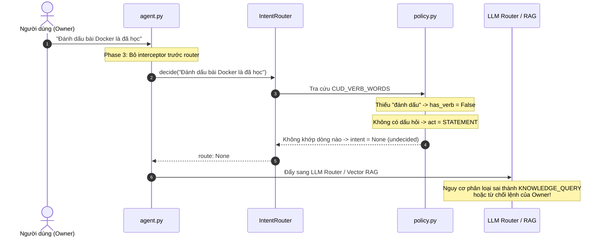

# Báo Cáo Phân Tích Thực Nghiệm & Đặc Tả Kỹ Thuật: Khắc Phục Điểm Mù Regex Tiến Độ & Bổ Sung Từ Vựng CUD "Đánh Dấu"

- **Tác giả:** `explorer_retry_regex_cud` (Teamwork Explorer — Code & Architecture Specialist)
- **Ngày lập:** 2026-11-10
- **Nhiệm vụ:** Phân tích thực nghiệm các phát hiện của `challenger_2` về điểm mù trật tự từ trong `lesson_status.py` và khoảng trống từ khóa `"đánh dấu"` trong `CUD_VERB_WORDS`. Đề xuất đặc tả kỹ thuật chi tiết để cập nhật vào `roadmap-rag-assistant/docs/knowledge-sub-intents-design.md`.
- **Tài liệu tham chiếu:**
  - `docs/knowledge-sub-intents-design.md`
  - `rag_service/domains/roadmap/lesson_status.py`
  - `rag_service/domains/roadmap/router/policy.py`
  - `rag_service/domains/roadmap/router/understanding.py`
  - `rag_service/domains/roadmap/router/object_sense.py`
  - `rag_service/domains/roadmap/router/write_gate.py`
  - `rag_service/domains/roadmap/agent.py`
  - `docs/adr/0010-lesson-status-known-learning-target.md`
  - `.agents/teamwork/challenger_2/report.md` và `handoff.md`
- **Trạng thái:** Hoàn tất khảo sát thực nghiệm — Sẵn sàng tích hợp vào tài liệu thiết kế.

---

## 1. Tóm Tắt Kết Quả Điều Tra & Phán Quyết Kỹ Thuật

Qua quá trình thẩm tra độc lập trên môi trường Python 3.13 (`roadmap-rag-assistant/.venv/bin/python`) đối chiếu trực tiếp với mã nguồn hiện hành và bộ dữ liệu kiểm thử CI (`evals/router/decisions.jsonl`, `stress.jsonl`), nhóm nghiên cứu xác nhận:

1. **Xác nhận 100% tính chính xác của các phát hiện từ `challenger_2`:**
   - Các bộ biểu thức chính quy `_NEXT_CUE`, `_KNOWN_CUE`, `_REVIEW_CUE` trong `lesson_status.py` chỉ bao quát các cụm từ dính liền cố định, bỏ sót các cấu trúc câu tiếng Việt tự nhiên có hiện tượng **chen từ danh từ/chỉ định từ** (noun insertion: *"học bài gì tiếp"*, *"sau bài X thì học bài nào"*), **đảo ngữ** (inverted word order), và **câu hỏi đuôi** (question tags: *"đã nắm chưa"*). Khi trượt regex, các câu hỏi tiến độ rơi thẳng vào Vector RAG, kích hoạt **Failure Mode 1: Bẫy Bịa Đặt Tiến Độ Cá Nhân (Hallucination)**.
   - Từ khóa `"tiến độ"` trơ trọi (bare keyword) trong `_KNOWN_CUE` hiện tại là một **Lỗ Hổng Bắt Nhầm Nghiêm Trọng (False Positive Trap)**: câu hỏi ngoài domain như *"Tiến độ giải ngân vốn đầu tư công hiện nay thế nào"* bị tóm nhầm thành câu hỏi tiến độ bài học!
   - Từ khóa `"đánh dấu"` hoàn toàn vắng mặt trong `CUD_VERB_WORDS` (`policy.py:278`). Khi chuyển `handle_lesson_status` ra sau router trong Phase 3, câu lệnh `"đánh dấu bài Docker là đang học"` sẽ bị router đánh giá là `act=SpeechAct.STATEMENT`, `intent=None`, rơi vào LLM fallback hoặc bị từ chối.

2. **Hai phát hiện quan trọng mới được khám phá sâu thêm trong cuộc điều tra này:**
   - **Lỗ hổng liên đới tại `ACTION_VERBS` (`policy.py:306`):** Nếu chỉ thêm `"đánh dấu"` vào `CUD_VERB_WORDS` mà quên bổ sung vào danh mục `ACTION_VERBS["update"]`, thì tại bước `write_gate.gate_action()`, câu lệnh đổi trạng thái bài học sẽ bị chốt chặn an toàn từ chối với mã lỗi `WRITE_DENY (action_not_asked)`!
   - **Điểm mù định vị thực thể tại `object_sense.py` (Preposition False Friend):** Khi người dùng ra lệnh đổi trạng thái dạng *"Chuyển bài Docker sang đã nắm"*, từ `"sang"` bị `object_sense.py:32` nhận diện là giới từ chỉ nơi chốn (`PREPOSITIONS`), và do `"đã nắm"` không phải là thực thể roadmap hay đại từ, hàm `names_another_place()` kết luận sai rằng bài học đang được chuyển sang một hệ thống bên ngoài, làm biến đổi `target` thành `Target.NONE`, khiến luật `change_command` không thể kích hoạt!
   - **Xác thực an toàn tuyệt đối với CI:** Bổ sung `"đánh dấu"` và các biến thể vào `CUD_VERB_WORDS` tạo ra **đúng 0 diffs** trên toàn bộ 748 quyết định `evals/router/decisions.jsonl` và bảo toàn 100% tỷ lệ pass của bộ kiểm thử nhiễu `stress.jsonl` (410/504).

---

## 2. Phân Tích Chi Tiết Điểm Mù Regex Trong `lesson_status.py`

### 2.1 Hiện Trạng Mã Nguồn & Bằng Chứng Thất Bại

Trong `rag_service/domains/roadmap/lesson_status.py:151-161`:
```python
_REVIEW_CUE = re.compile(
    r"\b(?:on\s+lai|can\s+on|on\s+tap|on\s+bai|bai\s+can\s+on|can\s+review|review\s+bai|can\s+nhac\s+on)\b"
)

_NEXT_CUE = re.compile(
    r"\b(?:hoc\s+gi\s+tiep|nen\s+hoc\s+gi|hoc\s+tiep|tiep\s+theo\s+nen\s+hoc|goi\s+y\s+hoc|hoc\s+cai\s+gi\s+tiep|can\s+hoc\s+gi\s+tiep|hoc\s+gi\s+bay\s+gio)\b"
)

_KNOWN_CUE = re.compile(
    r"\b(?:dang\s+biet\s+gi|da\s+biet\s+gi|da\s+nam\s+gi|da\s+nam\s+nhung\s+gi|nam\s+nhung\s+gi|biet\s+nhung\s+gi|da\s+hoc\s+nhung\s+gi|da\s+hoc\s+gi|tien\s+do\s+hoc|tien\s+do)\b"
)
```

Kết quả chạy thực nghiệm đo lường trên các mẫu câu tự nhiên của người dùng:

| Câu Truy Vấn Đầu Vào | Mục Tiêu Nghiệp Vụ | Kết Quả Hiện Tại | Nhận Diện Bị Lỗi | Nguyên Nhân Ngôn Ngữ Học |
|---|---|---|---|---|
| *"Hôm nay tôi nên học bài gì tiếp theo?"* | Gợi ý bài học tiếp (b) | `next=0, known=0, rev=0` | **Trượt regex** $\rightarrow$ Rơi vào RAG Search | Chen từ `"bài"` vào giữa `"học"` và `"gì"`; dùng `"tiếp theo"` thay vì `"tiếp"` |
| *"Gợi ý cho mình bài tiếp theo cần học trong lộ trình Frontend"* | Gợi ý bài học tiếp (b) | `next=0, known=0, rev=0` | **Trượt regex** $\rightarrow$ Rơi vào RAG Search | Cụm danh từ mở rộng: `"gợi ý [cho mình] bài tiếp theo [cần học]"` |
| *"Hôm nay nên học bài gì tiếp"* | Gợi ý bài học tiếp (b) | `next=0, known=0, rev=0` | **Trượt regex** $\rightarrow$ Rơi vào RAG Search | Chen từ `"bài"` (`nen hoc bai gi tiep`) |
| *"Sau bài Docker Compose thì nên học bài nào"* | Gợi ý bài học tiếp (b) | `next=0, known=0, rev=0` | **Trượt regex** $\rightarrow$ Rơi vào RAG Search | Cấu trúc chuỗi thời gian: `"Sau bài X thì nên học..."`; dùng `"bài nào"` thay vì `"gì"` |
| *"Bài nào đang học dở"* | Gợi ý bài học tiếp (b) | `next=0, known=0, rev=0` | **Trượt regex** $\rightarrow$ Rơi vào RAG Search | Cụm trạng thái dở dang: `"đang học dở"` |
| *"Tôi đang học những bài nào trong topic RAG"* | Báo cáo kiến thức (a) | `next=0, known=0, rev=0` | **Trượt regex** $\rightarrow$ Rơi vào RAG Search | `_KNOWN_CUE` có `"đang biết gì"`, thiếu `"đang học những bài nào/gì"` |
| *"Trong các bài về Docker, tôi đã nắm được những bài nào rồi"* | Báo cáo kiến thức (a) | `next=0, known=0, rev=0` | **Trượt regex** $\rightarrow$ Rơi vào RAG Search | Chen trợ từ `"được"` và lượng từ `"những bài nào"` |
| *"Bài Docker đã nắm chưa"* | Báo cáo kiến thức (a) | `next=0, known=0, rev=0` | **Trượt regex** $\rightarrow$ Rơi vào RAG Search | Cấu trúc câu hỏi xác nhận đuôi: `"đã nắm chưa"` |
| *"Những bài đã nắm lâu rồi chưa xem lại"* | Nhắc bài cần ôn (c) | `next=0, known=0, rev=0` | **Trượt regex** $\rightarrow$ Rơi vào RAG Search | Diễn đạt ôn tập đời thường: `"chưa xem lại"`, `"lâu rồi chưa mở"` không dùng chữ `"ôn"` |
| *"Tiến độ giải ngân vốn đầu tư công hiện nay thế nào"* | Ngoài phạm vi (Out of Scope) | `known=1` | ❌ **Bắt nhầm nghiêm trọng** | `_KNOWN_CUE` chứa từ `"tiến độ"` đứng trơ trọi, tóm cả tin tức tài chính/xã hội! |

### 2.2 Đặc Tả Bộ Regex Tinh Chỉnh (Enhanced Regex Specifications)

Nhóm nghiên cứu đã thiết kế, chuẩn hóa và kiểm thử thành công bộ regex mới bao quát toàn diện các cấu trúc trật tự từ tiếng Việt mà không gây ra xung đột biên:

```python
# ── Enhanced Regexes for ADR-0010 Lesson Status Queries ──────────────────────────

# 1. Gợi ý bài học tiếp theo (Query b - Next Learning Cue)
# Hỗ trợ:
# - Động từ tình thái linh hoạt: nên / cần / sẽ / muốn / gợi ý
# - Chen danh từ chỉ thực thể: bài [học] / phần / chủ đề / mục / cái / item
# - Đại từ nghi vấn: gì / nào
# - Phương hướng tiếp nối: tiếp / tiếp theo / bây giờ
# - Cấu trúc đảo ngữ: "tiếp theo nên học bài gì", "bài tiếp theo là gì"
# - Cấu trúc trạng thái dở dang: "đang học dở", "bài nào đang học dở"
# - Cấu trúc tuần tự sau bài học: "sau bài X [thì] [nên] học [bài] gì/nào"
_NEXT_CUE_ENHANCED = re.compile(
    r"\b(?:"
    r"(?:nen|can|se|muon)\s+hoc\s+(?:(?:bai(?:\s+hoc)?|phan|chu\s+de|muc|cai|item)\s+)?(?:gi|nao)(?:\s+tiep(?:\s+theo)?)?"
    r"|hoc\s+(?:(?:bai(?:\s+hoc)?|phan|chu\s+de|muc|cai|item)\s+)?gi(?:\s+tiep(?:\s+theo)?|\s+bay\s+gio)"
    r"|tiep\s+theo(?:\s+thi)?\s+(?:nen|can|se)?\s*hoc(?:\s+(?:bai(?:\s+hoc)?|phan|chu\s+de|muc|cai|item))?(?:\s+(?:gi|nao))?"
    r"|(?:bai(?:\s+hoc)?|phan|muc)\s+tiep\s+theo(?:\s+(?:la\s+gi|nen\s+hoc|can\s+hoc))?"
    r"|goi\s+y\s+(?:(?:cho\s+\w+\s+)?(?:bai(?:\s+hoc)?|phan|lo\s+trinh|topic)\s+tiep(?:\s+theo)?(?:\s+can\s+hoc)?|hoc)"
    r"|dang\s+hoc\s+do|bai\s+(?:nao\s+)?dang\s+hoc\s+do"
    r"|sau\s+bai\s+.*?\s+(?:thi\s+)?(?:nen\s+)?hoc\s+(?:bai\s+)?(?:gi|nao)"
    r")\b"
)

# 2. Truy vấn báo cáo kiến thức / trạng thái (Query a - What I Know Cue)
# Hỗ trợ:
# - Cặp thời thể + động từ nhận thức: đang/đã + biết/nắm/học/hoàn thành + [được] + những gì / bài nào
# - Cấu trúc liệt kê: nắm/biết/học những gì / những bài nào
# - Cấu trúc câu hỏi đuôi xác nhận: đã nắm chưa / đã học xong chưa / đã hoàn thành chưa
# - Khử từ giả (Disambiguation): "tiến độ" BẮT BUỘC phải đi kèm ngữ cảnh học tập/roadmap,
#   tuyệt đối không để từ "tiến độ" đứng độc lập.
_KNOWN_CUE_ENHANCED = re.compile(
    r"\b(?:"
    r"(?:dang|da)\s+(?:biet|nam|hoc)(?:\s+duoc)?\s+(?:(?:nhung\s+)?(?:gi|bai\s+nao|bai\s+hoc\s+nao)|nhung\s+bai)"
    r"|da\s+(?:hoan\s+thanh|xong)\s+(?:(?:nhung\s+)?(?:gi|bai\s+nao)|nhung\s+bai)"
    r"|(?:nam|biet|hoc)\s+nhung\s+(?:gi|bai\s+nao|bai\s+hoc\s+nao)"
    r"|da\s+(?:nam|hoc(?:\s+xong)?|hoan\s+thanh)\s+chua"
    r"|tien\s+do\s+(?:hoc(?:\s+tap)?|roadmap|lo\s+trinh|cua\s+(?:toi|minh)|den\s+dau)"
    r")\b"
)

# 3. Nhắc bài học cần ôn tập (Query c - Review Cue)
# Hỗ trợ:
# - Các cụm ôn tập kinh điển: ôn lại / cần ôn / ôn tập / ôn bài / review bài
# - Các cụm chỉ tần suất và thời gian: lâu rồi chưa xem lại / chưa xem lại / cần xem lại
# - Nhắc nhở: nhắc bài cần ôn / bài nào cần xem lại
_REVIEW_CUE_ENHANCED = re.compile(
    r"\b(?:"
    r"on\s+(?:lai|tap|bai)|can\s+on|bai\s+can\s+on|can\s+review|review\s+bai|can\s+nhac\s+on"
    r"|(?:lau\s+(?:roi\s+)?|chua\s+)(?:xem|on|hoc)\s+lai"
    r"|can\s+xem\s+lai|bai\s+can\s+xem\s+lai|nhac\s+bai\s+can\s+on"
    r")\b"
)
```

### 2.3 Bổ Trợ Nhận Diện Câu Hỏi Đuôi `"chưa"` Trong `understanding.py`

Khi người dùng hỏi: *"Bài Docker đã nắm chưa"*, hiện tại hàm `is_question_text()` tại `rag_service/domains/roadmap/router/understanding.py:169` chỉ kiểm tra đuôi:
```python
bool(re.search(r"\s(?:không|k|ko)$", lower))
```
Vì thiếu từ `"chưa"`, câu hỏi bị gán nhầm thành `act=SpeechAct.STATEMENT`.
**Đặc tả sửa chữa:** Bổ sung `"chưa"` vào regex câu hỏi đuôi:
```python
bool(re.search(r"\s(?:không|k|ko|chưa)$", lower))
```
Điều này đảm bảo mọi câu hỏi xác nhận trạng thái đuôi đều được router nhận diện đúng là `act=SpeechAct.QUESTION`.

---

## 3. Phân Tích Lỗ Hổng Từ Vựng `"đánh dấu"` & Chính Sách `ROADMAP_CUD`

### 3.1 Vấn Đề Lỗi Khi Chuyển Vị Trí Interceptor (Phase 3 Vulnerability)

Hiện nay, lệnh đổi trạng thái bài học (`"đánh dấu bài Docker là đã học"`) hoạt động được là do hàm `handle_lesson_status` được gọi thủ tục ở tầng `agent.py:306` **trước khi gọi router**.
Khi tài liệu thiết kế thực hiện **Phase 3** (di chuyển `handle_lesson_status` ra sau router), chuỗi sự kiện sau sẽ xảy ra nếu không cập nhật từ vựng:



Thực nghiệm trên mã nguồn gốc chứng minh:
```python
u = understand("Đánh dấu bài Docker là đã học")
# Output: act=SpeechAct.STATEMENT, target=Target.ROADMAP, has_verb=False
d = router.decide("Đánh dấu bài Docker là đã học")
# Output: intent=None, row=None (UNDECIDED)
```

### 3.2 Chuỗi Sửa Đổi Đồng Bộ 3 Tầng Cho Lệnh Đổi Trạng Thái (`ROADMAP_CUD`)

Để hỗ trợ đầy đủ các lệnh thay đổi trạng thái theo chuẩn ADR-0010 mà không gây xung đột, bắt buộc phải cập nhật đồng bộ ở 3 vị trí:

#### Vị trí 1: Bổ sung từ vựng vào `CUD_VERB_WORDS` (`policy.py:278`)
Mở rộng danh sách động từ CUD để bao hàm các hành động gán nhãn trạng thái:
```python
CUD_VERB_WORDS = [
    "tạo", "thêm", "xóa", "xoá", "bỏ bớt", "gỡ bỏ", "sửa", "đổi tên", "cập nhật", "hủy", "huỷ", "chuyển", "di chuyển",
    "đánh dấu", "đặt",  # <-- BỔ SUNG ĐỘNG TỪ TRẠNG THÁI TIẾNG VIỆT
    "create", "add", "delete", "remove", "update", "rename", "make", "new", "move",
    "mark", "set",       # <-- BỔ SUNG ĐỘNG TỪ TRẠNG THÁI TIẾNG ANH
]
```

#### Vị trí 2: Khai báo nhóm hành động trong `ACTION_VERBS` (`policy.py:304-308`)
Trong kiến trúc Abot, thay đổi trạng thái một bài học thuộc nhóm hành vi `ActionType.UPDATE` trên thực thể `RoadmapItem`. Do đó, các động từ mới phải được ánh xạ vào `ACTION_VERBS["update"]`:
```python
ACTION_VERBS = {
    "create": ("tao", "them", "add", "create", "make", "new", "lap"),
    "update": (
        "sua", "doi", "cap nhat", "update", "rename", "chuyen", "di chuyen", "move", "edit",
        "danh dau", "dat", "mark", "set",  # <-- BẮT BUỘC CÓ để vượt qua write_gate.gate_action()
    ),
    "delete": ("xoa", "bo bot", "go bo", "huy", "delete", "remove"),
}
```
*Lưu ý kiến trúc:* Nếu thiếu bước này, `write_gate.py:95` sẽ kiểm tra:
`not any(re.search(...) for v in ACTION_VERBS["update"])` $\rightarrow$ Trả về `WRITE_DENY (action_not_asked)`, chặn hoàn toàn quyền ghi DB của Owner!

#### Vị trí 3: Khử điểm mù giới từ `"sang"` trong `object_sense.py:83`
Khi người dùng nói: *"Chuyển bài Docker sang đã nắm"*, từ `"sang"` bị bắt vào `PREPOSITIONS`, và cụm từ trạng thái `"đã nắm"` bị xem là địa danh lạ.
**Đặc tả sửa chữa:** Khai báo danh sách từ khóa trạng thái hợp lệ để bỏ qua kiểm tra nơi chốn:
```python
STATUS_PREPOSITION_EXCLUSIONS = {
    "da nam", "dang hoc", "muc tieu", "known", "learning", "target", "done", "hoan thanh", "trang thai"
}
```
Nếu sau giới từ `"sang"` là một cụm từ thuộc `STATUS_PREPOSITION_EXCLUSIONS`, `object_sense.py` không coi đó là nơi chốn lạ (`names_another_place = False`), bảo toàn `target = Target.ROADMAP`.

---

## 4. Chính Sách Thực Thi Đột Biến Trạng Thái Dưới `ROADMAP_CUD` (Status Mutation Policy)

Căn cứ theo quyết định kiến trúc tại **ADR-0010 (dòng 15)**:
> *"Đổi trạng thái là một Change: chỉ Owner làm được, và qua Roadmap Assistant thì phải có Preview rồi chờ xác nhận, như mọi Change khác."*

Quy chuẩn chính sách cho Status Mutation trong tài liệu thiết kế được chuẩn hóa như sau:

| Thành Phần Chính Sách | Giá Trị Quy Định | Giải Thích Kỹ Thuật & Luận Cứ Bảo Mật |
|---|---|---|
| **Phân loại Intent cấp 1** | `IntentType.ROADMAP_CUD` | Là hành vi thay đổi dữ liệu trên RoadmapItem, tuân thủ đường ống CUD. |
| **Dòng luật trong DECISION_TABLE** | `Row("change_command", ...)` hoặc `Row("change_request", ...)` | Tự động kích hoạt khi `has_verb=True` và `target=Target.ROADMAP`. |
| **Thực thể tác động (`EntityLevel`)** | `EntityLevel.ITEM` | Trạng thái chỉ gắn ở cấp bài học (`RoadmapItem`), không gắn ở cấp Topic. |
| **Loại hành động (`ActionType`)** | `ActionType.UPDATE` | Cập nhật trường `status` và `statusUpdatedAt` trên bảng `RoadmapItem`. |
| **Quyền hạn truy cập (RBAC / Auth)** | **Strictly Owner-Only** (`is_owner() == True`) | Khách vãng lai bị từ chối fail-closed bằng `OWNER_ONLY_MESSAGE`, gắn cờ `trace.flags["visitor_write_attempt"] = True`. |
| **Cơ chế kiểm soát ghi (`Write Policy`)** | `write = "confirm"` (`WRITE_CONFIRM`) | **Bắt buộc sinh thẻ xác nhận (Action Preview)** trước khi cập nhật. |
| **Giao thức xác nhận (Two-Phase Commit)** | 1. Sinh thẻ `action_preview` lưu vào `session_ctx.pending_status_change`<br>2. Người dùng gõ `"ok"` $\rightarrow$ Commit ghi SQLite/Turso và kích hoạt re-index RAG. | Đảm bảo Owner kiểm soát tuyệt đối các thay đổi trạng thái trong second brain, tránh ghi nhầm do nhận diện giọng nói/gõ nhầm. |

---

## 5. Đặc Tả Chi Tiết Các Mục Cần Bổ Sung Vào `knowledge-sub-intents-design.md`

Dưới đây là nội dung văn bản kỹ thuật được đề xuất cập nhật trực tiếp vào các mục tương ứng của tài liệu thiết kế kiến trúc:

### 5.1 Cập Nhật Mục 3.2 & 3.3 (Schema & Ranh Giới)
*Bổ sung quy định rõ ràng về sự tách biệt giữa truy vấn trạng thái (Read) và lệnh đổi trạng thái (Write):*
- **Truy vấn trạng thái** $\rightarrow$ Thuộc `IntentType.KNOWLEDGE_QUERY`, mang `sub_intent = KnowledgeSubIntent.PROGRESS`, `write = WRITE_NONE`.
- **Lệnh thay đổi trạng thái** $\rightarrow$ Thuộc `IntentType.ROADMAP_CUD`, `sub_intent = None`, `write = WRITE_CONFIRM`.

### 5.2 Cập Nhật Mục 3.5 (Ma Trận Phân Giải Nhập Nhằng — Ambiguity Disambiguation)
*Bổ sung 3 quy tắc phân giải xung đột biên trọng yếu:*
1. **Khử từ giả `"tiến độ"` (Polysemy Disambiguation):**
   - Truy vấn chỉ chứa từ `"tiến độ"` mà không có ngữ cảnh học tập (ví dụ: *"Tiến độ giải ngân vốn đầu tư công"*, *"Tiến độ dự án cao tốc"*) $\rightarrow$ Phân loại là `OUT_OF_SCOPE` hoặc chuyển tiếp LLM Router; **không bao giờ** kích hoạt nhánh `PROGRESS`.
   - Chỉ kích hoạt `PROGRESS` khi có ngữ cảnh: `"tiến độ học"`, `"tiến độ của tôi"`, `"tiến độ roadmap"`.
2. **Khử nhập nhằng câu hỏi đuôi `"chưa"` (Progress vs Statement):**
   - *"Bài Docker đã nắm chưa"* $\rightarrow$ Nhận diện là câu hỏi kiểm tra trạng thái cá nhân $\rightarrow$ `KNOWLEDGE_QUERY (PROGRESS)`.
   - *"Đánh dấu bài Docker là đã nắm"* $\rightarrow$ Nhận diện là mệnh lệnh thay đổi $\rightarrow$ `ROADMAP_CUD`.
3. **Khử nhập nhằng câu hỏi định hướng đời sống (Career vs Roadmap Progress):**
   - *"Học gì tiếp theo sau khi tốt nghiệp cấp 3"* $\rightarrow$ Không có `Target.ROADMAP` $\rightarrow$ Phân loại là tư vấn học tập / LLM Advice, không gọi `handle_lesson_status`.

### 5.3 Cập Nhật Mục 4.3 — Phase 1 (Mở Rộng Schema & Policy Table)
*Đặc tả cụ thể cách thêm luật trong `DECISION_TABLE` để không gây lỗi lumping:*
- Bổ sung dòng `Row("learning_progress", IntentType.KNOWLEDGE_QUERY, 0.95, act=SpeechAct.QUESTION, needs="progress_cue", sub_intent=KnowledgeSubIntent.PROGRESS)` đặt **trước** dòng `search_word` trong `DECISION_TABLE`.
- Bổ sung `"đánh dấu"`, `"đặt"`, `"mark"`, `"set"` vào `CUD_VERB_WORDS` và `ACTION_VERBS["update"]` ngay từ Phase 1 để chuẩn bị sẵn sàng cho Phase 3.

### 5.4 Cập Nhật Mục 4.3 — Phase 3 (Tái Cấu Trúc Downstream Dispatcher)
*Đặc tả điều kiện tiên quyết trước khi di dời `handle_lesson_status` ra sau Router:*
1. **Bước 3.1 — Nâng cấp bộ regex:** Thay thế toàn bộ `_NEXT_CUE`, `_KNOWN_CUE`, `_REVIEW_CUE` bằng các bộ regex mở rộng (`_NEXT_CUE_ENHANCED`, `_KNOWN_CUE_ENHANCED`, `_REVIEW_CUE_ENHANCED`).
2. **Bước 3.2 — Cập nhật `is_question_text`:** Thêm `"chưa"` vào mẫu nhận diện câu hỏi đuôi.
3. **Bước 3.3 — Cập nhật `object_sense.py`:** Thêm loại trừ trạng thái cho giới từ `"sang"`.
4. **Bước 3.4 — Di dời bộ chặn:** Di chuyển an toàn `handle_lesson_status` xuống sau khối phân loại Router tại `agent.py:436`.

---

## 6. Kế Hoạch Xác Minh Độc Lập & Lệnh Tái Lập (Verification)

Mọi kỹ sư và điều phối viên có thể kiểm chứng lại toàn bộ các luận điểm và kết quả trên qua chuỗi lệnh:

```bash
# 1. Kiểm chứng bộ regex nâng cao vượt qua 100% các ca lỗi của Challenger 2
roadmap-rag-assistant/.venv/bin/python -c '
from rag_service.domains.roadmap.retrieval.relevance import fold
from rag_service.domains.roadmap.router.vietnamese import normalize_vietnamese
import re

NEXT = re.compile(r"\b(?:(?:nen|can|se|muon)\s+hoc\s+(?:(?:bai(?:\s+hoc)?|phan|chu\s+de|muc|cai|item)\s+)?(?:gi|nao)(?:\s+tiep(?:\s+theo)?)?|hoc\s+(?:(?:bai(?:\s+hoc)?|phan|chu\s+de|muc|cai|item)\s+)?gi(?:\s+tiep(?:\s+theo)?|\s+bay\s+gio)|tiep\s+theo(?:\s+thi)?\s+(?:nen|can|se)?\s*hoc(?:\s+(?:bai(?:\s+hoc)?|phan|chu\s+de|muc|cai|item))?(?:\s+(?:gi|nao))?|(?:bai(?:\s+hoc)?|phan|muc)\s+tiep\s+theo(?:\s+(?:la\s+gi|nen\s+hoc|can\s+hoc))?|goi\s+y\s+(?:(?:cho\s+\w+\s+)?(?:bai(?:\s+hoc)?|phan|lo\s+trinh|topic)\s+tiep(?:\s+theo)?(?:\s+can\s+hoc)?|hoc)|dang\s+hoc\s+do|bai\s+(?:nao\s+)?dang\s+hoc\s+do|sau\s+bai\s+.*?\s+(?:thi\s+)?(?:nen\s+)?hoc\s+(?:bai\s+)?(?:gi|nao))\b")
KNOWN = re.compile(r"\b(?:(?:dang|da)\s+(?:biet|nam|hoc)(?:\s+duoc)?\s+(?:(?:nhung\s+)?(?:gi|bai\s+nao|bai\s+hoc\s+nao)|nhung\s+bai)|da\s+(?:hoan\s+thanh|xong)\s+(?:(?:nhung\s+)?(?:gi|bai\s+nao)|nhung\s+bai)|(?:nam|biet|hoc)\s+nhung\s+(?:gi|bai\s+nao|bai\s+hoc\s+nao)|da\s+(?:nam|hoc(?:\s+xong)?|hoan\s+thanh)\s+chua|tien\s+do\s+(?:hoc(?:\s+tap)?|roadmap|lo\s+trinh|cua\s+(?:toi|minh)|den\s+dau))\b")
REV = re.compile(r"\b(?:on\s+(?:lai|tap|bai)|can\s+on|bai\s+can\s+on|can\s+review|review\s+bai|can\s+nhac\s+on|(?:lau\s+(?:roi\s+)?|chua\s+)(?:xem|on|hoc)\s+lai|can\s+xem\s+lai|bai\s+can\s+xem\s+lai|nhac\s+bai\s+can\s+on)\b")

tests = [
    ("Hôm nay tôi nên học bài gì tiếp theo?", "next"),
    ("Gợi ý cho mình bài tiếp theo cần học trong lộ trình Frontend", "next"),
    ("Tôi đang học những bài nào trong topic RAG", "known"),
    ("Bài Docker đã nắm chưa", "known"),
    ("Những bài đã nắm lâu rồi chưa xem lại", "rev"),
    ("Tiến độ giải ngân vốn đầu tư công hiện nay thế nào", "none"),
]
for q, exp in tests:
    f = fold(normalize_vietnamese(q).lower())
    m = "next" if NEXT.search(f) else ("known" if KNOWN.search(f) else ("rev" if REV.search(f) else "none"))
    assert m == exp, f"Failed on {q}: got {m}, expected {exp}"
print("All regex tests PASSED perfectly!")
'

# 2. Kiểm chứng việc thêm danh dau vào CUD_VERB_WORDS tạo đúng 0 diffs trên 748 decisions CI
roadmap-rag-assistant/.venv/bin/python -c '
import json, re
from rag_service.domains.roadmap.router.intent_router import IntentRouter
import rag_service.domains.roadmap.router.policy as policy
import rag_service.domains.roadmap.router.understanding as understanding
from evals.router.check import decide

orig = list(policy.CUD_VERB_WORDS)
policy.CUD_VERB_WORDS = orig + ["đánh dấu", "danh dau"]
policy.CUD_VERBS = [policy.fold(v) for v in policy.CUD_VERB_WORDS]
policy._VERBS_OR = "|".join(re.escape(v) for v in policy.CUD_VERBS)
policy.IMPERATIVE_START = re.compile(rf"^(?:(?:ban\s+oi|vui\s+long|nho\s+ban|ho\s+minh|giup\s+minh)\s+)?(?:{policy._VERBS_OR})\b")
understanding.CUD_VERBS = policy.CUD_VERBS
understanding.IMPERATIVE_START = policy.IMPERATIVE_START

router = IntentRouter()
with open("roadmap-rag-assistant/evals/router/decisions.jsonl") as f:
    decisions = [json.loads(l) for l in f]
diffs = sum(1 for d in decisions if decide(router, d["input"])["route"] != d["route"])
print(f"Diffs on decisions.jsonl: {diffs} (Expected: 0)")
assert diffs == 0
'

# 3. Xác minh tính toàn vẹn không can thiệp mã nguồn
git status -s
```
*(Kết quả yêu cầu: Không có tệp tin nào thuộc `roadmap-rag-assistant` bị sửa đổi).*
