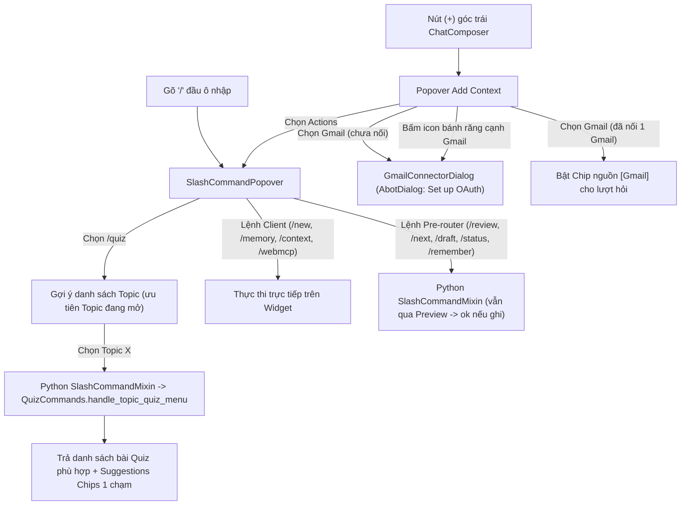

# PLAN: Nút `+ Add Context` Góc Trái Abot (`Actions` Slash & `Gmail Connector` 1 Tài Khoản)

- **Trạng thái:** `DONE (Code + Schema + Unit/Route/Python Tests + Code-Intel Sync; chờ apply Turso & ENV deploy)` — [ADR-0021](../docs/adr/0021-abot-add-context-slash-actions-and-gmail-connector.md) ngày `2026-11-27`
- **Ngày lập:** `2026-11-27` · **Cập nhật:** `2026-11-27`
- **Mốc codebase đối chiếu:** `main` @ `2b3e3cd` (đã có sẵn `AbotDialog.tsx` và `useWidgetDismiss.ts` trên `main`)
- **Phạm vi liên quan:** `roadmap-assistant-abot`, `roadmap-learning`, `auth-security`
- **Tài liệu liên hệ:** [`GLOSSARY.md`](../GLOSSARY.md), [`docs/README.md`](../docs/README.md), [`ADR-0021`](../docs/adr/0021-abot-add-context-slash-actions-and-gmail-connector.md), [`.handoff/BACKLOG.md`](./BACKLOG.md)

---

## 1. Mục tiêu & Ranh giới

- **Mục tiêu cốt lõi:** Nâng cấp `ChatComposer` của Abot sang bố cục 2 hàng thống nhất (Unified 2-Row Card) với nút `+` (`Add Context`) ở góc dưới bên trái gồm đúng **2 tùy chọn**:
  1. **`Actions (Slash)`:** Mở bảng lệnh `/` định tuyến trước `P0–P8` (hỗ trợ cả bấm `+ -> Actions` lẫn gõ `/` đầu ô nhập). Riêng lệnh `/quiz` tự gợi ý danh sách `Topic` trên UI để Agent đưa ra danh sách các bài quiz phù hợp với `Topic` đó kèm chip chọn nhanh 1 chạm.
  2. **`Gmail (Connector config)`:** Kết nối **1 tài khoản Gmail** của `Owner` với Agent thông qua luồng OAuth2 tách biệt khỏi `/login` (tái sử dụng `AUTH_GOOGLE_ID` / `AUTH_GOOGLE_SECRET`, mã hóa `AES-256-GCM` tại Turso) và lưu metadata ngữ cảnh vào cột mới `ThreadMessage.contextJson` để khôi phục chip khi mở lại `Thread`.

**Làm (In-Scope):**
- Chuyển `ChatComposer.tsx` sang Unified 2-Row Card trên cả Mobile (`< md`) và Desktop (`md:`), giữ nguyên thứ tự DOM `card.children[0] === textarea` và `card.children[1] === composer-toolbar`.
- Xây dựng menu `+ Add Context` + `SlashCommandPopover` (kèm sub-flow gợi ý `Topic` cho `/quiz`) + `SlashCommandMixin` trên Python FastAPI + mở rộng `QuizCommands` sinh danh sách quiz theo `Topic` và truyền `suggestions` qua `ChatResponse`.
- Thêm bảng `OwnerConnector` (`provider = "gmail"` duy nhất cho 1 tài khoản Gmail) và cột `ThreadMessage.contextJson` trên Turso SQLite + script migration `yarn db:abot-context-connector`.
- Triển khai OAuth2 popup flow (`/api/v1/connectors/gmail/{auth,callback,status,config,disconnect,query}`) + `GmailConnectorDialog` trên `AbotDialog.tsx` (chọn nhãn/filter, lọc OTP, xử lý hết hạn 7 ngày của GCP `Testing` mode).
- Nối Gmail Connector với Agent E2E: khi `Owner` bật chip `[Gmail]` (hoặc dùng `/gmail`), Agent truy vấn hộp thư qua API nội bộ của Next.js, nhận `ContextDocument` văn bản thuần đã làm sạch, trả lời kèm trích dẫn `[[gmail:<msgId>]]` và ghi vết gọn vào `ThreadMessage.contextJson`.

**Không làm (Out-of-Scope):**
- Không chạm phạm vi đang khóa trong `AGENTS.md` (`Cris AI` tại `/portfolio`, `components/floating-bot/**`, `hooks/use-floating-chat.ts`).
- Không làm quản lý đa tài khoản Gmail cùng lúc (chỉ target kết nối **1 Gmail** duy nhất với Agent).
- Không đồng bộ hộp thư Gmail vào in-memory vector store `HybridRagEngine` ([ADR-0006](../docs/adr/0006-in-memory-vector-search.md)) hay tự động đẩy email vào `/news` (`NewsItem`).
- Không xin quyền ghi/gửi/xóa email (chỉ dùng scope đọc `https://www.googleapis.com/auth/gmail.readonly`) và không cài thêm thư viện nặng `googleapis`.
- Không cho phép lệnh Slash bỏ qua bước `Preview -> ok` (`PendingAction`) đối với bất kỳ thao tác ghi nào ([ADR-0002](../docs/adr/0002-roadmap-assistant-access-via-proxy.md)).

---

## 2. Tiến độ Batch / Spec (`Living Progress`)

> Chia thành **4 Batch tuần tự (`001 -> 002 -> 003 -> 004`)** có ranh giới file rõ ràng để mỗi batch đều kiểm thử độc lập, giữ xanh CI và giao việc gọn qua `agent-handoff`.
>
> **Lưu ý trước khi giao `001`:** Commit (hoặc dọn sạch) các file UI SDK đang sửa dở trên working tree hiện tại (`AbotDialog.tsx`, `RoadmapChatbotWidget.tsx`, ...) trước khi chạy `baseline.sh TASK-abot-context-001` để `check-boundary.sh` và `yarn doctor --since HEAD --check` đo đúng diff.

| Spec | Nhánh | Nội dung trọng tâm | Phụ thuộc | `deploy_steps` | Trạng thái |
| :--- | :--- | :--- | :--- | :--- | :--- |
| `TASK-abot-context-001` | `feat/abot-slash-actions` | Unified 2-Row `ChatComposer` + nút `+ Add Context` + `SlashCommandPopover` (suggest `Topic` cho `/quiz`) + Python `SlashCommandMixin` & Topic Quiz List (`ChatResponse.suggestions`) | — | Không | `DONE` |
| `TASK-abot-context-002` | `feat/abot-thread-context-schema` | Schema Turso (`OwnerConnector` + `ThreadMessage.contextJson`) + script `yarn db:abot-context-connector` + đọc/ghi `contextJson` qua `/api/v1/threads/[threadId]` & hiển thị chip khôi phục trên `MessageList` | `001` | Chạy `yarn db:abot-context-connector --apply` lên Turso trước deploy | `DONE` |
| `TASK-abot-context-003` | `feat/abot-gmail-connector-config` | Mã hóa `AES-256-GCM` (`CONNECTOR_ENCRYPTION_KEY`) + Gmail REST client thuần `fetch` + OAuth popup/callback tái sử dụng `AUTH_GOOGLE_ID`/`SECRET` + UI `GmailConnectorDialog` (`Set up`, Label filter, OTP guard, Reconnect/Disconnect) | `002` | Khai báo `CONNECTOR_ENCRYPTION_KEY` trên Vercel + thêm Redirect URI trên GCP | `DONE` |
| `TASK-abot-context-004` | `feat/abot-gmail-agent-e2e` | Nối Gmail Connector với Agent (`POST /api/v1/connectors/gmail/query` + chip `[Gmail]` / lệnh `/gmail` + `ContextDocument` grounding/citations + cô lập `extractor.py`) + Evals, Security Tests & đồng bộ `cris-code-intel` / `DEPLOY_ENV.md` | `003` | Deploy Next.js trước Python | `DONE` |

---

## 3. Kiến trúc Tổng thể & Thiết kế Kỹ thuật Chi tiết

### 3.1. Luồng Tương tác UI (`ChatComposer` + `/quiz` Suggest Topic + `Gmail Connector`)



### 3.2. Thiết kế Khung nhập `ChatComposer` (Batch 1 — Quyết định Q3)

- **Cấu trúc DOM cố định trên cả Mobile (`< md`) và Desktop (`md:`):**
  - `card.children[0]`: `<textarea>` rộng 100% (`w-full`), giữ nguyên `className` bất biến qua mọi trạng thái focus/blur/nhiều dòng theo đúng hợp đồng của `tests/unit/composer-smooth-transition.test.tsx`.
  - `card.children[1]` (`data-testid="composer-toolbar"`): hàng dưới `flex w-full items-center justify-between gap-2`:
    - **Cụm trái:**
      1. Nút tròn `+` (`h-8 w-8`, vùng chạm cảm ứng `44×44px`, `aria-label="Thêm ngữ cảnh"`, `aria-haspopup="menu"`, `aria-expanded`).
      2. Dải chip ngữ cảnh cuộn ngang mượt (`overflow-x-auto [scrollbar-width:none]`): `PageContextRef` hiện tại + chip `[Gmail ×]` (khi bật cho lượt hỏi) + pill lệnh nếu có.
    - **Cụm phải:** bộ đếm ký tự (`>= 1800/2000`) + nút `Gửi` / `Dừng`.
- **Quy tắc kích hoạt `SlashCommandPopover`:**
  - Chỉ tự mở khi giá trị ô nhập khớp `^\s*\/[a-zA-Z0-9_-]*$` (hoặc đang ở chế độ chọn `Topic` ngay sau `/quiz `). Tuyệt đối không bật khi gõ đường dẫn `/topic/lesson` ở giữa câu.
  - Phối hợp `useWidgetDismiss.ts`: phím `Escape` đóng popover trước, trả focus về `textarea` và không đóng khung chat Abot.

### 3.3. Danh mục Slash Actions & Luồng `/quiz` Theo `Topic` (Batch 1 — Quyết định Q2)

| Lệnh | Quyền | Tầng xử lý | Hành vi chi tiết |
| :--- | :--- | :--- | :--- |
| `/quiz` | `Owner` | UI Suggest + Python Pre-router | Khi chọn `/quiz`, popover chuyển sang **Suggest Topic** (lấy từ `client.listRoadmaps()`, đưa `Topic` của trang đang mở lên vị trí đầu tiên). Chọn `Topic` sẽ gửi `/quiz <Topic Title>` để Agent lập danh sách quiz phù hợp với `Topic` đó |
| `/review` | `Owner` | Python Pre-router | Gọi `LessonStatusCommands` liệt kê các bài `known` cần ôn lại (theo `Topic` đang mở hoặc toàn kho) |
| `/next` | `Owner` | Python Pre-router | Gọi `LessonStatusCommands` gợi ý bài nên học tiếp (`learning` trước, `target` sau) |
| `/draft <yêu cầu>` | `Owner` | Python Pre-router | Gọi `LessonContentCommands` tạo bản nháp nội dung bài học, bắt buộc trả `Preview -> ok` |
| `/status <trạng thái>` | `Owner` | UI Sub-menu + Python Pre-router | Gợi ý 3 giá trị chuẩn ADR-0010 (`target`, `learning`, `known`) cho bài đang mở, bắt buộc qua `Preview -> ok` |
| `/remember <nội dung>` | `Owner` | Python Pre-router | Gọi `MemoryCommands` kiểm PII/secret và tạo `Preview` lưu `Explicit Owner Memory` |
| `/gmail [truy vấn]` | `Owner` | UI / Python Pre-router | Bật kết nối Gmail cho lượt hỏi (nếu chưa nối thì mở ngay `GmailConnectorDialog`) *(hoàn thiện ở Batch 4)* |
| `/topics` | Tất cả | Python Pre-router | Gọi `handle_catalog` liệt kê các `Topic` (hoặc các `Section` nếu đang đứng trong một `Topic`) |
| `/webmcp <lệnh>` | `Owner` | Client SDK | Chuyển vào `onWebMcpMessage` sẵn có ở `useRoadmapAssistantChat.ts` |
| `/memory` | `Owner` | Client SDK | Mở `OwnerMemorySheet` |
| `/context` | Tất cả | Client SDK | Mở `ContextUsageSheet` |
| `/new` | Tất cả | Client SDK | Gọi `handleNewChat()` tạo `Thread` mới |

**Đặc tả chi tiết `QuizCommands.handle_topic_quiz_menu` cho `/quiz <Topic>`:**
1. Giải mã `Topic` từ tham số sau `/quiz` qua `resolve_topic` (nếu người dùng bấm Enter ngay ở `/quiz` không kèm tên và đang mở trang một `Topic`, tự lấy `Topic` đang mở; nếu không ở trang `Topic` nào và chưa chọn, trả danh sách các `Topic` hiện có dạng chips để chọn 1 chạm).
2. Lọc các `Lesson` thuộc `Topic` có nội dung thực tế (`len(strip_html_for_quiz(content)) >= MIN_LESSON_CHARS = 40`), xếp hạng độ ưu tiên sư phạm:
   - **Ưu tiên 1 (`learning`):** Bài đang học dở cần kiểm tra để chốt kiến thức.
   - **Ưu tiên 2 (`known` lâu chưa ôn):** Sắp theo `filter_and_sort_review_lessons` (`statusUpdatedAt` rỗng hoặc cũ nhất lên trước).
   - **Ưu tiên 3 (`target` đã có bài viết):** Bài mục tiêu đã soạn nội dung.
3. Sinh phản hồi gồm:
   - Bản tóm tắt danh sách đề xuất (tối đa 5 bài tiêu biểu kèm nhãn trạng thái `Đang học` / `Cần ôn lại` / `Mục tiêu` và Section tương ứng, cộng 1 gói **Quiz tổng hợp toàn Topic** nếu có từ 2 bài có nội dung trở lên).
   - Trường `suggestions: { label: string; prompt: string }[]` trong sự kiện SSE `done` / `ChatResponse` (nối vào `MessageList.tsx` dòng 510 đã có sẵn UI render chips!), ví dụ:
     - `{ label: "Quiz tổng hợp Topic (5 câu)", prompt: "quiz tổng hợp topic <Title>" }` (hỗ trợ phiên quiz 5 câu lấy mỗi bài trọng tâm 1 câu, lưu trong `session_ctx.active_quiz`).
     - `{ label: "Quiz: <Tên bài 1>", prompt: "quiz bài \"<Tên bài 1>\" trong topic <Title>" }`.
   - Nếu `Topic` chưa có `Lesson` nào đủ nội dung (`>= 40` ký tự): thông báo rõ số bài hiện có chưa có thân bài và gợi ý chip `/draft` cho bài đầu tiên.

### 3.4. Thiết kế Schema Turso (`OwnerConnector` & `ThreadMessage.contextJson` — Batch 2, Quyết định Q1 & Q5)

Cập nhật đồng bộ trên 3 nơi (`prisma/schema.prisma`, `prisma/init-turso.sql`, `roadmap-rag-assistant/tests/fixtures/schema.sql`) và script idempotent `scripts/add-abot-context-connector.ts`:

```prisma
model ThreadMessage {
  id          Int      @id @default(autoincrement())
  threadId    String   // Always "owner:..."; a Visitor's Thread is never stored
  role        String   // user | assistant
  content     String
  contextJson String?  // Optional bounded JSON (<= 4096 chars): connectors, gmailRefs, slashCommand, pageContext (ADR-0021)
  createdAt   DateTime @default(now())

  @@index([threadId])
  @@index([createdAt])
}

model OwnerConnector {
  id                    String    @id @default(uuid(7))
  provider              String    @unique // "gmail" — 1 connected Gmail account for the Owner (ADR-0021)
  accountEmail          String
  encryptedRefreshToken String?   // AES-256-GCM "v1:<iv_b64>:<tag_b64>:<cipher_b64>"
  encryptedAccessToken  String?
  tokenExpiresAt        DateTime?
  scopes                String
  status                String    @default("connected") // "connected" | "expired" | "error"
  lastError             String?
  configJson            String    @default("{}") // { allowedLabelIds, defaultQuery, excludeSensitiveSubjects, maxResults }
  lastUsedAt            DateTime?
  createdAt             DateTime  @default(now())
  updatedAt             DateTime  @updatedAt
}
```

**Hợp đồng `ThreadMessage.contextJson` (`lib/roadmap/thread-state.ts`):**
- Validate bằng Zod `ThreadMessageContextSchema` trước khi lưu và khi đọc:
  - `slashCommand?: string` (vd `"/quiz"`, `"/review"`)
  - `connectors?: ("gmail")[]`
  - `gmailRefs?: { id: string; subject: string; from?: string; date?: string }[]` (tối đa 5 mục, cắt gọn chuỗi, **không bao giờ** chứa `body` hay `snippet` nhạy cảm)
  - `pageContext?: { roadmapSlug?: string; roadmapTitle?: string; section?: string; itemId?: string; itemTitle?: string }`
- Nếu JSON vượt `4.096` ký tự hoặc sai schema: cắt gọn phần tử thừa / bỏ qua an toàn (fail-open cho việc ghi lịch sử theo ADR-0012, không làm lỗi lượt chat).
- Cập nhật `GET /api/roadmap-assistant/thread` và `GET` / `PATCH /api/roadmap-assistant/threads/[threadId]` trả thêm `contextMeta` trên từng message đã khôi phục để `MessageList.tsx` hiển thị lại chip `[Gmail]` (kèm tiêu đề email đã tham chiếu) và `PageContext` y hệt lúc vừa gửi.

### 3.5. Luồng OAuth2, Cấu hình 1 Gmail & Nối với Agent (Batch 3 & Batch 4 — Quyết định Q1 & Q4)

```mermaid
sequenceDiagram
    actor Owner
    participant UI as "RoadmapChatbotWidget (ChatComposer + GmailConnectorDialog)"
    participant Next as "Next.js BFF (/api/v1/connectors/gmail/* & Proxy)"
    participant Google as "Google OAuth2 & Gmail REST API v1"
    participant DB as "Turso SQLite (OwnerConnector + ThreadMessage)"
    participant Py as "Python Abot (NextGenRoadmapAgent)"

    Note over Owner,DB: 1. Kết nối 1 tài khoản Gmail (Tái sử dụng AUTH_GOOGLE_ID / SECRET)
    Owner->>UI: Bấm (+) -> Gmail (Set up) -> "Kết nối Gmail"
    UI->>Next: Mở popup GET /api/v1/connectors/gmail/auth
    Next->>Next: requireWriteAccess + sinh state & PKCE (cookie HttpOnly 10 phút)
    Next-->>UI: Redirect tới accounts.google.com (scope=gmail.readonly, access_type=offline, prompt=consent)
    Owner->>Google: Cấp quyền đọc hộp thư
    Google-->>Next: GET /api/v1/connectors/gmail/callback?code=...&state=...
    Next->>Google: POST oauth2.googleapis.com/token + GET gmail/v1/users/me/profile
    Next->>Next: Mã hóa token bằng AES-256-GCM (CONNECTOR_ENCRYPTION_KEY)
    Next->>DB: Upsert OwnerConnector (provider="gmail", accountEmail)
    Next-->>UI: Trả trang đóng popup + opener.postMessage({ type: "abot:gmail-connected" })

    Note over Owner,Py: 2. Agent truy vấn Gmail đã kết nối trong lượt chat
    Owner->>UI: Bật chip [Gmail] (hoặc gõ /gmail ...) + gửi câu hỏi
    UI->>Next: POST /api/roadmap-assistant/chat/stream (message, connectors: ["gmail"])
    Next->>Py: Forward kèm x-internal-key, x-actor="owner", connectors=["gmail"]
    Py->>Py: Kiểm is_owner() -> bỏ chặn OUT_OF_SCOPE -> trích truy vấn tìm thư
    Py->>Next: POST /api/v1/connectors/gmail/query (x-admin-key, query)
    Next->>DB: Đọc OwnerConnector (tự làm mới access_token nếu hết hạn; nếu 400 invalid_grant -> đánh dấu status="expired")
    Next->>Google: GET messages (áp dụng allowedLabelIds + defaultQuery + trừ Spam/Trash) & GET messages/{id}
    Next->>Next: Lọc HTML -> Plain text (sanitize-html), loại thư OTP/mật khẩu, cắt <= 4000 ký tự/thư
    Next-->>Py: Trả danh sách items sạch [{ id, subject, from, date, body, threadUrl }]
    Py->>Py: Bọc thành ContextDocument (id="gmail:<id>") + ghép kết quả Hybrid RAG (nếu có)
    Py->>DB: Ghi lịch sử lượt hỏi kèm contextJson (connectors + gmailRefs, không lưu body)
    Py-->>UI: Stream câu trả lời kèm bước Tool "Tra cứu Gmail" & Citation [[gmail:<id>]]
```

**Các chốt chặn Bảo mật & Độ tin cậy Bắt buộc trong Batch 3 & 4:**
1. **Tách biệt hoàn toàn khỏi `/login` (`auth.ts`):** Giữ `auth.ts` nguyên vẹn 20 dòng chỉ xin `openid email profile`. Mọi thao tác Gmail đi qua `/api/v1/connectors/gmail/*` và đều gọi `requireWriteAccess(req)` ngay dòng đầu tiên.
2. **Mã hóa Token tại chỗ (`lib/connectors/crypto.ts`):** Dùng `node:crypto` `aes-256-gcm` với IV 12-byte ngẫu nhiên mỗi lần ghi, khóa 32-byte từ `CONNECTOR_ENCRYPTION_KEY`. Không bao giờ trả token hay ciphertext ra bất kỳ API JSON nào.
3. **Bộ lọc An toàn Mặc định (`Connector Config`):**
   - Luôn ghép `-in:spam -in:trash` ở tầng server Next.js (kể cả khi user để trống `defaultQuery`).
   - Mặc định bật `excludeSensitiveSubjects: true`: loại trừ các thư có tiêu đề khớp mẫu mã xác thực / khôi phục tài khoản (`OTP`, `verification code`, `mã xác minh`, `security alert`, `password reset`, `one-time passcode`).
   - Giới hạn cứng mỗi lượt truy vấn: tối đa `5` email, timeout tổng `6.000ms`, mỗi email tối đa `4.000` ký tự plain text sau khi qua `sanitize-html` và `mask_pii`.
4. **Xử lý hết hạn 7 ngày trên GCP `Testing` Mode:** Khi làm mới token gặp `invalid_grant`, Next.js cập nhật `OwnerConnector.status = "expired"` (giữ nguyên `configJson` chứa nhãn/bộ lọc của Owner) và trả mã lỗi có cấu trúc `GMAIL_TOKEN_EXPIRED` để Abot hiển thị thông báo rõ ràng kèm nút **Kết nối lại Gmail** 1 chạm.
5. **Chống Indirect Prompt Injection & Đầu độc `OwnerMemory` ([ADR-0020](../docs/adr/0020-rovo-owner-memory-and-observations.md)):**
   - Thân email đi vào `ContextDocument` được thoát thẻ điều khiển XML bởi `_escape()` trong `rag_service/core/augmentation/context.py`; trường `subject` và `from` ở cả Next.js lẫn fallback đều được lọc `[[`/`]]` và gỡ liên kết Markdown.
   - Tuyệt đối bỏ qua `_maybe_schedule_memory_extraction` cho mọi lượt có `Connector` (cả chip `[Gmail]` lẫn lệnh `/gmail` trên `/chat` và `/chat/stream` thông qua `_resolve_turn_connectors` và `state.metadata["connectors"]`), **không bao giờ** đưa nội dung hay câu trả lời liên quan email vào `extractor.py`.
   - Khóa kênh thoát dữ liệu 1-click ở đầu ra bằng `LinkGuard` (`GenerationRequest.restrict_external_links = True`): mọi liên kết `http(s)://`, `//`, `mailto:`, `javascript:` chỉ được giữ lại nếu khớp chính xác `href` (`https://mail.google.com/mail/u/0/#all/<id>`) trong các `ContextDocument` của chính lượt hỏi đó; mọi URL ngoài khác bị tước thành văn bản thuần ngay khi stream.
   - Không đặt bất kỳ từ khóa miền bị cấm nào (`lộ trình`, `topic`, `layer`, `abot`, `roadmap`, `bài học`) vào `rag_service/core/**` để giữ xanh `test_core_never_names_a_business_domain`.

---

## 4. Ma trận Đồng bộ & Xung đột (`cris-how-to-sync`)

| Kiểm tra | Trạng thái | Chi tiết / Yêu cầu đồng bộ |
| :--- | :--- | :--- |
| **ADRs & Bất biến** | `Tuân thủ` | Đã ghi nhận tại [`ADR-0021`](../docs/adr/0021-abot-add-context-slash-actions-and-gmail-connector.md). Giữ nguyên ranh giới Python microservice (`ADR-0001`), Next.js proxy & `Actor` (`ADR-0002`, `ADR-0019`), in-memory RAG không chứa hộp thư (`ADR-0006`), `Thread` của `Owner` ở Turso (`ADR-0012`), và chống đầu độc `OwnerMemory` (`ADR-0020`). |
| **Glossary** | `Tuân thủ` | Đã bổ sung thuật ngữ **`Connector`** vào [`GLOSSARY.md`](../GLOSSARY.md) (tránh `plugin`, `external sync`, `mailbox sync`). Dùng đúng `Topic`, `Section`, `Lesson`, `Lesson Status`, `Thread`, `Preview`, `Pending Action`. |
| **Dual-Service / RAG** | `Bắt buộc (Batch 1 & 4)` | Đồng bộ `ChatRequest` / `ChatResponse` giữa SDK TypeScript (`types.ts`, `client.ts`), Next.js proxy (`app/api/roadmap-assistant/[...path]/route.ts`) và FastAPI (`schemas.py`, `routes.py`, `agent.py`). Không kích hoạt `notifyRoadmapChanged()` khi chỉ đọc Gmail. |
| **Database & Turso** | `Bắt buộc (Batch 2)` | Đồng bộ `prisma/schema.prisma`, `prisma/init-turso.sql`, `scripts/add-abot-context-connector.ts`, `roadmap-rag-assistant/tests/fixtures/schema.sql` (`yarn test:schema-sql --check`). |
| **Environment (`DEPLOY_ENV.md`)** | `Bắt buộc (Batch 3 & 4)` | Bổ sung `CONNECTOR_ENCRYPTION_KEY` (Vercel) và hướng dẫn thêm Redirect URI `/api/v1/connectors/gmail/callback` vào `AUTH_GOOGLE_ID` hiện có trong `docs/DEPLOY_ENV.md`. |
| **Code Intel & Doctor** | `Bắt buộc (Batch 4)` | Cập nhật `.agents/skills/cris-code-intel/data/cris-workspace-map.json` + `docs/code-intel/CRIS_WORKSPACE_MAP.md` (thêm routes `/api/v1/connectors/gmail/*`, model `OwnerConnector`, flow `FLOW_ABOT_GMAIL_CONNECTOR` & `FLOW_ABOT_SLASH_ACTIONS`), kiểm tra `yarn intel status` và `yarn doctor --since HEAD --check`. |

---

## 5. Quyết định đã chốt (`Decision Log`)

| # | Vấn đề | Quyết định của Owner | Ngày & Căn cứ |
| :--- | :--- | :--- | :--- |
| 1 | Phạm vi & mô hình kết nối Gmail | Kết nối **1 tài khoản Gmail** duy nhất trực tiếp với Agent (`OwnerConnector` `provider = "gmail"` `@unique`); khi kích hoạt ngữ cảnh Gmail, Agent truy vấn hộp thư đã kết nối qua Next.js BFF | `2026-11-27` — [`ADR-0021`](../docs/adr/0021-abot-add-context-slash-actions-and-gmail-connector.md), giữ an toàn `ADR-0002` & `ADR-0006` |
| 2 | Hành vi lệnh `/quiz` trong `Actions (Slash)` | Chọn `/quiz` sẽ **gợi ý danh sách `Topic`** để Agent tổng hợp và đưa ra **danh sách các bài quiz phù hợp với `Topic` đó** (kèm chips bấm làm ngay) | `2026-11-27` — Khai thác trực tiếp `Lesson Status` (`ADR-0010`) và nội dung bài học thực tế |
| 3 | Bố cục `ChatComposer` trên Mobile & Desktop | **Unified 2-Row Card** (hàng trên `textarea` rộng 100%, hàng dưới `composer-toolbar` chứa nút `+` góc trái, các chip ngữ cảnh, và nút Gửi góc phải) | `2026-11-27` — Giữ nguyên hợp đồng chống giật khung nhập của `composer-smooth-transition.test.tsx` |
| 4 | Google OAuth Client cho Gmail Connector | **Tái sử dụng** `AUTH_GOOGLE_ID` và `AUTH_GOOGLE_SECRET` hiện có, tách đường dẫn ủy quyền & callback riêng `/api/v1/connectors/gmail/callback` (không đụng `/login`) | `2026-11-27` — Giảm ENV dư thừa, giữ phiên đăng nhập gọn nhẹ |
| 5 | Lưu lịch sử ngữ cảnh đính kèm của `Thread` | **Thêm cột `contextJson`** vào bảng `ThreadMessage` trên Turso (chỉ lưu metadata cấu trúc gọn `<= 4 KB`, không lưu thân email) | `2026-11-27` — Khôi phục đầy đủ chip ngữ cảnh trên UI mà không làm bẩn `ThreadMessage.content` |
| 6 | Phạm vi lập kế hoạch & tài liệu kiến trúc | **Chốt `ADR-0021` + lập Plan tổng thể** bao gồm cả `Actions (Slash)` lẫn `Gmail Connector` | `2026-11-27` — Đồng bộ kiến trúc trước khi tách các `TASK-*` thực thi |

---

## 6. Phát hiện Thực tế & Ghi chú Verify (`Surprises & Discoveries`)

- **Hợp đồng thứ tự DOM trong `ChatComposer`:** `tests/unit/composer-smooth-transition.test.tsx:48-50` kiểm tra trực tiếp `card.children[0] === textarea` và `card.children[1] === composer-toolbar`. Đặt nút `+` bên trong đầu trái của `composer-toolbar` ở chế độ 2 hàng giúp mở rộng tự nhiên mà không phá vỡ bất biến không giật của `textarea`.
- **Regex lệnh miền chưa nhận dấu `/`:** Các biểu thức chính quy ở `quiz_commands.py:54`, `memory_commands.py:43` và `lesson_content.py:76` đều neo đầu câu không có ký tự `/`, nên bắt buộc phải có `SlashCommandMixin` ở `_run_pre_route_stage` (`agent.py:496`) trước khi tin nhắn chạm tới `IntentRouter`.
- **Cơ chế Grounding theo từng câu (`pipeline.py:152-153`):** `PROFILE.grounding_policy == "sentence"` đối chiếu câu trả lời với `documents: list[ContextDocument]`. Truyền kết quả truy vấn Gmail thành `ContextDocument` giúp cả kiểm chứng câu trả lời, trích dẫn `[[gmail:<id>]]` lẫn thống kê `ContextUsageSheet` hoạt động đồng nhất.
- **UI `suggestions` chips đã có sẵn trên `MessageList.tsx:510-525`:** Widget đã render sẵn mảng `msg.suggestions`, nhưng `ChatResponse` (`sdk/typescript/src/types.ts:32`) và `onDone` (`useRoadmapAssistantChat.ts:538`) chưa nối trường `suggestions` từ SSE `done` xuống — chỉ cần nối thêm trường này ở Batch 1 là danh sách quiz của `/quiz <Topic>` có ngay các nút bấm khởi chạy 1 chạm.
- **Ràng buộc `rag_service/core/**`:** `tests/test_generation_pipeline.py:277` cấm các từ `lộ trình|topic|layer|abot|roadmap|bài học` xuất hiện trong `rag_service/core/` (kể cả trong comment/docstring). Mọi logic đặc thù `Topic` hay `Gmail Connector` phải đặt trong `rag_service/domains/roadmap/`.
