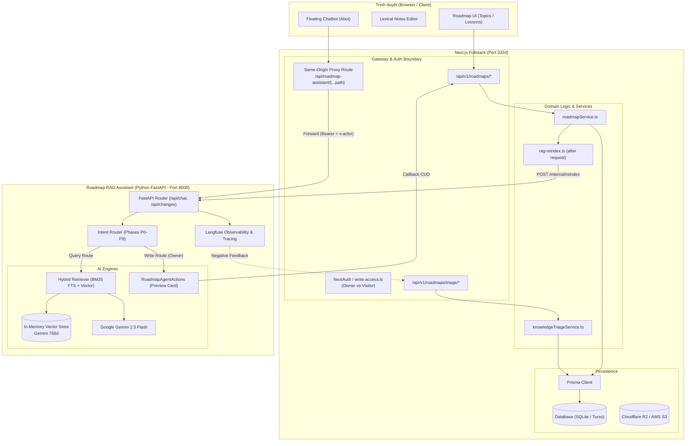
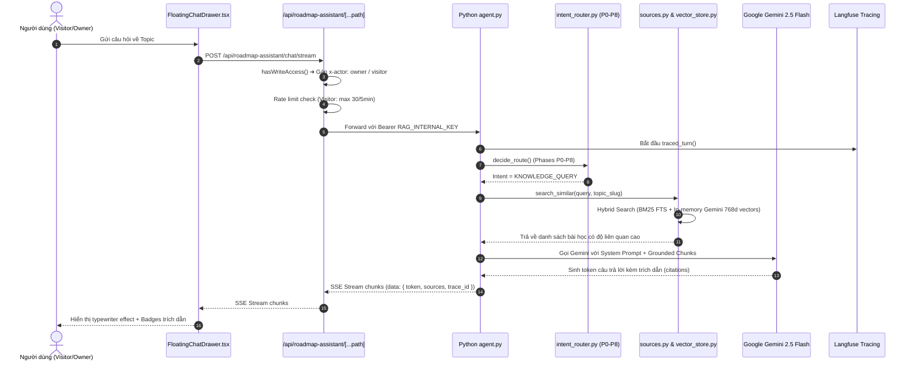
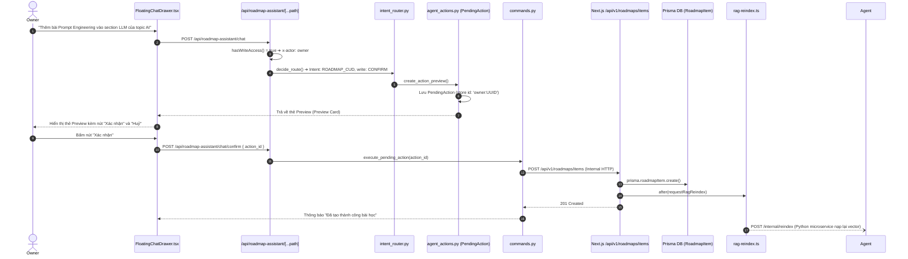
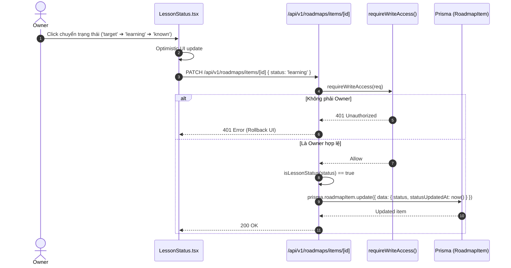

# BẢN ĐỒ KIẾN TRÚC & CẤU TRÚC XỬ LÝ LOGIC WORKSPACE CRIS (`crisne-website`)

> **Phiên bản:** 1.0.0 | **Commit:** `52a3596` | **Mô hình:** GitNexus Code Intelligence  
> **Skill đi kèm:** `.agents/skills/cris-code-intel/` | **CLI Tra cứu:** `cris-intel`

---

## 1. TỔNG QUAN KIẾN TRÚC HỆ THỐNG (HYBRID ARCHITECTURE)

Dự án `crisne-website` hoạt động theo mô hình lai (Hybrid Full-Stack) gồm hai dịch vụ chính tương tác chặt chẽ:

1. **Next.js 15+ App Router (TypeScript)**: Đóng vai trò Web UI, API Gateway, và Service Layer cho Roadmap, Notes, Storage.
2. **Python FastAPI Microservice (`roadmap-rag-assistant`)**: Đảm nhiệm AI Reasoning, Intent Routing P0-P8, Hybrid Vector Store (Gemini 768d + BM25 FTS) và sinh thẻ Preview CUD.

---

## 2. 6 DOMAINS TRỌNG YẾU (COMMUNITIES)

| ID Domain                | Tên Domain               | ADRs Quy định                                    | Trọng tâm Logic                                                                                            | Key Files                                                                                                                 |
| ------------------------ | ------------------------ | ------------------------------------------------ | ---------------------------------------------------------------------------------------------------------- | ------------------------------------------------------------------------------------------------------------------------- |
| `roadmap-learning`       | Roadmap & Learning       | ADR-0008, ADR-0009, ADR-0010                     | Quản lý Topic, Section (chuỗi tự do), Lesson, Lesson Status (`target`, `learning`, `known`)                | `lib/roadmap/*`, `logic/roadmap/roadmapService.ts`, `components/roadmap/*`, `app/api/v1/roadmaps/*`                       |
| `roadmap-assistant-abot` | Roadmap Assistant (Abot) | ADR-0001, ADR-0002, ADR-0003, ADR-0004, ADR-0006 | Trợ lý RAG AI trên Topic, proxy cùng domain, router P0-P8, in-memory vector store Gemini 768d, CUD Preview | `app/api/roadmap-assistant/*`, `roadmap-rag-assistant/rag_service/*`, `logic/roadmap/roadmapAssistantService.ts`          |
| `notes-editor`           | Notes & Lexical CMS      | N/A                                              | Lexical Editor, autosave debounce, tag taxonomy, markdown serialize                                        | `app/notes/*`, `app/api/tags/*`, `lib/notion.ts`                                                                          |
| `storage-media`          | Storage & Media          | N/A                                              | S3/R2 client, image upload                                                                                 | `app/api/upload-image/*`, `lib/r2-client.ts`                                                                               |
| `auth-security`          | Auth & Actor Model       | ADR-0002                                         | NextAuth, Actor `Owner` vs `Visitor`, `requireWriteAccess`, internal Bearer token                          | `auth.ts`, `lib/auth/*`, `hooks/use-can-write.ts`, `rag_service/auth.py`                                                  |
| `triage-observability`   | Triage & Active Learning | ADR-0003                                         | Missing Knowledge Triage queue, Langfuse 👎 vote sync, Golden set evals                                    | `app/api/v1/roadmaps/triage/*`, `logic/roadmap/knowledgeTriageService.ts`, `components/roadmap/KnowledgeTriageDrawer.tsx` |

---

## 3. BIỂU ĐỒ TRACE CÁC LUỒNG THỰC THI CỐT LÕI (EXECUTION FLOWS)

### Luồng 1: Hỏi đáp Kiến thức RAG với Abot (`FLOW_ABOT_CHAT_QUERY`)

---

### Luồng 2: Thao tác CUD Roadmap qua Abot (`FLOW_ABOT_CUD_PREVIEW_CONFIRM`)

---

### Luồng 3: Cập nhật Lesson Status (`FLOW_LESSON_STATUS_UPDATE`)

---

## 4. MA TRẬN API ROUTE TO HANDLER (ROUTE MAP)

| Method   | Path                                            | Quyền (Auth)        | Domain                   | Controller / Handler File                                        | Triggered Flow            |
| -------- | ----------------------------------------------- | ------------------- | ------------------------ | ---------------------------------------------------------------- | ------------------------- |
| `GET`    | `/`                                             | None                | `roadmap-learning`       | `app/page.tsx`                                                   | View Dashboard            |
| `GET`    | `/notes`                                        | None                | `notes-editor`           | `app/notes/page.tsx`                                             | View Notes                |
| `GET`    | `/notes/[slug]`                                 | None                | `notes-editor`           | `app/notes/[slug]/page.tsx`                                      | View / Edit Note          |
| `GET`    | `/api/v1/roadmaps`                              | None                | `roadmap-learning`       | `app/api/v1/roadmaps/route.ts#GET`                               | List Topics               |
| `POST`   | `/api/v1/roadmaps`                              | Owner Only          | `roadmap-learning`       | `app/api/v1/roadmaps/route.ts#POST`                              | Create Topic              |
| `GET`    | `/api/v1/roadmaps/[slug]`                       | None                | `roadmap-learning`       | `app/api/v1/roadmaps/[slug]/route.ts#GET`                        | Topic Detail              |
| `PATCH`  | `/api/v1/roadmaps/[slug]`                       | Owner Only          | `roadmap-learning`       | `app/api/v1/roadmaps/[slug]/route.ts#PATCH`                      | Update Topic              |
| `DELETE` | `/api/v1/roadmaps/[slug]`                       | Owner Only          | `roadmap-learning`       | `app/api/v1/roadmaps/[slug]/route.ts#DELETE`                     | Delete Topic              |
| `PATCH`  | `/api/v1/roadmaps/[slug]/sections`              | Owner Only          | `roadmap-learning`       | `app/api/v1/roadmaps/[slug]/sections/route.ts#PATCH`             | Rename Section (ADR-0009) |
| `DELETE` | `/api/v1/roadmaps/[slug]/sections`              | Owner Only          | `roadmap-learning`       | `app/api/v1/roadmaps/[slug]/sections/route.ts#DELETE`            | Dissolve Section          |
| `POST`   | `/api/v1/roadmaps/items`                        | Owner Only          | `roadmap-learning`       | `app/api/v1/roadmaps/items/route.ts#POST`                        | Create Lesson             |
| `PATCH`  | `/api/v1/roadmaps/items/[id]`                   | Owner Only          | `roadmap-learning`       | `app/api/v1/roadmaps/items/[id]/route.ts#PATCH`                  | Update Lesson & Status    |
| `PATCH`  | `/api/v1/roadmaps/items/[id]/content`           | Owner Only          | `roadmap-learning`       | `app/api/v1/roadmaps/items/[id]/content/route.ts#PATCH`          | Update HTML Content       |
| `DELETE` | `/api/v1/roadmaps/items/[id]`                   | Owner Only          | `roadmap-learning`       | `app/api/v1/roadmaps/items/[id]/route.ts#DELETE`                 | Delete Lesson             |
| `POST`   | `/api/v1/roadmaps/items/reorder`                | Owner Only          | `roadmap-learning`       | `app/api/v1/roadmaps/items/reorder/route.ts#POST`                | Reorder Lessons           |
| `GET`    | `/api/v1/roadmaps/full-export`                  | None                | `roadmap-learning`       | `app/api/v1/roadmaps/full-export/route.ts#GET`                   | RAG Export Corpus         |
| `POST`   | `/api/roadmap-assistant/[...path]`              | None (Actor Header) | `roadmap-assistant-abot` | `app/api/roadmap-assistant/[...path]/route.ts#POST`              | Proxy to Python Service   |
| `POST`   | `/api/chat/stream`                              | Internal Bearer     | `roadmap-assistant-abot` | `rag_service/api/routes.py#chat_stream`                          | RAG SSE Stream            |
| `POST`   | `/api/upload-image`                             | Owner Only          | `storage-media`          | `app/api/upload-image/route.ts#POST`                             | S3 / R2 Upload            |
| `POST`   | `/api/v1/roadmaps/triage`                       | Owner Only          | `triage-observability`   | `app/api/v1/roadmaps/triage/route.ts#POST`                       | Create Triage Item        |
| `POST`   | `/api/v1/roadmaps/triage/[id]/approve`          | Owner Only          | `triage-observability`   | `app/api/v1/roadmaps/triage/[id]/approve/route.ts#POST`          | Approve Triage to Lesson  |

---

## 5. BẢNG QUY TẮC BẤT BIẾN & ADR THAM CHIẾU

- **ADR-0001**: Trợ lý Roadmap phải luôn chạy trên dịch vụ Python FastAPI tách biệt.
- **ADR-0002**: Trình duyệt tuyệt đối không gọi trực tiếp Python service; bắt buộc thông qua Same-origin proxy `/api/roadmap-assistant` để bảo vệ phân quyền Actor.
- **ADR-0003**: Feedback người dùng (vote 👍/👎) thuộc quản lý của Langfuse.
- **ADR-0004**: Tất cả mô hình nhúng vector (embeddings) bắt buộc dùng Google Gemini `text-embedding-004` (768 dimensions).
- **ADR-0005**: Môi trường production sử dụng Turso (libSQL edge db) tương thích SQLite.
- **ADR-0006**: RAG Assistant sử dụng in-memory vector search trên RAM để đảm bảo độ trễ thấp và đơn giản hóa kiến trúc.
- **ADR-0007**: Thuật ngữ tuân thủ `GLOSSARY.md`, nhưng chấp nhận các từ đồng nghĩa trong mục `_Also_` đã tồn tại trong codebase.
- **ADR-0008**: Loại bỏ cấu trúc nhóm `level` trung gian; Topic trực tiếp chứa các bài học.
- **ADR-0009**: Section là mục tuỳ chọn của Topic để gom bài; là chuỗi tự do (free-form string), so khớp không phân biệt hoa thường; không tạo bảng riêng.
- **ADR-0010**: Lesson Status gồm 3 trạng thái (`target`, `learning`, `known`), phản ánh tiến trình của Owner, ẩn với Visitor và mặc định là `known`.
