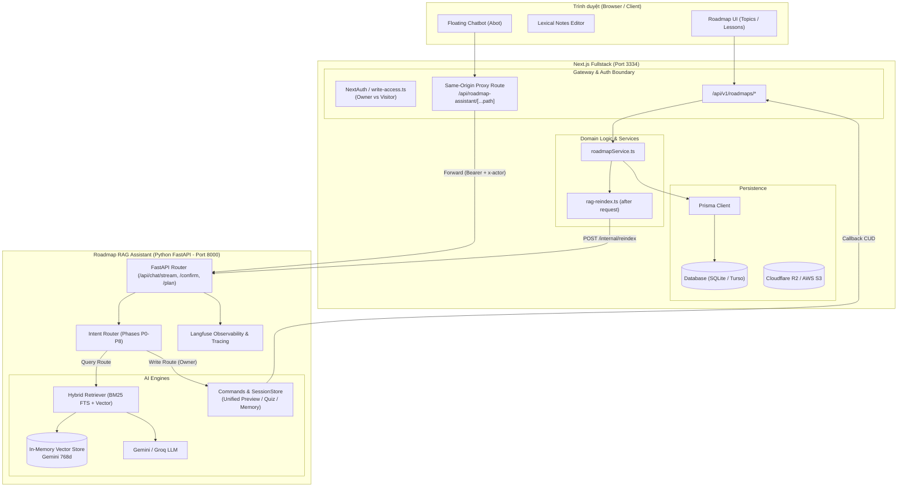
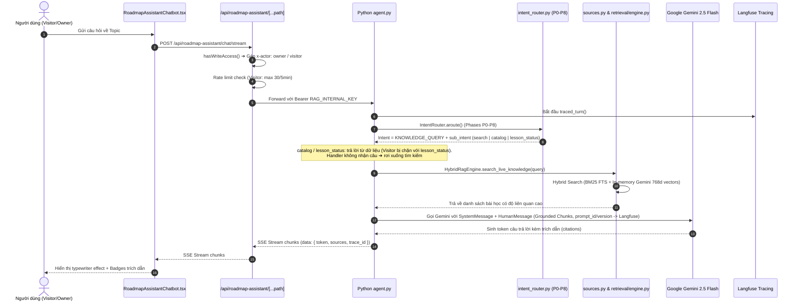
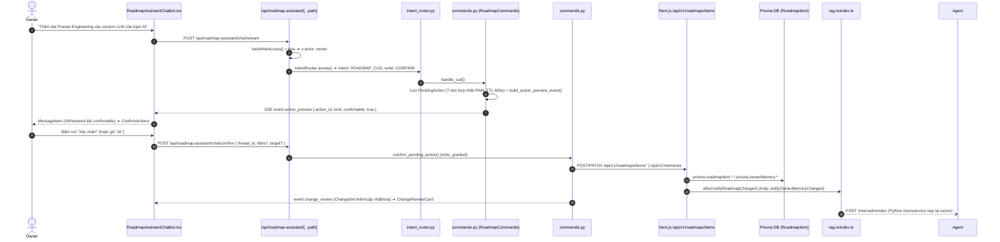
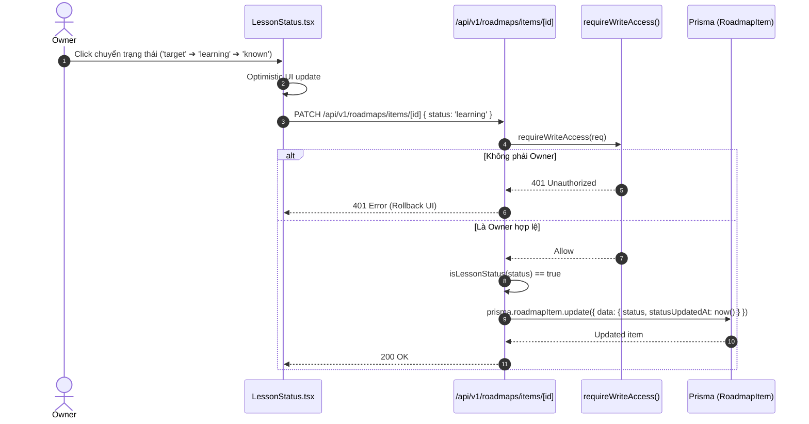

# BẢN ĐỒ KIẾN TRÚC & CẤU TRÚC XỬ LÝ LOGIC WORKSPACE CRIS (`crisne-website`)

> **Phiên bản:** 1.1.0 | **Commit:** `1dfcd0b` | **Mô hình:** GitNexus Code Intelligence  
> **Skill đi kèm:** `.agents/skills/cris-code-intel/` | **CLI Tra cứu:** `yarn intel`

---

## 1. TỔNG QUAN KIẾN TRÚC HỆ THỐNG (HYBRID ARCHITECTURE)

Dự án `crisne-website` hoạt động theo mô hình lai (Hybrid Full-Stack) gồm hai dịch vụ chính tương tác chặt chẽ:

1. **Next.js 16 App Router (TypeScript)**: Đóng vai trò Web UI, API Gateway, và Service Layer cho Roadmap, OwnerMemory, ThreadState, Private News, Storage.
2. **Python FastAPI Microservice (`roadmap-rag-assistant`)**: Đảm nhiệm AI Reasoning, Intent Routing P0-P8, Hybrid Vector Store (Gemini 768d + BM25 FTS), Active Recall Quiz, Concept Promotion, và thẻ `Preview` có cấu trúc.

---

## 2. 6 DOMAINS TRỌNG YẾU (COMMUNITIES)

| ID Domain                | Tên Domain               | ADRs Quy định                                    | Trọng tâm Logic                                                                                            | Key Files                                                                                                                 |
| ------------------------ | ------------------------ | ------------------------------------------------ | ---------------------------------------------------------------------------------------------------------- | ------------------------------------------------------------------------------------------------------------------------- |
| `roadmap-learning`       | Roadmap & Learning       | ADR-0008, ADR-0009, ADR-0010, ADR-0014           | Quản lý Topic, Section (chuỗi tự do), Lesson, Lesson Status (`target`, `learning`, `known`), KnowledgeRelation | `lib/roadmap/*`, `logic/roadmap/roadmapService.ts`, `components/roadmap/*`, `app/api/v1/roadmaps/*`                       |
| `roadmap-assistant-abot` | Roadmap Assistant (Abot) | ADR-0001..0004, ADR-0006, ADR-0011, 0012, 0015, 0017 | Trợ lý RAG AI, proxy cùng domain, router P0-P8, in-memory vector store, unified `Pending Action` / `Preview`, `OwnerMemory`, Quiz, Concept Promotion | `app/api/roadmap-assistant/*`, `roadmap-rag-assistant/rag_service/*`, `logic/roadmap/roadmapAssistantService.ts`          |
| `storage-media`          | Storage & Media          | N/A                                              | S3/R2 client, image upload                                                                                 | `app/api/upload-image/*`, `lib/r2-client.ts`                                                                               |
| `auth-security`          | Auth & Actor Model       | ADR-0002, ADR-0019                               | NextAuth, site Owner-only trừ `/login`, `requireWriteAccess`, proxy `x-actor`, WebMCP read-only cho Owner | `auth.ts`, `lib/auth/*`, `hooks/use-can-write.ts`, `rag_service/auth.py`, `rag_service/webmcp_planner.py`                  |
| `observability`          | Observability & Golden Set | ADR-0003, ADR-0011                               | Langfuse traces, feedback scores (Cris AI), Abot copy `traceId`, Golden set evals (`_routing`, `_answer`, `holdout`) | `lib/ai/langfuse.ts`, `app/api/chat/feedback/route.ts`                                                                    |
| `private-news`           | Private News Reader      | ADR-0005, ADR-0016, ADR-0017, ADR-0019           | Kho đọc tin private `/news` cho `Owner` (bỏ Public News), `/share` PWA Share Target, RSS cron (`ETag`/`304`), `news-ingest-worker/` 3 tầng, `KnowledgeProvenance` | `app/(news)/*`, `components/news/*`, `lib/news/*`, `app/api/news/*`, `app/api/ingest/route.ts`, `news-ingest-worker/*`   |

---

## 3. BIỂU ĐỒ TRACE CÁC LUỒNG THỰC THI CỐT LÕI (EXECUTION FLOWS)

### Luồng 1: Hỏi đáp Kiến thức RAG với Abot (`FLOW_ABOT_CHAT_QUERY`)

---

### Luồng 2: Thao tác CUD Roadmap qua Abot (`FLOW_ABOT_CUD_PREVIEW_CONFIRM`)

---

### Luồng bổ sung (ADR-0012..ADR-0019 & Batch A–C)

- **`FLOW_ABOT_OWNER_MEMORY_MANAGE`**: `roadmap-rag-assistant/rag_service/domains/roadmap/memory_commands.py#handle_memory_command` · `roadmap-rag-assistant/rag_service/core/memory/extractor.py#has_memory_signal` / `#maybe_suggest_memories` · `roadmap-rag-assistant/rag_service/domains/roadmap/observations.py#synthesize_owner_observations` / `#prune_stale_observations` · `roadmap-rag-assistant/rag_service/core/memory/store.py#list_active` · `app/api/v1/memories/route.ts#PATCH` · `app/api/v1/memories/settings/route.ts` · `app/api/v1/memories/activity-events/route.ts` · `app/api/v1/memories/activity-snapshot/route.ts` · `roadmap-rag-assistant/sdk/typescript/src/react/components/OwnerMemorySheet.tsx#OwnerMemorySheet`.
- **`FLOW_ABOT_ACTIVE_RECALL_QUIZ`**: `roadmap-rag-assistant/rag_service/domains/roadmap/quiz_commands.py#handle_quiz_command` · `#handle_active_quiz_turn` · `#classify_quiz_gaps` (chuyển tiếp lỗ hổng kiến thức sang `pending_concept_promotion` nối sau `pending_status_change`).
- **`FLOW_ABOT_CONCEPT_PROMOTION`**: `roadmap-rag-assistant/rag_service/domains/roadmap/lesson_content.py#handle_concept_promotion` / `#build_concept_promotion_proposal` (`include_owner_memory=False`, mặc định `status="target"`, không tạo Provenance) · `roadmap-rag-assistant/rag_service/domains/roadmap/linking_advisor.py#advise_concept_promotion` · `roadmap-rag-assistant/rag_service/domains/roadmap/commands.py#_handle_pending_concept_promotion` · `roadmap-rag-assistant/rag_service/execution/executor.py#schedule_local_rag_sync`.
- **`FLOW_ABOT_WEBMCP_SAFETY`**: `components/roadmap/RoadmapWebMcpRegistrar.tsx#RoadmapWebMcpRegistrar` · `hooks/use-roadmap-webmcp.ts#useRoadmapWebMcpTools` (chỉ mount khi `canWrite === true`) · `roadmap-rag-assistant/rag_service/api/routes.py#plan` · `roadmap-rag-assistant/rag_service/webmcp_planner.py#plan_webmcp_call` (read-only tools cho Owner, chuyển hướng lệnh ghi sang `Preview` -> `ok`).
- **`FLOW_ABOT_THREAD_HISTORY`**: `roadmap-rag-assistant/sdk/typescript/src/react/components/ThreadHistorySheet.tsx#ThreadHistorySheet` · `roadmap-rag-assistant/sdk/typescript/src/react/useThreadHistory.ts#useThreadHistory` · `app/api/roadmap-assistant/threads/route.ts#GET` · `app/api/roadmap-assistant/threads/[threadId]/route.ts#PATCH` · `#DELETE` (Owner-only Dialog Modal từ menu `Tùy chọn` `Gần đây`, tìm kiếm có/không dấu, chuyển hẳn sang `Thread` đang mở).
- **`FLOW_GLOBAL_SEARCH_CMD_K`**: `components/search/GlobalSearchPalette.tsx#GlobalSearchPalette` · `lib/search/search-controller.ts#openGlobalSearch` · `logic/search/searchService.ts#fetchGlobalSearch` · `app/api/v1/search/route.ts#GET` · `lib/search/global-search.ts#searchGlobalWorkspace` · `lib/search/text-match.ts#extractHighlightedSnippet` (Owner-only `Cmd+K`, tìm không dấu gộp Topic, Lesson kèm `#anchor` & Lesson Status, NewsItem không gồm `dismissed`).
- **`FLOW_ABOT_SLASH_ACTIONS`**: `roadmap-rag-assistant/sdk/typescript/src/react/components/ChatComposer.tsx#ChatComposer` · `AddContextMenu.tsx#AddContextMenu` · `SlashCommandPopover.tsx#SlashCommandPopover` · `roadmap-rag-assistant/rag_service/domains/roadmap/slash_commands.py#SlashCommandMixin` · `quiz_commands.py#QuizCommands` (`/quiz <Topic>` gợi ý danh sách bài quiz phù hợp + chips `suggestions`, `/review`, `/next`, `/status`, `/topics`, `/draft`, `/remember`, `/gmail`).
- **`FLOW_ABOT_GMAIL_CONNECTOR`**: `app/api/v1/connectors/gmail/**` · `lib/connectors/gmail-service.ts#queryConnectedGmail` · `lib/connectors/crypto.ts#encryptSecret` · `roadmap-rag-assistant/sdk/typescript/src/react/components/GmailConnectorDialog.tsx#GmailConnectorDialog` · `roadmap-rag-assistant/rag_service/domains/roadmap/gmail_connector.py#ConnectorMixin` (kết nối 1 Gmail `gmail.readonly` cho Owner qua PKCE, mã hóa AES-256-GCM trong `OwnerConnector`, lọc OTP/HTML/cấm vào `OwnerMemory`).

---

### Luồng 3: Cập nhật Lesson Status (`FLOW_LESSON_STATUS_UPDATE`)

---

## 4. MA TRẬN API ROUTE TO HANDLER (ROUTE MAP)

| Method   | Path                                            | Quyền (Auth)        | Domain                   | Controller / Handler File                                        | Triggered Flow            |
| -------- | ----------------------------------------------- | ------------------- | ------------------------ | ---------------------------------------------------------------- | ------------------------- |
| `GET`    | `/`                                             | None                | `roadmap-learning`       | `app/page.tsx`                                                   | View Publication Hub      |
| `GET`    | `/[topicSlug]`                                  | None                | `roadmap-learning`       | `app/[topicSlug]/page.tsx`                                       | View Topic Syllabus       |
| `GET`    | `/[topicSlug]/[lessonSlug]`                     | None                | `roadmap-learning`       | `app/[topicSlug]/[lessonSlug]/page.tsx`                          | View Editorial Lesson     |
| `GET`    | `/topic/[topicSlug]`                            | None                | `roadmap-learning`       | `app/topic/[topicSlug]/page.tsx`                                 | 308 Redirect to Topic     |
| `GET`    | `/lessons/[lessonSlug]`                         | None                | `roadmap-learning`       | `app/lessons/[lessonSlug]/page.tsx`                              | 308 Redirect to Lesson    |
| `GET`    | `/topic/[topicSlug]/[itemSlug]`                 | None                | `roadmap-learning`       | `app/topic/[topicSlug]/[itemSlug]/page.tsx`                      | 308 Redirect to Lesson    |
| `GET`    | `/api/v1/roadmaps`                              | None                | `roadmap-learning`       | `app/api/v1/roadmaps/route.ts#GET`                               | List Topics               |
| `POST`   | `/api/v1/roadmaps`                              | Owner Only          | `roadmap-learning`       | `app/api/v1/roadmaps/route.ts#POST`                              | Create Topic              |
| `GET`    | `/api/v1/roadmaps/[slug]`                       | None                | `roadmap-learning`       | `app/api/v1/roadmaps/[slug]/route.ts#GET`                        | Topic Detail              |
| `PATCH`  | `/api/v1/roadmaps/[slug]`                       | Owner Only          | `roadmap-learning`       | `app/api/v1/roadmaps/[slug]/route.ts#PATCH`                      | Update Topic              |
| `DELETE` | `/api/v1/roadmaps/[slug]`                       | Owner Only          | `roadmap-learning`       | `app/api/v1/roadmaps/[slug]/route.ts#DELETE`                     | Delete Topic              |
| `PATCH`  | `/api/v1/roadmaps/[slug]/sections`              | Owner Only          | `roadmap-learning`       | `app/api/v1/roadmaps/[slug]/sections/route.ts#PATCH`             | Rename Section (ADR-0009) |
| `DELETE` | `/api/v1/roadmaps/[slug]/sections`              | Owner Only          | `roadmap-learning`       | `app/api/v1/roadmaps/[slug]/sections/route.ts#DELETE`            | Dissolve Section          |
| `POST`   | `/api/v1/roadmaps/items`                        | Owner Only          | `roadmap-learning`       | `app/api/v1/roadmaps/items/route.ts#POST`                        | Create Lesson             |
| `PATCH`  | `/api/v1/roadmaps/items/[id]`                   | Owner Only          | `roadmap-learning`       | `app/api/v1/roadmaps/items/[id]/route.ts#PATCH`                  | Update Lesson & Status    |
| `PATCH`  | `/api/v1/roadmaps/items/[id]/content`           | Owner Only          | `roadmap-learning`       | `app/api/v1/roadmaps/items/[id]/content/route.ts#PATCH`          | Update HTML Content       |
| `DELETE` | `/api/v1/roadmaps/items/[id]`                   | Owner Only          | `roadmap-learning`       | `app/api/v1/roadmaps/items/[id]/route.ts#DELETE`                 | Delete Lesson             |
| `POST`   | `/api/v1/roadmaps/items/reorder`                | Owner Only          | `roadmap-learning`       | `app/api/v1/roadmaps/items/reorder/route.ts#POST`                | Reorder Lessons           |
| `GET`    | `/api/v1/roadmaps/full-export`                  | None                | `roadmap-learning`       | `app/api/v1/roadmaps/full-export/route.ts#GET`                   | RAG Export Corpus         |
| `GET`    | `/api/v1/search`                                | Owner Only          | `roadmap-learning`       | `app/api/v1/search/route.ts#GET`                                 | `FLOW_GLOBAL_SEARCH_CMD_K` |
| `POST`   | `/api/roadmap-assistant/[...path]`              | None (Actor Header) | `roadmap-assistant-abot` | `app/api/roadmap-assistant/[...path]/route.ts#forward`           | Proxy to Python Service   |
| `GET`    | `/api/roadmap-assistant/thread`                 | Owner Only          | `roadmap-assistant-abot` | `app/api/roadmap-assistant/thread/route.ts#GET`                  | Restore Owner Thread (`isRestored`) |
| `GET`    | `/api/roadmap-assistant/threads`                | Owner Only          | `roadmap-assistant-abot` | `app/api/roadmap-assistant/threads/route.ts#GET`                 | `FLOW_ABOT_THREAD_HISTORY` |
| `GET/PATCH/DELETE` | `/api/roadmap-assistant/threads/[threadId]` | Owner Only     | `roadmap-assistant-abot` | `app/api/roadmap-assistant/threads/[threadId]/route.ts`          | `FLOW_ABOT_THREAD_HISTORY` |
| `GET/PATCH/POST` | `/api/v1/connectors/gmail/auth` · `/callback` · `/status` · `/config` · `/disconnect` · `/query` | Owner Only | `roadmap-assistant-abot` | `app/api/v1/connectors/gmail/**` | `FLOW_ABOT_GMAIL_CONNECTOR` |
| `POST`   | `/api/chat/stream`                              | Internal Bearer     | `roadmap-assistant-abot` | `rag_service/api/routes.py#chat_stream`                          | RAG SSE Stream            |
| `POST`   | `/api/chat/confirm` · `/api/chat/cancel`        | Internal Bearer     | `roadmap-assistant-abot` | `rag_service/api/routes.py#confirm_action`                       | Execute / Cancel Pending Action |
| `POST`   | `/api/chat/plan`                                | Internal Bearer     | `roadmap-assistant-abot` | `rag_service/api/routes.py#plan`                                 | WebMCP Read-Only Planner  |
| `GET/POST/PATCH/DELETE` | `/api/v1/memories` · `/api/v1/memories/[id]` · `/api/v1/memories/settings` · `/api/v1/memories/activity-events` · `/api/v1/memories/activity-snapshot` | Owner Only | `roadmap-assistant-abot` | `app/api/v1/memories/**` | `FLOW_ABOT_OWNER_MEMORY_MANAGE` |
| `POST` | `/api/roadmap-assistant/memories/observations/refresh` | Owner Only (Proxy 403 Visitor) | `roadmap-assistant-abot` | `app/api/roadmap-assistant/[...path]/route.ts` -> `rag_service/api/routes.py#refresh_owner_observations` | `FLOW_ABOT_OWNER_MEMORY_MANAGE` |
| `POST`   | `/api/upload-image`                             | Owner Only          | `storage-media`          | `app/api/upload-image/route.ts#POST`                             | S3 / R2 Upload            |
| `GET`    | `/news` · `/news/sources` · `/share` | Owner Only          | `private-news`           | `app/(news)/**`                                                  | Private News Inbox & PWA  |
| `POST`   | `/api/ingest`                                   | Owner Only          | `private-news`           | `app/api/ingest/route.ts#POST`                                   | `FLOW_NEWS_INGEST_PIPELINE` |
| `GET`    | `/api/news` · `/api/news/[id]` · `/api/news/worker-health` | Owner Only | `private-news`       | `app/api/news/**`                                                | `FLOW_NEWS_FEED_BROWSE_AND_STATE` |
| `PATCH`  | `/api/news/[id]` · `DELETE /api/news/[id]` · `POST /api/news/mark-read` | Owner Only | `private-news` | `app/api/news/**`                                       | `FLOW_NEWS_FEED_BROWSE_AND_STATE` |
| `GET/POST` | `/api/news/cron`                              | Owner / Cron Secret | `private-news`           | `app/api/news/cron/route.ts`                                     | `FLOW_NEWS_RSS_CRON_SYNC` |
| `POST`   | `/api/news/sources/preview`                     | Owner Only          | `private-news`           | `app/api/news/sources/preview/route.ts#POST`                     | `FLOW_NEWS_RSS_CRON_SYNC` |
| `GET`    | `/api/news/sources/[id]/scans`                  | Owner Only          | `private-news`           | `app/api/news/sources/[id]/scans/route.ts#GET`                   | `FLOW_NEWS_RSS_CRON_SYNC` |
| `POST`   | `/api/news/[id]/integrate`                      | Owner Only          | `private-news`           | `app/api/news/[id]/integrate/route.ts#POST`                      | `FLOW_NEWS_ADD_TO_LESSON` |
| `POST`   | `/api/news/[id]/match-lessons`                  | Owner Only          | `private-news`           | `app/api/news/[id]/match-lessons/route.ts#POST`                  | `FLOW_ABOT_LINKING_AND_PROVENANCE` |
| `GET`    | `/api/v1/roadmaps/items/[id]/provenance`        | Owner Only          | `roadmap-learning`       | `app/api/v1/roadmaps/items/[id]/provenance/route.ts#GET`         | `FLOW_NEWS_ADD_TO_LESSON` |
| `GET/POST/DELETE` | `/api/v1/roadmaps/items/[id]/relations` | Owner Only         | `roadmap-learning`       | `app/api/v1/roadmaps/items/[id]/relations/route.ts`              | `FLOW_ABOT_LINKING_AND_PROVENANCE` |
| `GET`    | `/api/v1/roadmaps/provenance-by-lessons`        | Owner Only          | `roadmap-learning`       | `app/api/v1/roadmaps/provenance-by-lessons/route.ts#GET`         | `FLOW_ABOT_LINKING_AND_PROVENANCE` |

---

## 5. BẢNG QUY TẮC BẤT BIẾN & ADR THAM CHIẾU

- **ADR-0001**: Trợ lý Roadmap phải luôn chạy trên dịch vụ Python FastAPI tách biệt.
- **ADR-0002**: Trình duyệt tuyệt đối không gọi trực tiếp Python service; bắt buộc thông qua Same-origin proxy `/api/roadmap-assistant` để bảo vệ phân quyền Actor.
- **ADR-0003**: Feedback người dùng (vote 👍/👎) thuộc quản lý của Langfuse.
- **ADR-0004**: Vector embeddings dùng Google Gemini (`gemini-embedding-001` 3072d ở Abot; 768d ở Cris AI TS).
- **ADR-0005**: Môi trường production sử dụng Turso (libSQL edge db) tương thích SQLite.
- **ADR-0006**: RAG Assistant sử dụng in-memory vector search trên RAM (pure-Python cosine trong `hybrid.py` + BM25 FTS) để đảm bảo độ trễ thấp và đơn giản hóa kiến trúc.
- **ADR-0007**: Thuật ngữ tuân thủ `GLOSSARY.md`, nhưng chấp nhận các từ đồng nghĩa trong mục `_Also_` đã tồn tại trong codebase.
- **ADR-0008**: Loại bỏ cấu trúc nhóm `level` trung gian; Topic trực tiếp chứa các bài học.
- **ADR-0009**: Section là mục tuỳ chọn của Topic để gom bài; là chuỗi tự do (free-form string), so khớp không phân biệt hoa thường; không tạo bảng riêng.
- **ADR-0010**: Lesson Status gồm 3 trạng thái (`target`, `learning`, `known`), phản ánh tiến trình của Owner, ẩn với Visitor và mặc định là `known` (bài mới từ Concept Promotion / News Integrate mặc định `target`).
- **ADR-0011**: Bỏ Knowledge Triage; Langfuse giữ Feedback (`Cris AI` 👍/👎 giữ nguyên) và Golden Set; Abot giữ tắt nút 👍/👎 (`onFeedback` tắt theo Q3 Option A), giữ nút `ID` copy `traceId` cho Owner.
- **ADR-0012**: Lịch sử và ngữ cảnh `Topic`/`Lesson` của Thread Owner lưu ở Turso (`ThreadState`, `ThreadMessage` schema tối giản); Thread Visitor và mọi `Pending Action` chỉ nằm trong RAM (TTL 600s).
- **ADR-0013** (superseded by ADR-0014): URL bài học phẳng `/lessons/[lessonSlug]`. Phần `RoadmapItem.slug` duy nhất toàn cục và `SlugRedirect` vẫn giữ.
- **ADR-0014**: Topic ở `/[topicSlug]`, Lesson ở `/[topicSlug]/[lessonSlug]#[headingSlug]`; slug Topic không trùng route gốc (`lib/roadmap/paths.ts`); URL cũ 308 về URL mới.
- **ADR-0015** (superseded by ADR-0020): `Owner Memory` lưu ở Turso, thay thế và mở rộng sang mô hình 4 lớp / Rovo 2-tab ở `ADR-0020`.
- **ADR-0016**: `news-ingest-worker` là service Python riêng, chỉ trích xuất và tóm tắt từng NewsItem; mọi suy luận đối chiếu với Lesson thuộc Abot.
- **ADR-0017**: Provenance theo từng câu: marker rỗng `">` trong `RoadmapItem.content`, metadata ở `KnowledgeProvenance`; chỉ Owner thấy, nạp phía client (`useLessonProvenance`), không vào index Abot; marker mất thì thành "Nguồn tham khảo của bài" (`FLOW_NEWS_ADD_TO_LESSON`); concept promotion từ chat không tạo Provenance.
- **ADR-0018** (superseded by ADR-0019): Từng mở Public News; đã thay thế hoàn toàn.
- **ADR-0020**: Nâng cấp `Owner Memory` theo mô hình Rovo 2-tab (`Explicit` vs `Observations`), bảng `OwnerPreference` (kill-switches) & `OwnerActivityEvent` (tổng hợp 30d/7d kèm negative signals), lọc secret/PII/XML control tag, cách ly Lesson draft mặc định, xoá cứng theo Topic khi xoá Topic, và eval module độc lập `evals/memory/`.
- **ADR-0021**: Nút `+ Add Context` góc trái `ChatComposer` (Unified 2-Row Card), `Actions (Slash)` với `/quiz` gợi ý `Topic` → danh sách bài quiz phù hợp (`suggestions`), cột `ThreadMessage.contextJson` khôi phục chip ngữ cảnh, và 1 `Gmail Connector` (`OwnerConnector`) cấp quyền đọc `gmail.readonly`, mã hóa AES-256-GCM tái sử dụng `AUTH_GOOGLE_ID`/`SECRET`.
- **ADR-0019**: Site chỉ dành cho Owner, trừ `/login`; không còn Public News, `/feed-ingestion` redirect sang `/news`; route riêng tư tự kiểm `requireWriteAccess` vì middleware cho qua request có header key; WebMCP chỉ đăng ký read-only khi `canWrite === true`.
