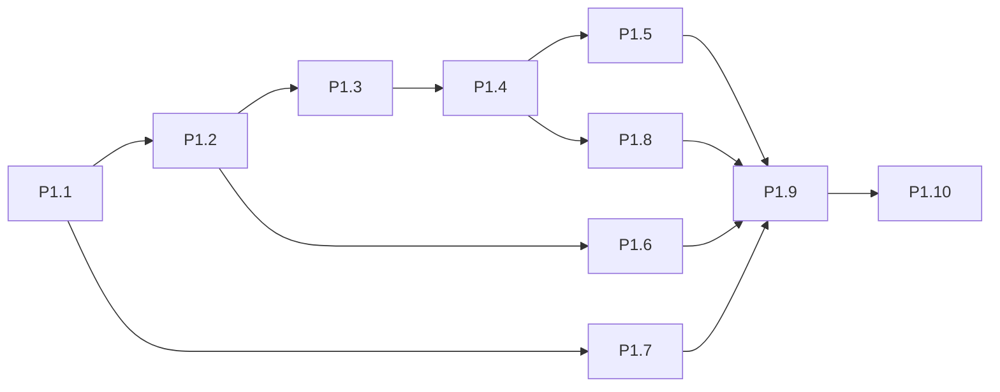
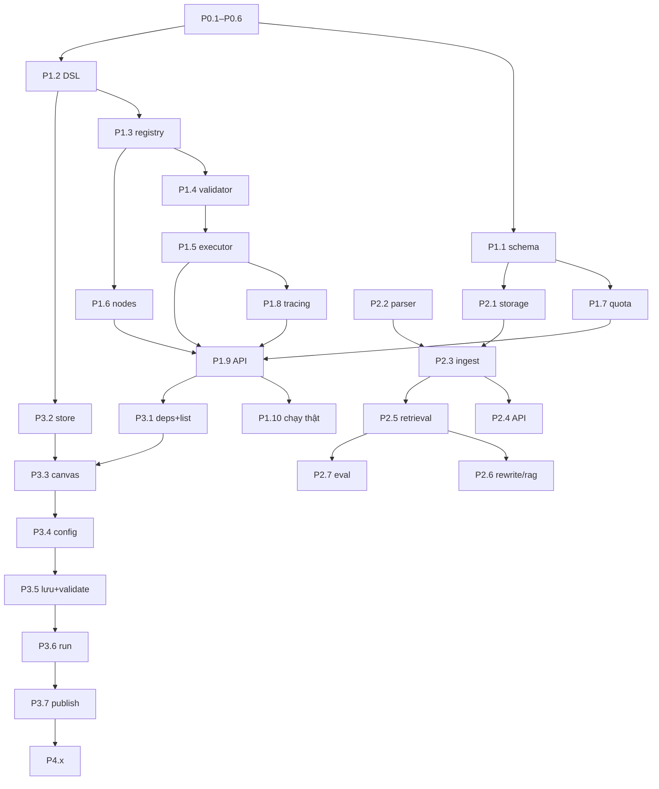

# Workflow Builder — Kế hoạch thực thi (giai đoạn 0 → 4)

> Kế hoạch triển khai cho [`workflow-builder-design.md`](./workflow-builder-design.md). Thiết kế là nguồn sự thật; file này chỉ chia việc.
> Cập nhật: 2026-10-14.

## Quy ước

- **Mỗi task = 1 PR**, ≤ ~1 ngày công. Mã task `P<giai đoạn>.<số>`.
- Mỗi PR: `yarn test` + `yarn lint` + `yarn tsc --noEmit` xanh; chạy GitNexus `impact` trước khi sửa symbol có sẵn, `detect_changes` trước khi commit (CLAUDE.md).
- **Không sửa** `lib/ai/*`, `lib/r2-client.ts`, `/api/chat`, 11 bảng Prisma cũ. Env server-only (không `NEXT_PUBLIC_`). UI chỉ Tailwind + shadcn/@base-ui. Node AI chỉ `gemini-2.5-flash-lite`. State cần chính xác nằm trong DB.
- "Phụ thuộc" = task phải merge trước. Task không phụ thuộc nhau có thể làm song song.

## Hiện trạng (đã xong)

| Hạng mục | Bằng chứng |
|---|---|
| Auth.js v5 + Google, session JWT | `auth.ts` |
| Allowlist `AUTH_OWNER_EMAILS`, fail-closed | `lib/auth/owner-access.ts` |
| `proxy.ts` chặn `/workflows/*`, `/api/workflows/*` | `proxy.ts` |
| Guard route ghi (`requireWriteAccess`, session hoặc `x-admin-key` fail-closed) | `lib/auth/write-access.ts`, 27 route dùng — commit `6d9b849` |
| Đăng nhập Google trên localhost:3334 → vào `/workflows` | Kiểm tra tay 2026-10-14 |

---

## Giai đoạn 0 — Hoàn tất tiền đề (1–2 ngày)

| Task | Nội dung | File | Phụ thuộc | Kiểm chứng |
|---|---|---|---|---|
| ~~**P0.1**~~ ✅ | Test allowlist + admin key: đã có sẵn. | `tests/unit/owner-access.test.ts` (4 test), `tests/route/write-access.test.ts` (12 test) | — | `npx vitest run tests/unit/owner-access.test.ts tests/route/write-access.test.ts` → 16 pass |
| ~~**P0.2**~~ ✅ | Route ghi không dùng `requireWriteAccess` đều **công khai có chủ ý + rate limit theo IP**: `chat` (20/5 phút), `chat/feedback` (60/5 phút), `favorites` (30). Comment quyết định trong code, có test 429. | `app/api/chat/feedback/route.ts`, `tests/route/write-access.test.ts` | — | `yarn test` → 298 pass |
| ~~**P0.3**~~ ✅ | Test tự quét `app/api/**/route.ts`, gọi mọi handler `POST/PUT/PATCH/DELETE` (trừ 3 route công khai) không session/key, kỳ vọng 401. Prisma/Notion/R2/image-upload/`fetch` bị mock ném lỗi → route thiếu guard làm test fail, không ghi thật. *(Đổi từ script gọi dev server sang test để chạy trong CI và tránh ghi DB dev.)* | `tests/route/write-routes-guard.test.ts` | P0.2 | `yarn test` → 37 handler trả 401; thử bỏ guard `POST /api/notes` → test fail |
| **P0.4** | Kiểm tra tay luồng từ chối: email ngoài allowlist → `AccessDenied`; `AUTH_OWNER_EMAILS=` trống → mọi email bị từ chối. Ghi kết quả. | `docs/workflow-builder-plan.md` (mục Nhật ký) | — | Ảnh chụp/ghi chú |
| **P0.5** | Vercel: thêm 4 biến `AUTH_*` (Preview + Production), redirect URI domain chính, chọn apex hoặc `www` và redirect cái còn lại; xác minh Fluid compute + gói Hobby/Pro. | Dashboard Vercel, Google Console | — | Đăng nhập được trên Preview URL; ghi gói + trạng thái Fluid vào Nhật ký |
| **P0.6** | Kiểm tra giới hạn trace/observation của gói Langfuse đang dùng. | Nhật ký | — | Ghi con số |

**Xong khi:** đăng nhập bằng email trong allowlist vào được `/workflows`, email khác bị từ chối, allowlist trống → từ chối tất cả; mọi route ghi trả 401 khi không có session/key; toàn bộ test pass (mốc 2026-10-14: 296 pass, 8 skip).

**Rủi ro:**
- Rate limit (`lib/rate-limit.ts`) là `Map` in-memory theo instance → trên Vercel nhiều instance, hạn mức thực tế cao hơn. Chấp nhận cho portfolio; chuyển sang store dùng chung (DB/KV) ở giai đoạn 4 nếu bị lạm dụng.
- Auth.js beta lỗi trên Vercel → dự phòng `next-auth` v4 + `getToken()` trong proxy (chỉ đổi `auth.ts`, `proxy.ts`, `write-access.ts`).

---

## Giai đoạn 1 — Engine headless (1–2 tuần)

| Task | Nội dung | File | Phụ thuộc | Kiểm chứng |
|---|---|---|---|---|
| **P1.1** ✅ (chờ Turso) | 8 bảng: `WorkflowProject`, `ProjectDocument`, `ProjectChunk`, `Workflow`, `WorkflowVersion`, `WorkflowRun`, `NodeExecution`, `WorkflowQuotaUsage` (trạng thái = `String`, graph/ui = JSON text vì Prisma 5 + SQLite không có enum/Json). Local: `prisma db push`. Turso: 21 lệnh `CREATE … IF NOT EXISTS` nối vào `init-turso.sql`. `isCurrentClient` nhận delegate `workflow`. **Còn lại:** chạy `yarn db:turso:init` trên Turso. | `prisma/schema.prisma`, `prisma/init-turso.sql`, `lib/prisma.ts` | — | Diff schema chỉ có dòng thêm; `init-turso.sql` chạy 2 lần trên SQLite trống + `migrate diff` với schema → rỗng; smoke test cascade trên `dev.db` → 0 bản ghi sót |
| ~~**P1.2**~~ ✅ | DSL types: union phân biệt theo `type` (thu hẹp `config`), hằng `NODE_TYPES`, `AI_NODE_TYPES`, `CONDITION_OPERATORS`, `MERGE_MODES`, `ELSE_BRANCH`. `canonicalizeGraph()` sắp key + sắp node/edge theo id (giữ thứ tự mảng trong config, vd nhánh `condition`); `graphHash()` = sha256. | `lib/workflow/dsl-types.ts`, `lib/workflow/graph-hash.ts`, `tests/unit/workflow-graph-hash.test.ts` | — | 5 test: đổi `ui` không đổi hash; đổi thứ tự key/node/edge không đổi hash; `undefined` = vắng; đổi prompt/edge/thứ tự nhánh → đổi hash |
| **P1.3** | Node registry + `resolveNodePorts(node)` (port, kiểu, `required`, `allowMultiple`); `condition`/`merge` sinh port từ config. | `lib/workflow/node-registry.ts` | P1.2 | Test port cho cả 7 loại |
| **P1.4** | Validator 9 quy tắc (mục 3.2 thiết kế), trả lỗi có `code` + `nodeId`/`edgeId`; Kahn trả danh sách node trong chu trình. | `lib/workflow/dsl-validator.ts` | P1.3 | ≥1 test hợp lệ + ≥1 test vi phạm cho **mỗi** quy tắc |
| **P1.5** | Executor thuần `executeWorkflow(graph, inputs, deps)`: trạng thái edge `PENDING/ACTIVE/SKIPPED`, lan truyền `SKIPPED`, `merge` 3 chế độ, lỗi → node `FAILED` + phần còn lại `CANCELLED`, timeout theo node. Không import `next/server`. | `lib/workflow/dag-executor.ts` | P1.4 | Test với provider giả: rẽ nhánh, merge khi 1 nhánh skip, 100% skip, node lỗi dừng run |
| **P1.6** | Node `input`, `condition` (`contains`/`equals`/`length_gt`), `merge`, `llm` (template `{{inputs.<port>}}`, `flash-lite`), `output`. | `lib/workflow/nodes/*.ts` | P1.3 | Test từng node; template tham chiếu port không có → lỗi |
| **P1.7** | Bộ đếm quota trong DB (theo ngày + model), kiểm tra **trước** khi gọi LLM, tăng bằng transaction. | `lib/workflow/quota.ts` | P1.1 | Test: vượt hạn mức → lỗi `QUOTA_EXCEEDED`, không gọi provider |
| **P1.8** | Trace Langfuse: 1 run = 1 trace, mỗi node 1 observation (generation/span), metadata + tags theo mục 3.5; hằng số tên dùng chung. | `lib/workflow/tracing.ts`, `lib/workflow/constants.ts` | P1.5 | Test với Langfuse mock: cây span đúng thứ tự, có trạng thái SKIPPED |
| **P1.9** | Repository + API: CRUD `Workflow`, `POST /api/workflows/[id]/runs` (validate server → tạo `WorkflowRun` → execute → ghi `NodeExecution`; `maxDuration=120`; `after(flushLangfuse)`), chế độ `dryRun` dùng `setLlmProvider()` giả. | `lib/workflow/repository.ts`, `app/api/workflows/**/route.ts` | P1.5, P1.6, P1.7, P1.8 | Test route; `curl` không session → 401 (proxy) |
| **P1.10** | Chạy thật 1 workflow `input → condition → 2 nhánh → merge → llm → output` bằng script, kiểm tra trace trên Langfuse. | `scripts/run-sample-workflow.ts`, `lib/workflow/fixtures/` | P1.9 | Trace hiện trên Langfuse; `WorkflowRun` có đủ `NodeExecution` |

**Song song:** P1.1 ∥ P1.2; P1.6 ∥ P1.4; P1.7 ∥ chuỗi P1.3→P1.5.

**Xong khi:** test dùng provider giả kiểm chứng đủ 9 quy tắc validate, `SKIPPED` lan truyền, `merge` khi một nhánh bị bỏ qua, dừng run khi node lỗi, cây span đúng; chạy thật 1 workflow và thấy trace trên Langfuse.

**Rủi ro:**
- Quota free tier (~20 req/ngày/model) cạnh tranh với chatbot → chỉ `flash-lite`, dry-run mặc định trong test/dev.
- Chạy quá 120s → timeout theo node; nếu thường xuyên vượt, đẩy job queue lên giai đoạn 4.
- Migration Turso lệch local → luôn cập nhật `init-turso.sql` cùng PR với `schema.prisma`.

---

## Giai đoạn 2 — Knowledge Base (1–2 tuần)

| Task | Nội dung | File | Phụ thuộc | Kiểm chứng |
|---|---|---|---|---|
| **P2.1** | Storage KB: prefix `workflow-kb/{projectId}/{documentId}`, dùng lại `r2Client`/`isR2Configured`; dev không R2 → ghi thư mục local riêng (`mkdir -p`). | `lib/workflow/kb-storage.ts` | P1.1 | Test với R2 mock; xác nhận `findUnusedStorageFiles` không quét `workflow-kb/` |
| **P2.2** | `DocumentParser` interface + parser `.md`, `.txt`; chunk theo heading, giữ `heading`. | `lib/workflow/kb/parser.ts`, `lib/workflow/kb/chunker.ts` | — | Test chunk cho file mẫu |
| **P2.3** | Ingest: upload → lưu storage → chunk → `contentHash` → embed chunk mới (768d `Float32Array` → `Bytes`). | `lib/workflow/kb/ingest.ts` | P2.1, P2.2 | Test: upload lại tài liệu không đổi → **0** lần `embed()` |
| **P2.4** | API upload/list/delete tài liệu theo project; giới hạn kích thước + định dạng. | `app/api/workflows/projects/[projectId]/documents/**` | P2.3 | Test route; file `.pdf` → 400 |
| **P2.5** | Retrieval mới: dùng lại `normalizeText`, `cosineSimilarity`; keyword + vector, `topK`, ngưỡng, trọng số, stop-words theo config; **luôn lọc `projectId`**. | `lib/workflow/kb/retrieval.ts` | P2.3 | Test: project A không bao giờ trả chunk project B |
| **P2.6** | Node `rewrite` (LLM viết lại câu hỏi) + `rag` (retrieval → `documents`); span Langfuse có điểm từng chunk. | `lib/workflow/nodes/rewrite.ts`, `lib/workflow/nodes/rag.ts` | P2.5, P1.6 | Test với provider/embedding giả |
| **P2.7** | Eval theo project: tập câu hỏi mẫu + chunk kỳ vọng, đo Hit@4. | `lib/workflow/kb/eval.ts`, `lib/workflow/fixtures/kb-eval/*.json`, `scripts/eval-kb.ts` | P2.5 | Hit@4 ≥ 0.8 |

**Song song:** P2.1 ∥ P2.2; P2.4 ∥ P2.5.

**Xong khi:** project A không bao giờ trả chunk của project B; upload lại tài liệu không đổi → 0 lần `embed()`; job dọn file không đụng `workflow-kb/`; eval trên tập câu hỏi mẫu đạt Hit@4 ≥ 0.8.

**Rủi ro:** tính cosine trong RAM chậm khi nhiều chunk → khi >~2.000 chunk/project, spike vector native **trên Turso thật** (local không có hàm vector).

---

## Giai đoạn 3 — Canvas (2–3 tuần)

| Task | Nội dung | File | Phụ thuộc | Kiểm chứng |
|---|---|---|---|---|
| **P3.1** | Cài `@xyflow/react`, `zustand`; trang danh sách workflow + tạo mới. | `package.json`, `app/(workflow-builder)/workflows/page.tsx` | P1.9 | Tạo workflow từ UI, thấy trong danh sách |
| **P3.2** | Store Zustand: `graph` + `ui` tách riêng; chuyển đổi DSL ↔ node/edge của React Flow. | `lib/workflow/canvas-store.ts`, `lib/workflow/canvas-mapping.ts` | P1.2 | Test: round-trip DSL → canvas → DSL giữ nguyên `graphHash`; kéo node chỉ đổi `ui` |
| **P3.3** | Canvas import động (`ssr: false`), custom node 7 loại, handle theo `resolveNodePorts`, palette kéo thả. | `components/workflow-canvas/Canvas.tsx`, `components/workflow-canvas/nodes/*.tsx`, `components/workflow-canvas/Palette.tsx` | P3.2, P1.3 | Kéo thả đủ 7 loại; nối edge sai kiểu bị chặn |
| **P3.4** | Panel cấu hình node (form theo loại; nhánh `condition`, chế độ `merge`, template `llm`, chọn tài liệu `rag`). | `components/workflow-canvas/NodeConfigPanel.tsx` | P3.3 | Sửa config → port `condition`/`merge` cập nhật trên canvas |
| **P3.5** | Lưu nháp (debounce) `draftGraph`/`draftUi`; validate realtime gọi validator, hiện lỗi trên node/edge. | `components/workflow-canvas/*`, `app/api/workflows/[id]/route.ts` | P3.4, P1.4 | Tạo chu trình → node trong chu trình bị đánh dấu |
| **P3.6** | Run draft: nhập input, gọi API run, hiện trạng thái từng node từ DB (`ACTIVE`/`SKIPPED`/`FAILED`), xem output. | `components/workflow-canvas/RunPanel.tsx` | P3.5 | Nhánh `SKIPPED` hiện khác màu |
| **P3.7** | Publish: tạo `WorkflowVersion` bất biến; danh sách version; chạy theo version. | `app/api/workflows/[id]/versions/route.ts`, `components/workflow-canvas/VersionList.tsx` | P3.6 | Sửa nháp sau publish không đổi version cũ |
| **P3.8** | Có `loading.tsx` + `error.tsx` cho route `/workflows/**`; kiểm tra màn hình hẹp. | `app/(workflow-builder)/workflows/**` | P3.3 | Ngắt mạng → error boundary hiện ra |

**Song song:** P3.1 ∥ P3.2; P3.8 ∥ P3.4–P3.7.

**Xong khi:** kéo thả không đổi `graphHash`; dựng và chạy được `input → condition → 2 nhánh → merge → llm → output` từ UI, thấy rõ nhánh `SKIPPED`.

**Rủi ro:** `@xyflow/react` với React/Next mới → spike ở P3.1 trước; luôn import động để tránh lỗi SSR.

---

## Giai đoạn 4 — Gia cố (theo nhu cầu)

| Task | Nội dung | File | Phụ thuộc | Kiểm chứng |
|---|---|---|---|---|
| **P4.1** | Tách Gemini key: factory `createGeminiProvider(apiKey)` tương thích ngược (`geminiProvider` giữ nguyên), Google project riêng + billing + hạn mức. *(Ngoại lệ có chủ đích với quy tắc không sửa `lib/ai/*` — chỉ thêm export.)* | `lib/ai/gemini.ts` (chỉ thêm) | P1.9 | Chatbot `/portfolio` không đổi hành vi; builder dùng key riêng |
| **P4.2** | Huỷ thật: `signal?` trong `LlmProvider`, nút Cancel run. | `lib/ai/*` (thêm tham số tuỳ chọn), executor | P3.6 | Cancel → request đang chạy bị huỷ, node `CANCELLED` |
| **P4.3** | Sentry cho route `/api/workflows/*`. | config Sentry | — | Lỗi thử xuất hiện trên Sentry |
| **P4.4** | Job queue nếu run thường xuyên >120s. | [cần đánh giá] | số liệu từ P1/P3 | — |

---

## Thứ tự PR tổng

Canvas (P3.1–P3.5) có thể bắt đầu ngay sau P1.9, song song với giai đoạn 2; node `rag` chỉ cần ở P3.4 khi P2.6 đã xong.

## Nhật ký kiểm chứng

| Ngày | Task | Kết quả |
|---|---|---|
| 2026-10-14 | — | Đăng nhập Google local OK, vào `/workflows` |
| 2026-10-14 | P1.2 | DSL types + graphHash, 5 test; suite 341 pass / 8 skip |
| 2026-10-14 | P1.1 | Schema + SQL Turso kiểm chứng trên SQLite trống; `dev.db` đã push (backup trước); cascade OK. ⚠️ `.env` chứa `TURSO_*` → script dùng `lib/prisma` chạy local sẽ trỏ Turso. Chưa áp lên Turso |
| 2026-10-14 | P0.3 | 37 handler ghi trả 401 khi ẩn danh; mutation test xác nhận bắt được route thiếu guard; suite 336 pass / 8 skip |
| 2026-10-14 | P0.2 | Danh sách route công khai: `chat`, `chat/feedback`, `favorites`; thêm 2 test 429 → 298 pass / 8 skip |
| 2026-10-14 | P0.1 | Test đã có sẵn, 16 pass; toàn bộ suite 296 pass / 8 skip (không phải 66 như thiết kế ghi) |
