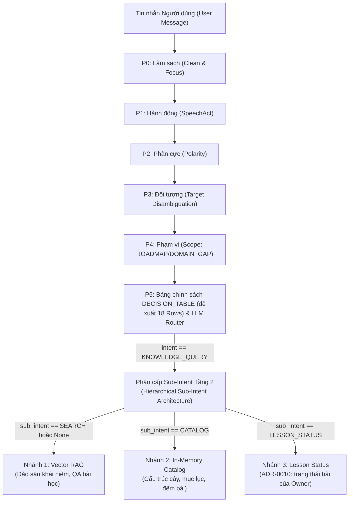
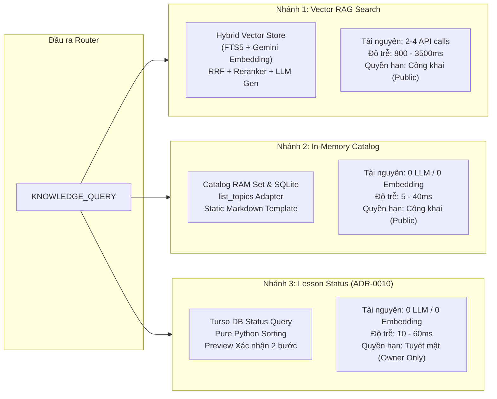
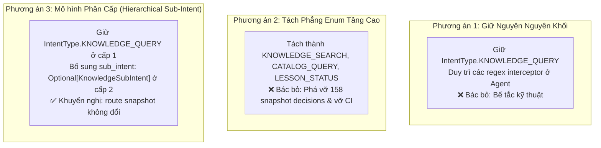
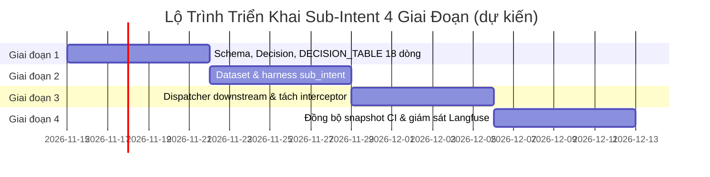

# Tài Liệu Thiết Kế Kiến Trúc: Đánh Giá & Phân Chia Sub-Intent Cho `IntentType.KNOWLEDGE_QUERY` Trong Trợ Lý Abot

- **Tác giả:** worker_design_doc & worker_update_design_doc (Teamwork Architecture Group)
- **Ngày cập nhật:** 2026-11-11 (rev 2: sửa theo review đối chiếu code, xem mục 6)
- **Trạng thái:** Phase 1–3 đã hiện thực (2026-11-11, chưa commit); Phase 4 xong phần CI, còn chạy lại kịch bản thủ công và đo Langfuse. Chi tiết và điểm lệch so với bản thiết kế: mục 6.3
- **Phạm vi tác động:** Trợ lý Abot (`roadmap-rag-assistant/`), Router Phân loại Ý định (`rag_service/domains/roadmap/router/`), Bộ kiểm thử hợp đồng CI (`evals/router/`), và Luồng thực thi Downstream (`rag_service/domains/roadmap/agent.py`).
- **Tài liệu tham chiếu:**
  - `roadmap-rag-assistant/docs/routing-phases.md`
  - `docs/adr/0010-lesson-status-known-learning-target.md`
  - `docs/adr/0009-flatten-topics-to-sections.md`
  - `docs/code-intel/CRIS_WORKSPACE_MAP.md`
  - Báo cáo Khảo sát Router: `.agents/teamwork/explorer_survey_router/report.md`
  - Báo cáo Khảo sát Downstream: `.agents/teamwork/explorer_survey_downstream/report.md`
  - Báo cáo Khảo sát Eval CI: `.agents/teamwork/explorer_survey_eval/report.md`
  - Báo cáo Phân tích Policy & Precedence: `.agents/teamwork/explorer_retry_policy/report.md`
  - Báo cáo Phân tích Regex & CUD Verbs: `.agents/teamwork/explorer_retry_regex_cud/report.md`
  - Báo cáo Phân tích False Friends & Safe Accessors: `.agents/teamwork/explorer_retry_false_friends/report.md`

---

## 1. Tóm Tắt Điều Hành & Bối Cảnh Bài Toán (Executive Summary & Problem Statement)

### 1.1 Bối Cảnh Hệ Thống & Vị Trí Router Phân Loại Ý Định
Trợ lý học tập Abot (`roadmap-rag-assistant`) vận hành trên một đường ống định tuyến tất định đa pha (deterministic 10-phase pipeline, ký hiệu từ $P_0$ đến $P_9$) kết hợp với mô hình ngôn ngữ lớn (LLM fallback) khi không có quy tắc nào khớp:
- $P_0$ (Clean): Lọc bỏ từ đệm, lời chào, tách mệnh đề chính và trích xuất `focus`.
- $P_1$ (Act): Nhận diện hành động hội thoại (`SpeechAct`: `question`, `command`, `plan`, `request`, `statement`...).
- $P_2$ (Polarity): Đánh giá phân cực (`affirm`, `decline`, `hypothetical`, `report`).
- $P_3$ (Target): Định danh thực thể roadmap (`Target`: `roadmap`, `assistant`, `off_topic`, `none`).
- $P_4$ (Scope): Kiểm tra phạm vi kiến thức (`Scope`: `ROADMAP`, `DOMAIN_GAP`, `EXTERNAL`, `NONE`).
- $P_5$ (Table / LLM Router): Ánh xạ qua bảng chính sách `DECISION_TABLE` (hiện 15 dòng, đề xuất 18 dòng ở mục 3.3) hoặc chuyển tiếp sang LLM Router.
- $P_6$ (System 2): Kiểm chứng độc lập cho các ứng viên thay đổi dữ liệu (`ROADMAP_CUD`).
- $P_7$ (Grounding): Xác thực sự tồn tại của đối tượng trong catalog cây lộ trình.
- $P_8$ (Gate): Cổng kiểm soát ghi (`WriteGate`: `run`, `preview`, `reroute`, `blocked`).
- $P_9$ (Reply): Sinh phản hồi streaming hoặc áp dụng câu trả lời mẫu tất định.

Trong kiến trúc này, toàn bộ các truy vấn liên quan đến tri thức lộ trình hiện đang được dồn chung về một intent duy nhất: `IntentType.KNOWLEDGE_QUERY` (định nghĩa tại `rag_service/domains/roadmap/router/schemas.py:16`).



### 1.2 Vấn Đề Kiến Trúc Cốt Lõi: Nút Thắt Cổ Chai Của Intent Đơn Nhất
Qua khảo sát thực nghiệm đối kháng trên toàn bộ 158 quyết định `knowledge_query` tại `evals/router/decisions.jsonl` và luồng thực thi tại `rag_service/domains/roadmap/agent.py`, thiết kế `IntentType.KNOWLEDGE_QUERY` đơn nhất bộc lộ 4 xung đột kiến trúc nghiêm trọng:

1. **Sự dồn nén 3 khối lượng công việc downstream dị biệt (Coalesced Heterogeneous Workloads):**
   - **Vector RAG Search:** Tìm kiếm ngữ nghĩa sâu qua FTS5 + Dense Embeddings (`models/gemini-embedding-001`), RRF, Reranker và sinh câu trả lời bằng LLM (độ trễ 800ms – 3,500ms, tiêu tốn token API).
   - **In-Memory Catalog Lookup:** Tra cứu cây mục lục, danh sách topic/section, đếm bài học từ đối tượng `Catalog` trên RAM và SQLite metadata (độ trễ 5ms – 40ms, 0 token LLM, 0 embedding).
   - **Lesson Status (ADR-0010):** Truy vấn trạng thái cá nhân `known`, `learning`, `target` và thời điểm cập nhật `statusUpdatedAt` của Owner (độ trễ 10ms – 60ms, dữ liệu riêng tư, fail-closed access control).
2. **Cái bẫy "Catch-All" và Nguy cơ Bịa đặt Thông tin (Hallucination Trap):**
   Kho chỉ mục vector của RAG cố tình không chứa dữ liệu trạng thái học tập của người dùng vì lý do bảo mật. Khi câu hỏi về tiến độ cá nhân không khớp được regex cứng, nó rơi vào `KNOWLEDGE_QUERY`, kích hoạt Vector RAG. Do không có dữ liệu trạng thái trong ngữ cảnh, mô hình ngôn ngữ lớn (LLM) sẽ suy diễn sai lệch hoặc bịa đặt tiến độ của người dùng.
3. **Bẫy Nghịch Đảo Thứ Tự Ưu Tiên `search_word` vs Catalog Listing:**
   Do các từ `"danh sách"`, `"liệt kê"`, `"list"`, `"show me"` nằm trong `SEARCH_WORDS` và dòng `Row("search_word")` nằm ở vị trí trước các luật danh mục, các truy vấn danh mục cấu trúc điển hình trong tập snapshot (như *"cho xem danh sach cac topic trong phan frontend"*, *"danh sách bài trong layer Docker"*, *"liệt kê tất cả các bài học thuộc topic 1 cho mình xem"*, *"Show me all lessons under the DevOps mục"*) bị nuốt trọn vào `row=search_word`. Nếu gán thô `search_word -> sub_intent=SEARCH`, toàn bộ truy vấn danh mục này sẽ bị ép gọi Vector RAG (độ trễ 800ms – 3,500ms, tiêu tốn token LLM) thay vì In-Memory Catalog (5ms – 40ms, 0 token).
4. **Bẫy Lumping 86.5% Của `roadmap_question`:**
   Trong 52 quyết định snapshot gán nhãn `row=roadmap_question`, có tới **45 quyết định (86.5%)** là câu hỏi về hành động CUD giả định (*"nếu xóa topic AI thì có mất bài không"*), câu hỏi kiểm toán quá khứ (*"ai đã xóa bài Redis k"*), câu lệnh phủ định (*"đừng xóa bài Machine Learning k"*), hoặc câu hỏi nội dung bài (*"bài đó nói gì"*). Chỉ có **7 quyết định (13.5%)** thực sự là câu hỏi về vị trí cấu trúc hoặc đếm số lượng bài. Nếu gán mặc định `roadmap_question -> sub_intent=CATALOG`, 86.5% truy vấn này sẽ bị gán nhầm sang `CATALOG`, làm tê liệt downstream do In-Memory Catalog hoàn toàn không có LLM hay Vector RAG để xử lý câu hỏi ngữ nghĩa.

### 1.3 Mục Tiêu Thiết Kế
Tài liệu này xác lập phương án kiến trúc nhằm:
- Phân định rõ ràng 3 nhánh nghiệp vụ tri thức, đảm bảo mỗi nhánh được xử lý bằng cơ chế downstream tối ưu nhất về tài nguyên và độ trễ.
- Giảm nguy cơ hallucination về Lesson Status (ADR-0010) cho các câu hỏi đi qua bảng quyết định. Các đường còn lại (scope, vocabulary, LLM, reroute) không gán sub-intent và vẫn fallback về SEARCH: đây là giới hạn đã biết (mục 6.2), không phải "loại bỏ hoàn toàn".
- Giải quyết bẫy lumping 86.5% và nghịch đảo thứ tự ưu tiên trong bảng chính sách.
- Đưa các interceptor **chỉ đọc** (liệt kê topic, liệt kê section, truy vấn Lesson Status a/b/c) vào sau router. Các interceptor có ghi (xác nhận preview đang chờ, đổi tên section, đổi Lesson Status (d)) **giữ nguyên trước router**.
- Thiết lập giao thức truy cập an toàn downstream chống lỗi `AttributeError: 'NoneType' object has no attribute 'value'`.
- Giữ trường `"route"` của 158 quyết định đã commit; chỉ `"rules"` (tên row) và trường mới `"sub_intent"` trong snapshot đổi, được duyệt qua `router-check --accept`.

### 1.4 Tóm Tắt Quyết Định Kiến Trúc Được Đề Xuất
Áp dụng **Phương Án Phân Cấp (Hierarchical Sub-Intent Architecture)**:
1. **Bảo toàn Intent Cấp 1:** Giữ nguyên `IntentType.KNOWLEDGE_QUERY = "knowledge_query"` ở tầng Intent cấp 1.
2. **Mở rộng Schema Pydantic Với Safe Accessor & Validator:**
   Bổ sung trường `sub_intent: Optional[KnowledgeSubIntent]` vào `IntentClassificationResult` với 3 giá trị:
   - `SEARCH` (`"search"`): Tra cứu bài học và khái niệm qua Vector RAG.
   - `CATALOG` (`"catalog"`): Tra cứu cấu trúc lộ trình và mục lục qua In-Memory Catalog.
   - `LESSON_STATUS` (`"lesson_status"`): Truy vấn Lesson Status của Owner theo ADR-0010. Tên theo `GLOSSARY.md` (**Lesson Status**; `progress` nằm trong _Avoid_).
   Kèm theo thuộc tính an toàn `@property sub_intent_value` và `@model_validator(mode="after")` ngăn chặn trạng thái không nhất quán. `sub_intent` chỉ do bảng quyết định gán; giá trị LLM router trả về bị bỏ qua (mục 3.2).
   Đồng thời thêm `sub_intent` vào `Decision` (`intent_router.py`), truyền qua `to_result()`, nhánh `clause:` của `decide()`, và `snapshot()`.
3. **Phân Tách `roadmap_question`:**
   Tách `roadmap_question` thành 2 dòng luật riêng biệt trong bảng chính sách:
   - `Row("roadmap_catalog_query")` (nhận diện vị trí, số lượng, cấu trúc qua `needs="catalog_cue"`) $\rightarrow$ gán `sub_intent=KnowledgeSubIntent.CATALOG`.
   - `Row("roadmap_content_query")` (thu gom các câu hỏi nội dung, câu hỏi CUD giả định, kiểm toán quá khứ) $\rightarrow$ gán `sub_intent=KnowledgeSubIntent.SEARCH`.
4. **Tái Cấu Trúc Bảng Quyết Định 18 Dòng (`DECISION_TABLE`):**
   Thiết lập thứ tự ưu tiên theo nguyên lý: *Domain-Specific Structured Sub-Intents (Lesson Status & Catalog) MUST Precede Generic Keyword Fallbacks (Search Word)*.
   Đưa `lesson_status_query` lên vị trí 5 (trước `about_assistant`, vì "gợi ý bài tiếp theo..." hiện khớp `about_assistant`), và `catalog_list_query`, `roadmap_catalog_query` lên vị trí 10–11, đứng **trước** dòng `search_word` (vị trí 12). Mỗi `needs` mới phải có nhánh tương ứng trong `IntentRouter._matches`.
5. **Giữ Nguyên Luồng Đổi Lesson Status (ADR-0010, kịch bản d):**
   Lệnh đổi trạng thái tiếp tục đi luồng riêng hiện có: `parse_status_change_request` → preview → `session_ctx.pending_status_change` → xác nhận "ok" tại `commands.py:153` → `adapter.update_item`. Luồng này đã đáp ứng yêu cầu "Preview rồi chờ xác nhận" của ADR-0010 và chạy **trước router**. Không chuyển (d) sang `IntentType.ROADMAP_CUD`: `StructuredRoadmapAction` không có field status, và row `change_command` có `write="allow"` (không preview). `KNOWLEDGE_QUERY` là thuần đọc.

---

## 2. Phân Tích Hiện Trạng & Sự Khác Biệt Trong Luồng Thực Thi Downstream (R1)

### 2.1 Hiện Trạng Của `IntentType.KNOWLEDGE_QUERY` Trong Router

#### Định nghĩa Hợp đồng Schema Hiện tại
Trong `rag_service/domains/roadmap/router/schemas.py`:
```python
class IntentType(str, Enum):
    ROADMAP_CUD = "roadmap_cud"
    KNOWLEDGE_QUERY = "knowledge_query"
    PLAN_GOAL = "plan_goal"
    CHITCHAT = "chitchat"
    OUT_OF_SCOPE = "out_of_scope"
    UNCLEAR = "unclear"

class IntentClassificationResult(BaseModel):
    intent: IntentType = Field(..., description="Primary intent of the user message.")
    confidence: float = Field(..., description="Confidence score between 0.0 and 1.0.")
    needs_cud_extraction: bool = Field(False, description="True if requires extracting StructuredRoadmapAction.")
    needs_confirmation: bool = Field(False, description="True if the change must be confirmed before running.")
```

#### Các Cơ Chế Định Tuyến Ra `KNOWLEDGE_QUERY`
Trong đường ống $P_0 - P_9$, một tin nhắn có thể được phân loại thành `KNOWLEDGE_QUERY` qua 5 con đường khác nhau:
1. **Bảng Chính Sách Heuristic ($P_5$ `DECISION_TABLE` trong `policy.py`):**
   - Dòng `search_word` (độ tin cậy 0.90): `act=QUESTION`, chứa từ khóa tra cứu (`"tìm"`, `"là gì"`, `"thế nào"`, `"how to"`).
   - Dòng `roadmap_question` (độ tin cậy 0.90): `act=QUESTION`, đối tượng `target=Target.ROADMAP`.
   - Dòng `known_title_question` (độ tin cậy 0.90): `act=QUESTION`, chứa tiêu đề bài học có trong bộ từ vựng `_vocabulary`.
   - Dòng `how_to_question` (độ tin cậy 0.85): `act=QUESTION`, `target=Target.NONE`, chứa cấu trúc how-to kỹ thuật (`"cách tạo topic trong Kafka"`).
   - Dòng `show_request` (độ tin cậy 0.85): `target=Target.ROADMAP`, chứa yêu cầu hiển thị không có động từ thay đổi (`"cho mình xem cấu trúc..."`).
2. **Định Tuyến Theo Phạm Vi ($P_4$ Scope Router trong `route_decision.py:140`):**
   Nếu tin nhắn là câu hỏi/câu trần thuật mở không có đối tượng cụ thể nhưng `scope.scope` thuộc `ROADMAP` hoặc `DOMAIN_GAP`, hệ thống gán `KNOWLEDGE_QUERY` với phương thức `method="scope"`, độ tin cậy 0.85.
3. **Định Tuyến Theo Từ Vựng Danh Mục (`intent_router.py:233`):**
   Nếu câu trần thuật chứa các từ ngữ trùng khớp với bài học trong catalog, router gán `KNOWLEDGE_QUERY` với `method="vocabulary"`, độ tin cậy 0.80.
4. **Phân Loại Dự Phòng Qua LLM Router (`intent_router.py:aroute`):**
   Khi các luật heuristic không thể quyết định, prompt router gửi sang LLM yêu cầu phân loại. Các tên công nghệ đứng một mình (ví dụ: `"Kafka"`, `"RAG"`) được quy định cứng trả về `KNOWLEDGE_QUERY`.
5. **Định Tuyến Lại Từ System 2 ($P_6$ Write Candidate Reroute trong `route_decision.py:182`):**
   Khi một tin nhắn ban đầu bị System 1 nghi ngờ là `ROADMAP_CUD` nhưng System 2 xác định không phải là lệnh thay đổi dữ liệu (ví dụ: câu hỏi giả định hoặc câu hỏi điều kiện), tin nhắn được định tuyến lại thành `KNOWLEDGE_QUERY` với phương thức `method="{s1_method}+reroute"`.

---

### 2.2 Ba Nhánh Nghiệp Vụ Downstream Dị Biệt



#### 2.2.1 Nhánh 1: Vector RAG Search (Semantic Retrieval & Synthesis)
- **Mục đích nghiệp vụ:** Giải thích khái niệm chuyên sâu, đào sâu nội dung bài học, trả lời kiến thức kỹ thuật dựa trên kho dữ liệu tài liệu đã được đánh chỉ mục.
- **Điểm vào thực thi downstream:** `agent.py:436` $\rightarrow$ `answer_from_sources(...)` tại `rag_service/core/orchestration/sources.py:68`.
- **Đường ống xử lý chi tiết:**
  1. *Biến đổi truy vấn (Query Transformation):* Nếu bật `rag_query_transform`, gọi LLM phân rã câu hỏi phức tạp hoặc giải quyết đại từ chỉ xuất.
  2. *Kiểm tra tính tươi mới (Index Freshness):* `ensure_fresh()` kiểm tra generation của DB, nếu cũ hơn 30s thì đồng bộ lại.
  3. *Truy vấn lai (Hybrid Retrieval tại `hybrid.py:402`):*
     - BM25 qua SQLite FTS5 trên bảng ảo `fts_docs`.
     - Dense Vector Search: Tính cosine similarity giữa query vector (từ Google Gemini Embedding `models/gemini-embedding-001`) và toàn bộ vector bài học trên RAM.
     - Lọc ngưỡng tương đồng `VECTOR_MIN_SIMILARITY = 0.665`.
     - Hợp nhất thứ hạng qua Reciprocal Rank Fusion (RRF): $\text{Score} = \sum \frac{1}{60 + \text{rank} + 1}$.
  4. *Reranking LLM:* Tùy chọn chấm điểm lại top ứng viên qua mô hình cross-encoder hoặc LLM nếu khoảng cách điểm top-1 và top-2 quá hẹp.
  5. *Sinh câu trả lời:* Định dạng ngữ cảnh Markdown qua `format_knowledge_context` và stream token qua LLM Generator (Gemini Flash / Groq Llama-3.3).
- **Tiêu thụ tài nguyên & Độ trễ:**
  - Mạng ngoại vi: 2 đến 4 cuộc gọi API bên ngoài (Embedding + LLM + Transform/Rerank).
  - CPU & RAM: Tính tích vô hướng $O(N \cdot d)$ trên CPU, bộ đệm `_QUERY_VECTORS` LRU cache trong RAM.
  - Chi phí Token: 500 – 2,500 tokens mỗi lượt hỏi đáp.
  - Độ trễ đáp ứng: **800ms – 3,500ms** (có thể vọt lên 5,000ms nếu gặp rate-limit hoặc re-sync index).
- **Quyền hạn & Ngữ cảnh:** Công khai (Public Access), phục vụ cả Visitor và Owner; yêu cầu lịch sử hội thoại gần.

#### 2.2.2 Nhánh 2: In-Memory Catalog Lookup (Roadmap Metadata & Hierarchy)
- **Mục đích nghiệp vụ:** Phục vụ các câu hỏi về cấu trúc, bao quát danh mục: "Lộ trình AI có những topic nào?", "Topic Backend có bao nhiêu bài?", "Bài Semantic Caching nằm ở section nào?".
- **Điểm vào thực thi downstream:** Điều phối qua `handle_listing` và `handle_sections`.
- **Giới hạn hiện tại:** hai handler này chỉ trả lời "liệt kê topic" và "liệt kê section". Đếm bài, hỏi vị trí bài và liệt kê bài trong một section chưa có handler. Sprint này các câu đó fallback về Vector RAG (Phase 3); Failure Mode 2 và 3 với các câu này chỉ được giải ở sprint sau.
- **Đường ống xử lý chi tiết:**
  1. Tra cứu danh sách topic qua `adapter.list_topics()` (lấy `id`, `slug`, `title`, `description`, `COUNT(items)` từ SQLite).
  2. Gom nhóm và đếm bài theo section qua hàm thuần túy `section_counts(topic)` (`sections.py:74`).
  3. Định danh thực thể qua đối tượng `Catalog` (`target_grounding.py:36`) duy trì tập hợp `topics` và `items` trong RAM, sử dụng so khớp chuỗi hoặc `difflib.get_close_matches(cutoff=0.85)`.
  4. Trả lời ngay lập tức bằng template Markdown tĩnh (`section_list_reply`, `list_topics` format), stream qua SSE bằng `_stream_text`.
- **Tiêu thụ tài nguyên & Độ trễ:**
  - Mạng ngoại vi: **0 cuộc gọi LLM! 0 cuộc gọi Embedding!** Hoàn toàn không tốn token quota.
  - CPU & RAM: Dưới 0.5ms CPU để đếm từ điển, dưới 100KB RAM.
  - Độ trễ đáp ứng: **5ms – 40ms** (nhanh hơn nhánh Vector RAG từ 50 đến 100 lần).
- **Quyền hạn & Ngữ cảnh:** Công khai (Public Access), cần `page_context` (`roadmapSlug`) để nhận diện ngữ cảnh trang hiện tại.

#### 2.2.3 Nhánh 3: Lesson Status Queries (ADR-0010)
- **Mục đích nghiệp vụ:** Biến Roadmap thành "Bộ não thứ hai" (Second Brain) cho Owner, theo dõi trạng thái `known` (đã nắm), `learning` (đang học), `target` (mục tiêu) và mốc thời gian cập nhật `statusUpdatedAt`.
- **Nền tảng nghiệp vụ theo ADR-0010:**
  - Trạng thái gắn ở cấp **Lesson (`RoadmapItem`)**, không gắn ở cấp Topic.
  - Mặc định là `known` đối với bài học cũ hoặc bài mới tạo.
  - Lưu thời điểm cập nhật trạng thái gần nhất để tính chu kỳ ôn tập.
  - **Ranh giới bảo mật tuyệt đối:** Chỉ Owner mới có quyền xem và sửa đổi trạng thái cá nhân. Visitor bị từ chối truy cập fail-closed (`OWNER_ONLY_MESSAGE`). Ở tầng adapter, dữ liệu status bị tước bỏ nếu không phải Owner.
- **Bốn phân luồng tác vụ (Sub-Journeys) tại `lesson_status.py`:**
  - *(a) Báo cáo tiến độ ("Tôi đang biết gì về X"):* Lọc danh sách bài đã nắm, đang học, mục tiêu qua `filter_known_lessons` và `filter_and_sort_next_lessons`, định dạng qua `format_what_i_know_reply`.
  - *(b) Gợi ý học tiếp ("Nên học gì tiếp"):* Ưu tiên hoàn thành các bài đang học (`learning`) trước, sau đó mới đề xuất các bài mục tiêu (`target`), định dạng qua `format_next_learning_reply`.
  - *(c) Nhắc bài cần ôn tập ("Bài nào cần ôn lại"):* Lọc bài `known`, sắp xếp tăng dần theo `statusUpdatedAt` (các bài có mốc thời gian null/rỗng được ưu tiên đưa lên đầu vì lâu nhất chưa ôn), định dạng qua `format_review_reply`.
  - *(d) Lệnh thay đổi trạng thái ("Đánh dấu bài X là đang học"):* Kiểm tra quyền Owner $\rightarrow$ tìm bài trong topic $\rightarrow$ sinh preview xác nhận và lưu vào `session_ctx.pending_status_change` $\rightarrow$ khi người dùng xác nhận "ok" (`commands.py:153`), commit ghi vào DB Turso và kích hoạt re-index RAG. **(d) không thuộc sub-intent nào và giữ nguyên vị trí trước router** (xem 1.4 mục 5).
- **Tiêu thụ tài nguyên & Độ trễ:**
  - Mạng ngoại vi: **0 cuộc gọi LLM! 0 cuộc gọi Embedding!** Cho các câu hỏi (a), (b), (c) và bước sinh preview (d).
  - I/O Cơ sở dữ liệu: 1 câu lệnh SELECT (`list_topics` + `RoadmapItem` hoặc `full-export`). Khi commit lệnh (d): 1 câu lệnh UPDATE DB.
  - Độ trễ đáp ứng: **10ms – 60ms** cho truy vấn; **80ms – 250ms** khi commit ghi DB.

---

### 2.3 Ma Trận So Sánh Toàn Diện Giữa 3 Nhánh Downstream

> Các con số độ trễ, token và CPU trong mục 2.2–2.4 là **ước lượng**, chưa đo trên trace Langfuse. Phase 4 đo thật (P95 theo `sub_intent`).

| Tiêu Chí So Sánh | Nhánh 1: Vector RAG Search | Nhánh 2: In-Memory Catalog Lookup | Nhánh 3: Lesson Status (ADR-0010) |
| :--- | :--- | :--- | :--- |
| **Bản chất nghiệp vụ** | Giải thích khái niệm, đào sâu kiến thức bài học, trả lời QA tài liệu. | Tra cứu mục lục, danh mục topic, đếm số bài học, cấu trúc cây. | Quản lý tiến trình học tập cá nhân của Owner (biết gì, học tiếp gì, ôn bài nào). |
| **Component phụ trách** | `answer_from_sources` (`sources.py`) & `HybridRagEngine` (`engine.py`). | `handle_listing` (`commands.py`), `handle_sections` (`sections.py`). | `handle_lesson_status` (`lesson_status.py`), `commands.py`. |
| **Phụ thuộc Mô hình (AI/LLM)** | **Rất cao**: Gemini Embedding API + LLM Generator + Query Transform / Rerank LLM. | **Không (0 LLM)**: Sử dụng thuần túy thuật toán logic và chuỗi định dạng. | **Không (0 LLM)**: Sử dụng thuật toán sắp xếp và chuỗi định dạng Python. |
| **Tiêu tốn Token / Quota** | **Cao**: 500 – 2,500 tokens/lượt. Tiềm ẩn nguy cơ chạm giới hạn rate-limit API. | **Bằng 0 (0 token)**. Hoàn toàn không tốn chi phí vận hành mô hình. | **Bằng 0 (0 token)**. Hoàn toàn không tốn chi phí vận hành mô hình. |
| **Tài nguyên tính toán (Compute)**| Nặng: Tính Cosine similarity $O(N \cdot d)$, FTS5 scan, RRF, JSON serialization. | Cực nhẹ: Duyệt từ điển `dict`, đếm mảng trên RAM (< 0.5ms CPU). | Nhẹ: Sắp xếp mảng bài học theo timestamp ($O(K \log K)$, < 1ms CPU). |
| **Độ trễ phản hồi (Latency E2E)**| **Chậm (800ms – 3,500ms)** do độ trễ mạng mạng gọi các API LLM bên ngoài. | **Siêu nhanh (5ms – 40ms)**. Nhanh hơn nhánh Vector RAG 50–100 lần. | **Rất nhanh (10ms – 60ms)** với truy vấn; 80ms – 250ms khi ghi DB. |
| **Tính tiền định (Determinism)** | **Xác suất (Probabilistic)**: Phụ thuộc LLM temperature, có nguy cơ hallucination. | **Tiền định 100% (Deterministic)**: Dữ liệu thế nào phản hồi chính xác như vậy. | **Tiền định 100% (Deterministic)**: Sắp xếp thứ tự chính xác theo thuật toán. |
| **Ranh giới bảo mật & Quyền hạn**| **Công khai (Public Access)**: Khách viếng thăm và Owner nhận cùng nội dung. | **Công khai (Public Access)**: Cấu trúc lộ trình mở cho mọi đối tượng. | **Tuyệt mật (Owner Only)**: Fail-closed `is_owner() == True`. Visitor bị từ chối 100%. |
| **Ngữ cảnh cần thiết (Context)** | Nội dung chi tiết bài học (`content_text`), vector embeddings, lịch sử hội thoại. | Metadata lộ trình: `slug`, `title`, `sections`, số lượng bài học (`item_count`). | Metadata tiến trình: `status` (`known`/`learning`/`target`), `statusUpdatedAt`, `itemId`. |
| **Tác dụng phụ hệ thống (Side Effects)** | Ghi cache query embedding vào RAM/đĩa; gửi vết trace lên Langfuse. | Không có bất kỳ tác dụng phụ nào trên cơ sở dữ liệu hay hệ thống. | Truy vấn: Không.<br>Lệnh đổi trạng thái: **Ghi DB Turso, kích hoạt re-index RAG**. |
| **Đột biến dữ liệu (DB Mutations)**| Không (Hoàn toàn chỉ đọc - Read-Only). | Không (Hoàn toàn chỉ đọc - Read-Only). | Truy vấn (a,b,c): Read-Only.<br>Lệnh (d): **UPDATE RoadmapItem** kèm xác nhận Preview. |
| **Hậu quả khi định tuyến sai sang RAG** | (Là nhánh gốc) | Trả lời rườm rà, lãng phí chi phí token, độ trễ tăng vọt từ 20ms lên 3,000ms. | **Thất bại hoàn toàn**: RAG không có dữ liệu status người dùng $\rightarrow$ Bịa đặt thông tin. |

---

### 2.4 Phân Tích Các Kiểu Thất Bại (Failure Modes) Khi Rơi Vào Vector RAG

#### Failure Mode 1: Bẫy Bịa Đặt Tiến Độ Học Tập Cá Nhân (Lesson Status Hallucination Trap)
- *Cơ chế phát sinh:* Tại `retrieval/ingestion.py:92-96`, lớp `DatabaseIngestionWorker` tạo văn bản nhúng vector cho bài học theo định dạng:
  ```python
  item_search_text = f"Bài học Mục Item: {item_title}. Lộ trình: {topic_title} ({slug}) -> Mục: {section}. Mô tả: {item_desc}. Nội dung chi tiết: {clean_content}"
  ```
  Trường `status` và `statusUpdatedAt` hoàn toàn **KHÔNG** được đưa vào chỉ mục vector nhằm bảo vệ quyền riêng tư của Owner.
- *Hậu quả thực tế:* Khi người dùng hỏi: *"bài nào tôi học xong rồi"* hoặc *"cho tôi biết các bài tôi đã hoàn thành trong topic Docker"*, câu hỏi rơi vào Vector RAG. Bộ máy RAG tìm kiếm các bài viết chứa từ khóa "học xong", "hoàn thành". Khi đưa ngữ cảnh này vào prompt LLM, LLM không nhận được bất kỳ thông tin nào về trạng thái thực tế của người dùng, dẫn đến việc LLM tự tưởng tượng ra một danh sách các bài học mà người dùng "đã học", gây sai lệch hoàn toàn thực tế học tập!

#### Failure Mode 2: Lãng Phí Tài Nguyên & Tăng Vọt Độ Trễ Cho Các Truy Vấn Mục Lục (Resource & Latency Waste)
- *Cơ chế phát sinh:* Người dùng hỏi các câu hỏi tự nhiên về danh mục như: *"lộ trình hiện tại của mình có bao nhiêu bài tất cả vậy?"* hoặc *"có những lộ trình nào trên website vậy"*. Do câu hỏi chứa từ đệm hội thoại, hàm `is_plain_listing` trả về `False`, câu hỏi rơi vào Router $\rightarrow$ gán `KNOWLEDGE_QUERY` $\rightarrow$ gọi Vector RAG.
- *Hậu quả thực tế:* Thay vì chỉ mất 5ms để đọc mảng topic trong RAM, hệ thống phải thực hiện 1 cuộc gọi nhúng Gemini Embedding (400ms) + quét FTS5 + gọi LLM Generation (1,500ms). Tổng thời gian phản hồi bị kéo dài từ 20ms lên hơn 2,000ms, đồng thời tiêu tốn hàng nghìn token vô ích.

#### Failure Mode 3: Thất Bại Trong Khả Năng Thống Kê & Đếm Cấu Trúc (Structural Counting Failure)
- *Cơ chế phát sinh:* Vector RAG hoạt động dựa trên việc chia nhỏ văn bản thành các đoạn (chunks) và tìm kiếm top-K đoạn tương đồng nhất ($K=4$ hoặc $5$).
- *Hậu quả thực tế:* Khi người dùng hỏi: *"topic AI có mấy bài"*, Vector RAG chỉ lấy về được 4 bài học có điểm tương đồng cao nhất. Kết quả là LLM trả lời: *"Topic AI có 4 bài học là..."*, trong khi thực tế trên cơ sở dữ liệu topic này có thể có tới 25 bài học!

#### Failure Mode 4: Bẫy Lumping 86.5% Của `roadmap_question` Sang Catalog
- *Cơ chế phát sinh:* Nếu áp dụng quy định gán thô `Row("roadmap_question") -> sub_intent=CATALOG`, toàn bộ 52 quyết định snapshot trong `evals/router/decisions.jsonl` bị gom về `CATALOG`.
- *Hậu quả thực tế:* Trong 52 câu này, có tới **45 câu (86.5%)** là:
  - 26 câu hỏi CUD giả định: *"nếu xóa topic AI thì có mất bài không"*, *"xóa topic DevOps có ảnh hưởng gì không"*, *"nếu đổi tên topic thì link cũ có còn chạy không"*.
  - 5 câu hỏi kiểm toán quá khứ: *"ai đã xóa bài Redis k"*, *"hôm qua tôi đã tạo topic Test Router k"*.
  - 8 câu từ chối kèm đuôi hỏi: *"đừng xóa bài Machine Learning k"*, *"thôi không xóa bài Redis nữa k"*.
  - 6 câu hỏi nội dung bài học: *"bài đó nói gì"*, *"bài số 3 trong mục networking có nội dung gì thế"*.
  In-Memory Catalog không có LLM hay Vector RAG để giải thích tác động xóa tầng (cascade delete), không có nhật ký kiểm toán, và không chứa nội dung bài viết. Việc gán sang `CATALOG` sẽ khiến Abot trả về danh mục topic trống rỗng hoặc câu trả lời lạc lõng, phá vỡ trải nghiệm người dùng.

#### Failure Mode 5: Nghịch Đảo Thứ Tự Ưu Tiên Nuốt Chửng Danh Mục Vào `search_word`
- *Cơ chế phát sinh:* Dòng `Row("search_word")` nằm ở vị trí thứ 9 trong `DECISION_TABLE` mà không có ràng buộc `target` (`target=None`). Các từ `"danh sách"`, `"liệt kê"`, `"list"`, `"show me"` nằm trong `SEARCH_WORDS`.
- *Hậu quả thực tế:* Các truy vấn danh mục cấu trúc thuần túy trong snapshot:
  1. `Show me all lessons under the DevOps mục`
  2. `cho xem danh sach cac topic trong phan frontend`
  3. `danh sách bài trong layer Docker`
  4. `liệt kê tất cả các bài học thuộc topic 1 cho mình xem`
  bị bắt vào `row=search_word`. Nếu gán `search_word -> sub_intent=SEARCH`, cả 4 câu danh mục này bị kéo vào Vector RAG, tăng độ trễ từ 20ms lên 2,000ms.

---

## 3. Thiết Kế & Đề Xuất Kiến Trúc Sub-Intent (R2)

### 3.1 Đánh Giá Các Phương Án Kiến Trúc Ứng Viên



- **Phương Án 1 (Giữ Nguyên):** Tiếp tục chắp vá regex trước router. Bác bỏ vì để hở lỗ hổng hallucination và vi phạm kiến trúc 10 pha.
- **Phương Án 2 (Tách Phẳng Enum Cấp 1):** Tách thành 3 enum ngang hàng. Bác bỏ vì đổi trường `"route"` của 158 quyết định trong `evals/router/decisions.jsonl`, phải sửa nhãn trong các bộ held-out đang tính `heldout.routing.correct`, và mọi chỗ so `intent == KNOWLEDGE_QUERY` (agent, route_decision, write_gate, tests) phải đổi. (Bản trước ghi "223 xuống 171"; con số này không có nguồn kiểm chứng nên đã bỏ.)
- **Phương Án 3 (Mô Hình Phân Cấp - Hierarchical Sub-Intent):** Giữ nguyên `IntentType.KNOWLEDGE_QUERY` ở tầng 1, mở rộng `sub_intent: Optional[KnowledgeSubIntent]` ở tầng 2. Trường `"route"` của snapshot không đổi; chỉ tên row và key `"sub_intent"` đổi (mục 4.1).

---

### 3.2 Đặc Tả Schema Pydantic & Bảng Chính Sách (Schema & Policy Specs)

Dưới đây là đặc tả kỹ thuật chi tiết các mô hình dữ liệu Pydantic v2 mở rộng trong `schemas.py` và `policy.py`:

```python
"""Pydantic Schemas for Knowledge Sub-Intent Architecture.

File: rag_service/domains/roadmap/router/schemas.py (Đề xuất mở rộng)
"""

from __future__ import annotations

from enum import Enum
from typing import List, Optional
from pydantic import BaseModel, Field, model_validator


class IntentType(str, Enum):
    """Primary intent of the user message (Top-Level Intent)."""
    ROADMAP_CUD = "roadmap_cud"         # Create or delete a topic or lesson; rename a section
    KNOWLEDGE_QUERY = "knowledge_query" # Ask about existing lessons, concepts, search docs
    PLAN_GOAL = "plan_goal"             # A learning plan, answered from the existing lessons
    CHITCHAT = "chitchat"               # Greetings, thanks, identity questions
    OUT_OF_SCOPE = "out_of_scope"       # Unrelated to roadmaps (weather, finance, general coding...)
    UNCLEAR = "unclear"                 # LLM router could not tell; the user is asked to rephrase


class KnowledgeSubIntent(str, Enum):
    """Sub-intent classification under IntentType.KNOWLEDGE_QUERY.
    
    Determines the exact downstream execution engine, optimizing compute resources,
    latency profile, and strict privacy boundaries.
    """
    SEARCH = "search"                # Vector RAG: Deep semantic search, concept QA, lesson explanations
    CATALOG = "catalog"              # In-memory Catalog: Structural hierarchy, topic/section listing, lesson counts
    LESSON_STATUS = "lesson_status"  # ADR-0010: the Owner's target/learning/known lessons (Owner only, read-only)


class IntentClassificationResult(BaseModel):
    """Result contract of the Intent Router."""

    intent: IntentType = Field(
        ...,
        description="Primary intent of the user message."
    )
    confidence: float = Field(
        ...,
        description="Confidence score between 0.0 and 1.0."
    )
    sub_intent: Optional[KnowledgeSubIntent] = Field(
        None,
        description=(
            "Granular sub-intent when intent == IntentType.KNOWLEDGE_QUERY. "
            "Dictates downstream execution: SEARCH (Vector RAG), CATALOG (RAM metadata), or LESSON_STATUS (ADR-0010). "
            "Set by the decision table only; leave empty."
        )
    )
    needs_cud_extraction: bool = Field(
        False,
        description="True if the message requires extracting StructuredRoadmapAction."
    )
    needs_confirmation: bool = Field(
        False,
        description="True if the change is asked politely or on a condition and must be confirmed before it runs."
    )

    @property
    def sub_intent_value(self) -> Optional[str]:
        """Safe accessor returning string value of sub_intent or None if not set.
        
        Prevents AttributeError: 'NoneType' object has no attribute 'value'
        when sub_intent is None across non-KNOWLEDGE_QUERY intents.
        """
        return self.sub_intent.value if self.sub_intent is not None else None

    @model_validator(mode="after")
    def enforce_sub_intent_hierarchy(self) -> "IntentClassificationResult":
        """Defense-in-depth: Ensure sub_intent only exists when intent == KNOWLEDGE_QUERY.
        
        If intent is CHITCHAT, ROADMAP_CUD, PLAN_GOAL, or OUT_OF_SCOPE, sub_intent is
        automatically normalized to None, preventing inconsistent state coupling.
        """
        if self.intent != IntentType.KNOWLEDGE_QUERY:
            self.sub_intent = None  # validate_assignment is off: a plain assignment, no re-validation
        return self
```

Ghi chú thiết kế:
- Bỏ `KnowledgeQueryMetadata` của bản trước: không row nào điền nó (YAGNI). Khi downstream cần topic/section, các handler hiện có đã tự đọc (`_resolve_target_topic`, `_section_topic`).
- `IntentClassificationResult` đồng thời là schema structured output của LLM router (`invoke_structured` tại `intent_router.py:244`). Prompt router không mô tả `sub_intent`, nên giá trị LLM trả về **không được tin**: `aroute` xoá nó (`res.model_copy(update={"sub_intent": None})`) trước khi trả kết quả `method="llm"`. Kết quả từ LLM luôn đi theo Quy tắc 3 (fallback SEARCH).

Mở rộng `Decision` trong `intent_router.py` (bắt buộc; nếu thiếu, `sub_intent` của row không ra khỏi router):
```python
@dataclass(frozen=True)
class Decision:
    intent: Optional[IntentType]
    confidence: float
    write: str
    row: Optional[str]
    understanding: Understanding
    sub_intent: Optional[KnowledgeSubIntent] = None   # [MỚI] từ Row.sub_intent

    def to_result(self) -> Optional[IntentClassificationResult]:
        if self.intent is None:
            return None
        return IntentClassificationResult(
            intent=self.intent,
            confidence=self.confidence,
            sub_intent=self.sub_intent,                 # [MỚI]
            needs_cud_extraction=self.intent == IntentType.ROADMAP_CUD,
            needs_confirmation=self.write == WRITE_CONFIRM,
        )

    def snapshot(self) -> dict:
        ...  # giữ nguyên các key cũ; thêm "sub_intent": self.sub_intent.value khi khác None
```
- `decide()`: dựng `Decision(row.intent, row.confidence, row.write, row.name, u, row.sub_intent)`; nhánh `clause:` truyền `first.sub_intent`.
- `snapshot()` thêm key `"sub_intent"` để `router-check` khoá luôn sub-intent của 158 quyết định, thay vì chỉ đo ở harness phụ.

Mở rộng cấu trúc `Row` trong `policy.py`:
```python
@dataclass(frozen=True)
class Row:
    name: str
    intent: Optional[IntentType]
    confidence: float
    act: Optional[SpeechAct | tuple[SpeechAct, ...]] = None
    target: Optional[Target] = None
    needs: Optional[str] = None
    write: str = "none"
    sub_intent: Optional[KnowledgeSubIntent] = None
```

> **Quy tắc phân định với Lệnh Thay Đổi Trạng Thái (ADR-0010 Action d):**
> Các lệnh mang tính đột biến dữ liệu như *"đánh dấu bài X là đang học"* hoặc *"chuyển bài Y sang đã nắm"* **tuyệt đối KHÔNG** thuộc `KNOWLEDGE_QUERY.sub_intent=LESSON_STATUS`. 
> Chúng cũng **không** chuyển sang `IntentType.ROADMAP_CUD`: `StructuredRoadmapAction`/`SingleEntity` không có field status, và câu "đánh dấu bài X là đang học" nếu thành `COMMAND` + `ROADMAP` sẽ khớp `change_command` (`write="allow"`, ghi không preview). Chúng giữ luồng riêng hiện có, chạy trước router: `parse_status_change_request` → preview → `pending_status_change` → "ok" tại `commands.py:153`. Luồng này đáp ứng ADR-0010 ("Preview rồi chờ xác nhận"). `lesson_status_cue` loại mọi câu có động từ thay đổi, nên hai luồng không chồng nhau. `KNOWLEDGE_QUERY` là thuần đọc.

---

### 3.3 Đặc Tả Bảng Quyết Định 18 Dòng & Ranh Giới Phân Định (DECISION_TABLE Specification)

#### Nguyên Tắc Kiến Trúc
> **"Domain-Specific Structured Sub-Intents (Lesson Status & Catalog) MUST Precede Generic Keyword Fallbacks (Search Word)."**

#### Toàn Văn Bảng Quyết Định 18 Dòng Chuẩn Cho `policy.py`
```python
DECISION_TABLE: tuple[Row, ...] = (
    # ── 1. Plan & Off-topic ──
    Row("plan", IntentType.PLAN_GOAL, 0.98, act=SpeechAct.PLAN),
    Row("off_topic", IntentType.OUT_OF_SCOPE, 0.90, target=Target.OFF_TOPIC),

    # ── 2. Chitchat & Persona ──
    Row("greeting", IntentType.CHITCHAT, 0.95, act=SpeechAct.GREETING),
    Row("recall", IntentType.CHITCHAT, 0.90, act=SpeechAct.RECALL),
    # [MỚI] Lesson Status (ADR-0010), đặt TRƯỚC about_assistant: "Gợi ý bài tiếp theo trong topic Docker" hiện được
    # đọc là target=ASSISTANT. Không ràng buộc act: "Tiến độ học tập của tôi đến đâu rồi", "Bài Docker đã nắm chưa"
    # được đọc là statement. Cue đủ hẹp và loại câu có động từ thay đổi / write blocker (xem lesson_status_cue).
    Row(
        "lesson_status_query",
        IntentType.KNOWLEDGE_QUERY,
        0.92,
        needs="lesson_status_cue",
        sub_intent=KnowledgeSubIntent.LESSON_STATUS,
    ),
    Row("about_assistant", IntentType.CHITCHAT, 0.90, target=Target.ASSISTANT),

    # ── 3. Write Permissions & Safety Blockers (System 1 Gate) ──
    Row("blocked_change", None, 0.0, act=(SpeechAct.COMMAND, SpeechAct.REQUEST), needs="write_blocker", write="deny"),
    Row("change_request", IntentType.ROADMAP_CUD, 0.85, act=SpeechAct.REQUEST, write="confirm"),
    Row("change_command", IntentType.ROADMAP_CUD, 0.95, act=SpeechAct.COMMAND, target=Target.ROADMAP, write="allow"),

    # ── 4. Specific Structured Sub-Intents (TRƯỚC search_word) ──
    # [MỚI] Yêu cầu xem danh sách topic/section/bài trong container: Bắt trước search_word
    Row(
        "catalog_list_query",
        IntentType.KNOWLEDGE_QUERY,
        0.92,
        act=(SpeechAct.QUESTION, SpeechAct.REQUEST),
        needs="catalog_list",
        sub_intent=KnowledgeSubIntent.CATALOG,
    ),
    # [TÁCH TỪ roadmap_question] Câu hỏi cấu trúc, vị trí, số lượng của lộ trình
    Row(
        "roadmap_catalog_query",
        IntentType.KNOWLEDGE_QUERY,
        0.90,
        act=SpeechAct.QUESTION,
        target=Target.ROADMAP,
        needs="catalog_cue",
        sub_intent=KnowledgeSubIntent.CATALOG,
    ),

    # ── 5. Generic Keyword Search & Advice ──
    # Từ khóa tìm kiếm chung ("tìm", "là gì", "thế nào", "giải thích"...)
    Row(
        "search_word",
        IntentType.KNOWLEDGE_QUERY,
        0.90,
        act=SpeechAct.QUESTION,
        needs="search_word",
        sub_intent=KnowledgeSubIntent.SEARCH,
    ),
    # Câu hỏi xin lời khuyên ("lộ trình nào phù hợp", "nên học gì trước") -> Chuyển LLM Router
    Row("advice_question", None, 0.0, act=SpeechAct.QUESTION, needs="advice"),

    # ── 6. Fallback Roadmap Questions & Known Entities ──
    # [TÁCH TỪ roadmap_question] Câu hỏi nội dung, câu hỏi CUD giả định, báo cáo quá khứ về roadmap
    Row(
        "roadmap_content_query",
        IntentType.KNOWLEDGE_QUERY,
        0.90,
        act=SpeechAct.QUESTION,
        target=Target.ROADMAP,
        sub_intent=KnowledgeSubIntent.SEARCH,
    ),
    # Khớp tên bài học trong từ điển tiêu đề
    Row(
        "known_title_question",
        IntentType.KNOWLEDGE_QUERY,
        0.90,
        act=SpeechAct.QUESTION,
        needs="known_title",
        sub_intent=KnowledgeSubIntent.SEARCH,
    ),
    # Câu hỏi how-to kỹ thuật ngoài roadmap ("cách tạo topic trong Kafka")
    Row(
        "how_to_question",
        IntentType.KNOWLEDGE_QUERY,
        0.85,
        act=SpeechAct.QUESTION,
        target=Target.NONE,
        needs="how_to",
        sub_intent=KnowledgeSubIntent.SEARCH,
    ),
    # Yêu cầu hiển thị lộ trình ("cho mình xem lại cấu trúc...")
    Row(
        "show_request",
        IntentType.KNOWLEDGE_QUERY,
        0.85,
        target=Target.ROADMAP,
        needs="show_request",
        sub_intent=KnowledgeSubIntent.CATALOG,
    ),

    # ── 7. Fallback Opener ──
    Row("greeting_opener", IntentType.CHITCHAT, 0.95, needs="opens_with_greeting"),
)
```

#### Tiêu Chí Nhận Diện `needs="catalog_cue"`
Một tin nhắn được xác định có `catalog_cue` khi thỏa mãn 2 điều kiện:
1. **Khớp ít nhất một trong 3 nhóm dấu hiệu cấu trúc:**
   - **Đếm số lượng (`COUNTING_CUE`):**
     `\b(?:có\s+bao\s+nhiêu|bao\s+nhiêu\s+bài|mấy\s+bài|có\s+mấy|tổng\s+số\s+bài|đếm\s+số\s+bài|mấy\s+topic|bao\s+nhiêu\s+topic|mấy\s+mục|bao\s+nhiêu\s+mục)\b`
   - **Vị trí phân cấp (`POSITION_CUE`):**
     `\b(?:nằm\s+ở\s+đâu|ở\s+đâu|thuộc\s+topic\s+nào|thuộc\s+section\s+nào|ở\s+vị\s+trí\s+nào|nằm\s+ở\s+mục\s+nào|nằm\s+ở\s+phần\s+nào)\b`
   - **Cấu trúc tổng thể (`HIERARCHY_CUE`):**
     `\b(?:có\s+những\s+topic\s+nào|gồm\s+những\s+gì|những\s+topic\s+nào|gồm\s+những\s+phần\s+nào|gồm\s+những\s+mục\s+nào|cấu\s+trúc\s+(?:lộ\s+trình|các\s+section))\b`
     cộng nhánh tiếng Anh `\bwhich\s+(?:sections?|topics?|lessons?)\s+(?:are|is)\s+(?:in|included|under|there)\b` (ca `cat-08`). Nhánh rộng hơn (`which topics` trơn) làm *"Which topics in my current roadmap cover asynchronous concepts?"* (snapshot, `search_word`) lật sang CATALOG.
   - Cả ba regex chạy trên `u.flat` (đã gấp dấu), viết ở dạng không dấu như script xác minh #6. Bản có dấu ở trên chỉ để dễ đọc.
2. **Loại trừ Write Blocker:**
   Nếu `u.write_blocker is not None` (như *"nếu xóa topic AI..."*, *"ai đã xóa..."*), `catalog_cue` trả về `False`. Đây đúng là điều kiện script xác minh #6 dùng để ra con số 7/45.
3. **Loại trừ động từ tra cứu:** nếu `u.flat` khớp `\b(?:tim|kiem|tra\s+cuu|cho\s+xin)\b`, `catalog_cue` trả về `False`. Vì `roadmap_catalog_query` đứng trước `search_word`, thiếu điều kiện này thì 2 quyết định `search_word` trong snapshot (*"tìm giúp mấy bài liên quan đến authentication và authorization"*, *"tim bai ve websocket xem no nam o dau"*) lật sang CATALOG. Prototype có điều kiện này: vẫn 7/52 `roadmap_question` thành CATALOG, 0 quyết định `search_word` bị lật.

#### Tiêu Chí Nhận Diện `needs="catalog_list"`
```python
CATALOG_CONTAINER = re.compile(r"\b(?:topics?|sections?|muc|layers?|lo\s+trinh|roadmaps?)\b")
# Không có "xem" đứng một mình: "xem bài Docker trong topic DevOps nói gì" là câu hỏi nội dung
LIST_VERBS = re.compile(r"\b(?:danh\s+sach|liet\s+ke|list|show\s+me|cho\s+(?:\w+\s+)?xem|hien\s+thi)\b")

def matches_catalog_list(u: Understanding, text: str) -> bool:
    if u.has_change_verb:
        return False
    if is_plain_listing(text) or LIST_TOPICS.search(text.lower()) or asks_section_list(text):
        return True
    return bool(LIST_VERBS.search(u.flat) and CATALOG_CONTAINER.search(u.flat))
```
`is_plain_listing` (`commands.py`) và `asks_section_list` (`sections.py`) đang nằm ở domain, ngoài package `router/`. Khi hiện thực: chuyển các pattern dùng chung vào `policy.py` (file "một chỗ để sửa" của router) và để domain import ngược lại, tránh router import handler.

#### Tiêu Chí Nhận Diện `needs="lesson_status_cue"`
```python
# policy.py: NEXT_CUE, KNOWN_CUE, REVIEW_CUE (mục 3.4), LESSON_NOUN, NEXT_FILLER, CONTENT_ASK và asks_next_lesson;
# lesson_status.py import lại, nên router và handler dùng chung một bộ cue
LESSON_NOUN = re.compile(r"\b(?:bai|lesson|topic|lo\s+trinh|roadmap|muc|phan|section)\b")
NEXT_FILLER = re.compile(r"\b(?:toi|minh|em|tui|hom\s+nay|bay\s+gio|thi|nhi|vay|a|nhe|nha|di|ban|oi|cho|la)\b|[?.!,]")
CONTENT_ASK = re.compile(r"\b(?:noi\s+(?:ve\s+)?gi|noi\s+dung|giai\s+thich|la\s+gi)\b")

def asks_next_lesson(flat: str) -> bool:
    m = NEXT_CUE.search(flat)
    if m is None:
        return False
    # Có danh từ chỉ bài/topic, HOẶC ngoài cue chỉ còn từ đệm ("nên học gì tiếp", "gợi ý học tiếp").
    # "học gì tiếp theo sau khi tốt nghiệp cấp 3" còn thừa "sau khi tốt nghiệp cấp 3": không phải Lesson Status.
    # (Bản đầu của doc bắt buộc LESSON_NOUN, làm mất 3 câu đang chạy đúng: "nên học gì tiếp", ...)
    return bool(LESSON_NOUN.search(flat)) or not NEXT_FILLER.sub(" ", flat[:m.start()] + " " + flat[m.end():]).strip()

def matches_lesson_status(u: Understanding) -> bool:  # understanding.py
    f = u.flat
    if u.has_change_verb or u.write_blocker is not None or CONTENT_ASK.search(f):
        return False  # (d) đổi trạng thái đi luồng riêng; câu hỏi nội dung là SEARCH
    return bool(asks_next_lesson(f) or KNOWN_CUE.search(f) or REVIEW_CUE.search(f))
```

#### Bổ sung `IntentRouter._matches`
`_matches` (`intent_router.py:134`) trả `row.needs is None` cho mọi `needs` lạ, tức là row mới **không bao giờ khớp** nếu thiếu nhánh. Thêm:
```python
if row.needs == "lesson_status_cue":
    return matches_lesson_status(u)
if row.needs == "catalog_list":
    return matches_catalog_list(u, text)
if row.needs == "catalog_cue":
    return matches_catalog_cue(u)
```

#### Prototype trên snapshot hiện tại (2026-11-11)
Chạy ba hàm trên với `understand()` hiện có, trên 748 quyết định trong `decisions.jsonl`:
- `lesson_status_cue`: **0** quyết định khớp, nên vị trí 5 không đổi route nào đã commit.
- `catalog_list`: khớp đúng 4 ca `search_word` của Failure Mode 5, cộng 1 ca `show_request` và 1 ca `roadmap_question` (*"lộ trình AI Architecture có những topic nào"*). Cả hai ca sau vốn đã thuộc CATALOG.
- Các ca `ls-01..10`, `bound-01..03` ở mục 4.2 đều cho kết quả đúng kỳ vọng. Ca *"bài tiếp theo của series này nói về gì"* (bản regex trước bắt nhầm) không còn khớp.
Nhờ cơ chế khử từ giả `FALSE_OBJECT` tại `understanding.py:212`, các câu hỏi ngoài luồng như *"cách xóa item khỏi list trong Python"* hoặc *"Kafka topic là gì"* đã bị khử từ khóa giả ngay từ $P_0 - P_3$, bảo đảm không bị bắt nhầm vào `catalog_list`.

#### Vai Trò Của `roadmap_content_query`
Dòng `roadmap_content_query` nằm sau `roadmap_catalog_query` và `search_word`, đóng vai trò chốt chặn an toàn (safety net) thu gom toàn bộ các câu hỏi còn lại liên quan đến roadmap:
- Câu hỏi CUD giả định: *"nếu xóa topic AI thì có mất bài không"*
- Câu hỏi kiểm toán: *"ai đã xóa bài Redis k"*
- Lời từ chối có đuôi hỏi: *"đừng xóa bài Machine Learning k"*
- Câu hỏi nội dung bài học: *"bài đó nói gì"*, *"bài số 3 trong mục networking có nội dung gì thế"*
Tất cả các câu hỏi này được gán `sub_intent = KnowledgeSubIntent.SEARCH`, chuyển cho nhánh Vector RAG như hiện nay (không đổi behavior so với row `roadmap_question` cũ).

---

### 3.4 Tập Hợp Ví Dụ Truy Vấn Điển Hình & Đặc Tả Bộ Lexicon / Regex Nâng Cao

#### Tập Hợp Ví Dụ Điển Hình

##### Nhóm 1: `KNOWLEDGE_SEARCH` (Vector RAG Search)
1. *"RAG là gì và hoạt động như thế nào?"* $\rightarrow$ Tra cứu khái niệm kỹ thuật cốt lõi.
2. *"Giải thích cơ chế chunking tài liệu trong hệ thống tìm kiếm ngữ nghĩa."* $\rightarrow$ Yêu cầu đào sâu nội dung bài học.
3. *"Tìm giúp tôi các bài viết liên quan đến Authentication và JWT token."* $\rightarrow$ Tìm kiếm bài học theo chủ đề kiến thức.
4. *"So sánh sự khác nhau giữa Docker Compose và Dockerfile."* $\rightarrow$ Hỏi đáp so sánh kỹ thuật.
5. *"Cách tạo topic trong Kafka"* $\rightarrow$ Hỏi đáp kỹ thuật chuyên môn (`Target.NONE`).
6. *"bài đó nói gì"* $\rightarrow$ Câu hỏi nội dung bài học qua context gần.
7. *"nếu xóa topic AI thì có mất bài không"* $\rightarrow$ Câu hỏi giả định CUD chuyển LLM QA.

##### Nhóm 2: `CATALOG_QUERY` (In-Memory Catalog)
1. *"Website hiện có những lộ trình nào vậy?"* $\rightarrow$ Liệt kê toàn bộ các topic trên website.
2. *"Topic AI Engineering có bao nhiêu bài học tất cả?"* $\rightarrow$ Truy vấn định lượng, đếm tổng số bài của topic.
3. *"Cho mình xem danh sách các section trong topic Backend."* $\rightarrow$ Liệt kê cấu trúc các mục của một lộ trình.
4. *"Bài Semantic Caching nằm ở đâu vậy bạn?"* $\rightarrow$ Tra cứu vị trí phân cấp.
5. *"Show me all lessons under the DevOps mục"* $\rightarrow$ Liệt kê danh sách bài học thuộc một mục cụ thể.
6. *"Roadmap AI Architecture gồm những phần nào?"* $\rightarrow$ Hỏi về cấu trúc tổng thể của roadmap.
7. *"cho xem danh sach cac topic trong phan frontend"* $\rightarrow$ Liệt kê danh mục cấu trúc.

##### Nhóm 3: `LESSON_STATUS` (Lesson Status - ADR-0010)
1. *"Tôi đang biết những gì về mảng AI Engineering?"* $\rightarrow$ Truy vấn kịch bản (a): Báo cáo những bài ở trạng thái `known`.
2. *"Hôm nay tôi nên học bài gì tiếp theo?"* $\rightarrow$ Truy vấn kịch bản (b): Gợi ý bài `learning` trước, rồi đến `target`.
3. *"Những bài học nào tôi đã lâu chưa ôn lại?"* $\rightarrow$ Truy vấn kịch bản (c): Liệt kê bài `known` có `statusUpdatedAt` cũ nhất hoặc null.
4. *"Tiến độ học tập của tôi trong roadmap này đến đâu rồi?"* $\rightarrow$ Báo cáo tổng hợp tiến trình cá nhân.
5. *"Trong các bài về Docker, tôi đã nắm được những bài nào rồi?"* $\rightarrow$ Lọc bài `known` trong phạm vi topic cụ thể.
6. *"Gợi ý cho mình bài tiếp theo cần học trong lộ trình Frontend"* $\rightarrow$ Gợi ý bài học tiếp theo dựa trên trạng thái cá nhân.
7. *"Bài Docker đã nắm chưa"* $\rightarrow$ Câu hỏi xác nhận trạng thái cá nhân có đuôi `"chưa"`.

---

#### Đặc Tả Regex Lesson Status (NEXT_CUE, KNOWN_CUE, REVIEW_CUE)

Ba regex dưới đây thay `_NEXT_CUE`, `_KNOWN_CUE`, `_REVIEW_CUE` trong `lesson_status.py` và chuyển về `policy.py` (router dùng cho `lesson_status_cue`, `lesson_status.py` import lại). Chạy trên `u.flat` / `fold(normalize_vietnamese(text).lower())`:

```python
# 1. Gợi ý bài học tiếp theo (Next Learning Cue)
NEXT_CUE = re.compile(
    r"\b(?:"
    r"(?:nen|can|se|muon)\s+hoc\s+(?:(?:bai(?:\s+hoc)?|phan|chu\s+de|muc|cai|item)\s+)?(?:gi|nao)(?:\s+tiep(?:\s+theo)?)?"
    r"|hoc\s+(?:(?:bai(?:\s+hoc)?|phan|chu\s+de|muc|cai|item)\s+)?gi(?:\s+tiep(?:\s+theo)?|\s+bay\s+gio)"
    r"|tiep\s+theo(?:\s+thi)?\s+(?:nen|can|se)?\s*hoc(?:\s+(?:bai(?:\s+hoc)?|phan|chu\s+de|muc|cai|item))?(?:\s+(?:gi|nao))?"
    r"|(?:bai(?:\s+hoc)?|phan|muc)\s+tiep\s+theo\s+(?:la\s+gi|nen\s+hoc|can\s+hoc)"  # đuôi bắt buộc: "bài tiếp theo nói về gì" là SEARCH
    r"|goi\s+y\s+(?:(?:cho\s+\w+\s+)?(?:bai(?:\s+hoc)?|phan|lo\s+trinh|topic)\s+tiep(?:\s+theo)?(?:\s+can\s+hoc)?|hoc(?:\s+tiep(?:\s+theo)?)?)"
    r"|dang\s+hoc\s+do|bai\s+(?:nao\s+)?dang\s+hoc\s+do"
    r"|sau\s+bai\s+.*?\s+(?:thi\s+)?(?:nen\s+)?hoc\s+(?:bai\s+)?(?:gi|nao)"
    r")\b"
)

# 2. Truy vấn báo cáo kiến thức / trạng thái (What I Know Cue)
KNOWN_CUE = re.compile(
    r"\b(?:"
    r"(?:dang|da)\s+(?:biet|nam|hoc)(?:\s+duoc)?\s+(?:(?:nhung\s+)?(?:gi|bai\s+nao|bai\s+hoc\s+nao)|nhung\s+bai)"
    r"|da\s+(?:hoan\s+thanh|xong)\s+(?:(?:nhung\s+)?(?:gi|bai\s+nao)|nhung\s+bai)"
    r"|(?:nam|biet|hoc)\s+nhung\s+(?:gi|bai\s+nao|bai\s+hoc\s+nao)"
    r"|da\s+(?:nam|hoc(?:\s+xong)?|hoan\s+thanh)\s+chua"
    r"|tien\s+do\s+(?:hoc(?:\s+tap)?|roadmap|lo\s+trinh|cua\s+(?:toi|minh)|den\s+dau)"
    r")\b"
)

# 3. Nhắc bài học cần ôn tập (Review Cue)
REVIEW_CUE = re.compile(
    r"\b(?:"
    r"on\s+(?:lai|tap|bai)|can\s+on|bai\s+can\s+on|can\s+review|review\s+bai|can\s+nhac\s+on"
    r"|(?:lau\s+(?:roi\s+)?|chua\s+)(?:xem|on|hoc)\s+lai"
    r"|can\s+xem\s+lai|bai\s+can\s+xem\s+lai|nhac\s+bai\s+can\s+on"
    r")\b"
)
```

#### Không Sửa `is_question_text`, `CUD_VERB_WORDS`, `ACTION_VERBS`, `object_sense.py`
Bản trước đề xuất bốn thay đổi này. Rev 2 bỏ cả bốn:
- **Thêm `"chưa"` vào câu hỏi đuôi:** không cần. `lesson_status_query` không ràng buộc `act`, nên *"Bài Docker đã nắm chưa"* (hiện đọc là `statement`) vẫn khớp. Đổi `act` toàn cục sẽ làm dịch các quyết định khác trong snapshot.
- **Thêm `"đánh dấu"`, `"đặt"`, `"mark"`, `"set"` vào `CUD_VERB_WORDS` / `ACTION_VERBS["update"]`:** chỉ cần khi (d) chuyển sang `ROADMAP_CUD`, mà rev 2 không làm việc đó. Thêm vào còn gây hại: `set` đang nằm trong `_TECH` của `FALSE_OBJECT` (`policy.py:80`, nghĩa Python set); `"đặt"` gấp dấu thành `dat`, quá rộng ("đặt câu hỏi"); và lệnh đổi trạng thái sẽ khớp `change_command` (`write="allow"`, không preview).
- **`STATUS_PREPOSITION_EXCLUSIONS` cho `"sang"`:** chỉ phục vụ (d) đi qua router; không còn cần.

(d) tiếp tục do `parse_status_change_request` (`_STATUS_CHANGE_RE` đã tự có động từ "đánh dấu/đặt/mark/set") xử lý trước router.

---

### 3.5 Ma Trận Phân Giải Nhập Nhằng Mở Rộng & Cơ Chế Khử Từ Giả (Extended Ambiguity Disambiguation Matrix)

Khi mở rộng sub-intent, các va chạm từ giả (False Friends) và đa nghĩa tiếng Việt là nguyên nhân hàng đầu gây sai lệch định tuyến. Dưới đây là ma trận phân giải 9 cặp xung đột trọng yếu:

| Cặp Xung Đột & Va Chạm Từ Giả | Ví Dụ Mơ Hồ / Tranh Chấp | Phân Loại Cấp 1 & Sub-Intent Đúng | Nguyên Nhân Gốc Rễ Xung Đột | Tiêu Chí Phân Giải Đa Pha ($P_0 - P_4$) & Biện Pháp Phòng Ngừa |
| :--- | :--- | :--- | :--- | :--- |
| **False Friend 1: Tiến độ ngoài domain vs Lesson Status** | - *"Tiến độ giải ngân vốn đầu tư công hiện nay thế nào"*<br>- *"Tiến độ học tập của tôi trong roadmap AI đến đâu rồi"* | - Câu 1: không phải Lesson Status (route theo luồng hiện có: hôm nay là `search_word`, sau đó scope có thể đổi thành `OUT_OF_SCOPE`)<br>- Câu 2: `KNOWLEDGE_QUERY` (`sub_intent=LESSON_STATUS`) | Cùng chứa danh từ đa nghĩa `"tiến độ"`. | **Phân giải bằng cue, không dựa vào scope:**<br>`KNOWN_CUE` không cho `"tiến độ"` đứng một mình, bắt buộc cụm ghép (`"tiến độ học"`, `"tiến độ của tôi"`, `"tiến độ ... đến đâu"`). Prototype: câu 1 không khớp, câu 2 khớp. (Regex `_KNOWN_CUE` hiện tại có nhánh `tien\s+do` trơn nên đang bắt nhầm câu 1.) |
| **False Friend 2: "Mấy bài" tìm kiếm vs "Mấy bài" đếm mục lục** | - *"Tìm giúp mấy bài về authentication và JWT"*<br>- *"Topic AI Engineering có mấy bài học tất cả"* | - Câu 1: `KNOWLEDGE_QUERY` (`sub_intent=SEARCH`)<br>- Câu 2: `KNOWLEDGE_QUERY` (`sub_intent=CATALOG`) | `"mấy bài"` vừa là lượng từ ("vài bài") vừa là nghi vấn đếm. Cả hai câu đều được đọc là `target=ROADMAP`. | **Phân giải bằng điều kiện 3 của `catalog_cue`:**<br>Câu 1 có động từ tra cứu (`tìm`) nên `catalog_cue=False`, rơi xuống `search_word` → `SEARCH`. Câu 2 không có → `roadmap_catalog_query` → `CATALOG`. Prototype xác nhận cả hai. |
| **False Friend 3: Định hướng học đời sống vs Gợi ý bài tiếp theo** | - *"Học gì tiếp theo sau khi tốt nghiệp cấp 3"*<br>- *"Hôm nay tôi nên học bài gì tiếp theo trong roadmap"* | - Câu 1: không phải Lesson Status (route theo luồng hiện có)<br>- Câu 2: `KNOWLEDGE_QUERY` (`sub_intent=LESSON_STATUS`) | Cùng khớp `"học gì tiếp theo"`. | **Phân giải bằng `LESSON_NOUN`:**<br>Nhánh `NEXT_CUE` chỉ tính khi câu nhắc bài/topic/lộ trình/mục/phần. Câu 1 không có nên không khớp (prototype đã xác nhận). Router không biết người hỏi là Owner hay Visitor: kiểm tra Owner nằm ở downstream (Quy tắc 2), không ở router. |
| **False Friend 4: Lệnh đổi trạng thái vs Truy vấn trạng thái** | - *"Đánh dấu bài Docker Compose là đang học"*<br>- *"Bài Docker Compose tôi đã nắm chưa"* | - Câu 1: không qua router; `parse_status_change_request` xử lý trước router → preview → `pending_status_change`<br>- Câu 2: `KNOWLEDGE_QUERY` (`sub_intent=LESSON_STATUS`) | Cùng nhắc tên bài và trạng thái (`"đang học"`, `"đã nắm"`). | **Phân định bằng thứ tự xử lý:**<br>1. Câu 1 bị chặn trước router bởi luồng (d) hiện có, đáp ứng "Preview rồi chờ xác nhận" của ADR-0010.<br>2. Nếu lọt tới router, `lesson_status_cue` vẫn trả `False` khi có động từ thay đổi.<br>3. Bất biến: các nhánh con của `KNOWLEDGE_QUERY` là **thuần đọc**. |
| **False Friend 5: Tin nhắn kết hợp đa ý định (Multi-Intent)** | - *"Giải thích RAG là gì và cho tôi xem danh sách topic"*<br>- *"Topic AI có mấy bài và giải thích bài đầu tiên"* | - Cả 2 câu: `KNOWLEDGE_QUERY` (`sub_intent=SEARCH`) | Kết hợp giữa nhu cầu đào sâu khái niệm (Search) và xem cấu trúc (Catalog) trong cùng một lượt thoại. | **Nguyên tắc ưu tiên tài nguyên & Trải nghiệm (Failure Mode Prevention):**<br>1. Nếu ép về `CATALOG`, mô hình sẽ chỉ trả về danh sách in-memory và bỏ rơi hoàn toàn phần giải thích chuyên sâu (gây ức chế cho người dùng).<br>2. Khi câu hỏi kết hợp Search + Catalog, router ưu tiên gán `sub_intent=SEARCH` (Vector RAG). Bộ RAG có đủ ngữ cảnh tài liệu để vừa giải thích khái niệm vừa bao quát thông tin bài học. |
| **Catalog vs Search (Vị trí vs Nguyên lý)** | - *"Bài Semantic Caching nằm ở đâu"*<br>- *"Semantic Caching hoạt động thế nào"* | - Câu 1: `KNOWLEDGE_QUERY` (`sub_intent=CATALOG`)<br>- Câu 2: `KNOWLEDGE_QUERY` (`sub_intent=SEARCH`) | Cùng nhắc đến tên một bài học cụ thể trong cây lộ trình. | **Phân tích mục tiêu câu hỏi ($P_0$ Focus):**<br>- Cụm từ vị trí (`"ở đâu"`, `"nằm ở"`, `"thuộc phần nào"`) $\rightarrow$ `CATALOG`.<br>- Cụm từ nguyên lý (`"thế nào"`, `"là gì"`, `"cơ chế"`, `"hoạt động"`) $\rightarrow$ `SEARCH`. |
| **Search vs Lesson Status** | - *"Tôi đang học RAG, hãy giải thích chunking"*<br>- *"Tôi đang học những bài nào trong topic RAG"* | - Câu 1: `KNOWLEDGE_QUERY` (`sub_intent=SEARCH`)<br>- Câu 2: `KNOWLEDGE_QUERY` (`sub_intent=LESSON_STATUS`) | Cùng xuất hiện cụm từ *"đang học"* và tên chủ đề *"RAG"*. | **Bóc tách mệnh đề chính ($P_0$ Main Clause):**<br>- Ở câu 1, *"tôi đang học RAG"* là mệnh đề phụ giới thiệu ngữ cảnh, trọng tâm hỏi là *"giải thích chunking"* $\rightarrow$ `SEARCH`.<br>- Ở câu 2, câu hỏi trực tiếp nhắm vào danh sách bài ở trạng thái `learning` $\rightarrow$ `LESSON_STATUS`. |
| **Catalog vs Plan Goal** | - *"Xem danh sách bài trong roadmap Backend"*<br>- *"Lập lộ trình học Backend từ đầu"* | - Câu 1: `KNOWLEDGE_QUERY` (`sub_intent=CATALOG`)<br>- Câu 2: `PLAN_GOAL` (`sub_intent=None`) | Đều nhắc đến lộ trình Backend. | **Phân biệt qua SpeechAct ($P_1$):**<br>- Xem danh mục có sẵn $\rightarrow$ `CATALOG`.<br>- Yêu cầu tư vấn, thiết lập kế hoạch học tập cá nhân hóa $\rightarrow$ `PLAN_GOAL`. |
| **Catalog vs Out of Scope (Trùng danh từ)** | - *"Cách tạo topic trong Kafka"* | - `KNOWLEDGE_QUERY` (`sub_intent=SEARCH`, `target=Target.NONE`) | Chứa từ *"topic"* (danh từ trùng lặp với khái niệm cây roadmap). | **Khử từ giả ($P_3$ `FALSE_OBJECT`):**<br>Cụm *"Kafka topic"* bị loại bỏ khỏi danh từ roadmap, nhận diện là câu hỏi how-to kỹ thuật chung $\rightarrow$ `SEARCH` (Vector RAG). |

---

## 4. Đánh Giá Tác Động Eval CI & Lộ Trình Triển Khai 4 Giai Đoạn (R3)

### 4.1 Đánh Giá Toàn Diện Tác Động Lên Bộ Test Suite `evals/router/`

Hệ thống đánh giá CI của router được bảo vệ bằng cơ chế **Chốt chặn kép (Two-tier Gating)**:
- **Tầng 1 - Ratchet Metrics:** Cấm suy giảm độ chính xác trên các chỉ số chuẩn trong `baseline.json` và `confuse_baseline.json`.
- **Tầng 2 - Decision Snapshot Contract:** Bắt buộc khớp 100% từng quyết định phân loại trong `decisions.jsonl` (**748 quyết định**).

#### Khảo sát Thực Nghiệm 158 Quyết Định `knowledge_query` Trong `decisions.jsonl`
Khảo sát trích xuất chính xác trên tập snapshot xác nhận phân bổ thực tế của 158 quyết định `knowledge_query`:
- `row=search_word`: **102 quyết định** (trong đó có 4 truy vấn danh mục cấu trúc bị kẹt).
- `row=roadmap_question`: **52 quyết định** (trong đó có 7 ca catalog cấu trúc/đếm, 45 ca non-catalog gồm giả định CUD, kiểm toán, từ chối, nội dung).
- `row=how_to_question`: **2 quyết định**.
- `row=show_request`: **1 quyết định**.
- `row=clause:roadmap_question`: **1 quyết định**.
- *Tổng cộng: Đúng 158 quyết định.*

#### Kế Hoạch Di Chuyển Snapshot CI (Snapshot Migration & Safety Ratchet Plan)
Khi triển khai bảng quyết định 18 dòng mới:
- Trường `"route"` giữ nguyên `"knowledge_query"` trên toàn bộ 158 quyết định, và không quyết định nào ngoài 158 đổi route (prototype: `lesson_status_cue` khớp 0/748). Kỳ vọng ratchet `heldout.routing.correct` (223) và `heldout.intent_cases.correct` (64) không đổi; xác nhận bằng `router-check` sau khi hiện thực.
- Đổi tên row trong `"rules"` (mô phỏng thứ tự row mới trên snapshot, 2026-11-11):

| Row cũ | Row mới | Số quyết định | Ví dụ |
| :--- | :--- | ---: | :--- |
| `roadmap_question` | `roadmap_content_query` | 45 | *"nếu xóa topic AI thì có mất bài không"* |
| `roadmap_question` | `roadmap_catalog_query` | 6 | *"bài Docker nằm ở đâu"* |
| `roadmap_question` | `catalog_list_query` | 1 | *"lộ trình AI Architecture có những topic nào"* (row 10 đứng trước row 11) |
| `search_word` | `catalog_list_query` | 4 | *"Show me all lessons under the DevOps mục"* |
| `search_word` | `search_word` | 98 | không đổi |
| `clause:roadmap_question` | tính lại theo clause | 1 | kiểm tra trong diff |
| `how_to_question`, `show_request` | không đổi | 3 | |

- Mọi quyết định `knowledge_query` có thêm key `"sub_intent"` (từ `snapshot()`), nên diff của `router-check` sẽ chạm cả 158 dòng. Khi review diff, kiểm tra cột `sub_intent` theo bảng trên.
- Test đơn vị cần cập nhật cùng lúc: `tests/test_router_policy.py:124` đang kỳ vọng `("topic này có mấy bài", "roadmap_question", WRITE_NONE)`; đổi thành `roadmap_catalog_query`.

Sự thay đổi tên `row=` trong `"rules"` phản ánh sự cải thiện độ phân giải ngữ nghĩa có chủ đích (intentional semantic improvement), không phải là lỗi hồi quy.

Quy trình áp dụng 2 bước:
1. Chạy kiểm tra diff snapshot:
   ```bash
   cd roadmap-rag-assistant
   python -m evals router-check
   ```
2. Phê duyệt và lưu trữ snapshot cải tiến:
   ```bash
   python -m evals router-check --accept
   ```

---

### 4.2 Đặc Tả Ca Kiểm Thử Mới Cần Bổ Sung (28 Ca Kiểm Thử)

#### Bảng 1: Ca Kiểm Thử Bổ Sung Cho Nhánh `CATALOG_QUERY` (8 ca)
| ID | Câu Truy Vấn Đầu Vào | Phân Loại Cấp 1 | Sub-Intent Mong Đợi | Ghi Chú Kỹ Thuật |
|---|---|---|---|---|
| `cat-01` | *"Liệt kê tất cả các topic hiện có trên website"* | `KNOWLEDGE_QUERY` | `CATALOG` | Truy vấn danh mục topic toàn thể |
| `cat-02` | *"Topic AI Engineering có bao nhiêu bài học"* | `KNOWLEDGE_QUERY` | `CATALOG` | Đếm số lượng bài trong topic cụ thể |
| `cat-03` | *"Topic này có mấy bài"* | `KNOWLEDGE_QUERY` | `CATALOG` | Đếm số lượng qua context active topic |
| `cat-04` | *"Cho mình xem danh sách các section trong topic DevOps"* | `KNOWLEDGE_QUERY` | `CATALOG` | Liệt kê danh mục section |
| `cat-05` | *"Bài Semantic Caching nằm ở đâu vậy"* | `KNOWLEDGE_QUERY` | `CATALOG` | Tra cứu vị trí cây thư mục của bài học |
| `cat-06` | *"Lộ trình Backend gồm những mục nào"* | `KNOWLEDGE_QUERY` | `CATALOG` | Tra cứu cấu trúc phân cấp |
| `cat-07` | *"cho xem danh sach topic"* | `KNOWLEDGE_QUERY` | `CATALOG` | Thử thách tiếng Việt không dấu |
| `cat-08` | *"which sections are included in Frontend roadmap"* | `KNOWLEDGE_QUERY` | `CATALOG` | Thử thách câu hỏi tiếng Anh |

#### Bảng 2: Ca Kiểm Thử Bổ Sung Cho Nhánh `LESSON_STATUS` (ADR-0010) (10 ca)
| ID | Câu Truy Vấn Đầu Vào | Phân Loại Cấp 1 | Sub-Intent Mong Đợi | Ghi Chú Kỹ Thuật |
|---|---|---|---|---|
| `ls-01` | *"Tôi đang biết những gì về AI Engineering?"* | `KNOWLEDGE_QUERY` | `LESSON_STATUS` | Kịch bản (a): Báo cáo kiến thức đã có |
| `ls-02` | *"Tôi đã nắm được những bài học nào rồi"* | `KNOWLEDGE_QUERY` | `LESSON_STATUS` | Kịch bản (a): Lọc toàn bộ bài `known` |
| `ls-03` | *"Tiến độ học tập của tôi đến đâu rồi"* | `KNOWLEDGE_QUERY` | `LESSON_STATUS` | Kịch bản (a): Tổng quan tiến trình cá nhân |
| `ls-04` | *"Hôm nay nên học bài gì tiếp"* | `KNOWLEDGE_QUERY` | `LESSON_STATUS` | Kịch bản (b): Gợi ý bài học tiếp theo |
| `ls-05` | *"Bài nào đang học dở"* | `KNOWLEDGE_QUERY` | `LESSON_STATUS` | Kịch bản (b): Lọc các bài `learning` |
| `ls-06` | *"Gợi ý bài tiếp theo trong topic Docker"* | `KNOWLEDGE_QUERY` | `LESSON_STATUS` | Kịch bản (b): Gợi ý có chỉ định topic |
| `ls-07` | *"Bài nào cần ôn lại"* | `KNOWLEDGE_QUERY` | `LESSON_STATUS` | Kịch bản (c): Bài `known` có timestamp cũ |
| `ls-08` | *"Những bài đã nắm lâu rồi chưa xem lại"* | `KNOWLEDGE_QUERY` | `LESSON_STATUS` | Kịch bản (c): Biến thể từ ngữ ôn tập |
| `ls-09` | *"Cho tôi danh sách bài cần ôn trong phần RAG"* | `KNOWLEDGE_QUERY` | `LESSON_STATUS` | Kịch bản (c): Ôn tập có chỉ định section |
| `ls-10` | *"Sau bài Docker Compose thì nên học bài nào"* | `KNOWLEDGE_QUERY` | `LESSON_STATUS` | Kịch bản (b): Gợi ý bài tiếp nối |

#### Bảng 3: Ca Kiểm Thử Phân Định Ranh Giới & Khử Nhầm Lẫn (Boundary Disambiguation) (10 ca)
| ID | Câu Truy Vấn Đầu Vào | Phân Loại Cấp 1 | Sub-Intent / Intent Đúng | Phân Biệt Tránh Nhầm Lẫn |
|---|---|---|---|---|
| `bound-01`| *"Tôi đang học RAG, hãy giải thích chunking"* | `KNOWLEDGE_QUERY` | `SEARCH` | Ngữ cảnh cá nhân là phụ, trọng tâm là hỏi khái niệm $\rightarrow$ RAG Search |
| `bound-02`| *"Tôi đang học những bài nào trong phần RAG"* | `KNOWLEDGE_QUERY` | `LESSON_STATUS` | Trọng tâm là hỏi danh sách bài trạng thái `learning` $\rightarrow$ Lesson Status |
| `bound-03`| *"Semantic Caching hoạt động thế nào"* | `KNOWLEDGE_QUERY` | `SEARCH` | Hỏi nguyên lý $\rightarrow$ RAG Search (đối lập với `cat-05`) |
| `bound-04`| *"Đánh dấu bài Docker Compose là đang học"* | (không qua router) | `None` | Luồng (d) trước router: `parse_status_change_request` khớp, sinh preview. Test ở `tests/` cho `lesson_status.py`, không đưa vào `samples.jsonl` |
| `bound-05`| *"Chuyển bài Kafka sang đã nắm"* | (không qua router) | `None` | Như `bound-04`; đồng thời `lesson_status_cue` trả `False` (có động từ thay đổi) |
| `bound-06`| *"Lập lộ trình học Backend hoàn chỉnh cho người mới"*| `PLAN_GOAL`| `None` (Plan Goal) | Yêu cầu sinh lộ trình mới $\rightarrow$ Thuộc PLAN_GOAL, không thuộc Catalog |
| `bound-07`| *"Tìm giúp mấy bài về authentication và JWT"* | `KNOWLEDGE_QUERY` | `SEARCH` | `"mấy bài"` + động từ tra cứu: điều kiện 3 của `catalog_cue` |
| `bound-08`| *"bài tiếp theo của series này nói về gì"* | `KNOWLEDGE_QUERY` | `SEARCH` | Không phải Lesson Status: hỏi nội dung (`CONTENT_ASK`) |
| `bound-09`| *"Học gì tiếp theo sau khi tốt nghiệp cấp 3"* | không phải `LESSON_STATUS` | `None` | Không có `LESSON_NOUN` (False Friend 3) |
| `bound-10`| *"Tiến độ giải ngân vốn đầu tư công hiện nay thế nào"* | không phải `LESSON_STATUS` | `None` | `"tiến độ"` đứng một mình (False Friend 1) |

---

### 4.3 Lộ Trình Triển Khai 4 Giai Đoạn (Phased Rollout Roadmap)

Mỗi phase kết thúc ở trạng thái chạy được; theo quy ước repo, chỉ đề xuất commit sau khi xong cả 4 phase. Ngày là dự kiến, chưa phase nào bắt đầu.



#### Phase 1: Schema, `Decision` & Bảng Quyết Định 18 Dòng
Phase này không đổi behavior downstream: agent chưa đọc `sub_intent`, và các interceptor vẫn đứng trước router.
- **Nhiệm vụ cụ thể:**
  1. Thêm enum `KnowledgeSubIntent` (`SEARCH`, `CATALOG`, `LESSON_STATUS`) vào `schemas.py`.
  2. Mở rộng `IntentClassificationResult` với `sub_intent`, `sub_intent_value`, `enforce_sub_intent_hierarchy` (mục 3.2).
  3. Thêm `sub_intent` vào `Row` (`policy.py`) và `Decision` (`intent_router.py`); truyền qua `decide()` (cả nhánh `clause:`), `to_result()`, `snapshot()`.
  4. `aroute`: xoá `sub_intent` của kết quả `method="llm"` (mục 3.2).
  5. Chuyển `NEXT_CUE`, `KNOWN_CUE`, `REVIEW_CUE` (bản mục 3.4) cùng `LESSON_NOUN`, `CONTENT_ASK` vào `policy.py`; `lesson_status.py` import lại. Các hàm `asks_*` giữ nguyên chữ ký.
  6. Thêm `matches_lesson_status`, `matches_catalog_list`, `matches_catalog_cue` và ba nhánh tương ứng trong `_matches`.
  7. Cập nhật `DECISION_TABLE` theo mục 3.3.
  8. `route_decision.decide_route`: khi `decision.sub_intent == LESSON_STATUS`, bỏ qua bước scope (`scope_fn`). Lesson Status là dữ liệu cá nhân, không phải nội dung domain; nếu không bỏ qua, *"Tiến độ học tập của tôi đến đâu rồi"* (`target=NONE`) có thể bị scope chấm `EXTERNAL` và trả `OUT_OF_SCOPE`.
  9. Sửa `tests/test_router_policy.py:124` (mục 4.1).
- **Không làm:** sửa `CUD_VERB_WORDS`, `ACTION_VERBS`, `is_question_text`, `object_sense.py` (mục 3.4).
- **Tiêu chí hoàn thành (DoD):**
  - `cd roadmap-rag-assistant && .venv/bin/python -m pytest -q` pass.
  - `.venv/bin/python -m evals router-check`: diff khớp bảng migration ở mục 4.1, không quyết định nào đổi `"route"`; rồi `--accept`.

#### Phase 2: Dataset & Harness `sub_intent`
- **Nhiệm vụ cụ thể:**
  1. Bổ sung nhãn `sub_intent` cho các mẫu `knowledge_query` hiện có trong `evals/datasets/_routing/samples.jsonl` (đếm lại số mẫu thực tế khi làm).
  2. Thêm 28 ca ở mục 4.2. `bound-04`, `bound-05` không qua router nên viết thành unit test cho `parse_status_change_request`, không đưa vào `samples.jsonl`.
  3. Mở rộng `evals/router/generate_stress.py` với family `catalog` và `lesson_status`.
  4. Tạo `evals/router/sub_intent_check.py` đo độ chính xác `sub_intent` trên tập có nhãn. `router-check` đã khoá sub-intent của snapshot qua key `"sub_intent"`; harness này đo trên tập rộng hơn.
- **Tiêu chí hoàn thành (DoD):** các ca được commit; độ chính xác sub-intent $\ge 95\%$; `.venv/bin/python -m evals validate` pass.

#### Phase 3: Dispatcher Downstream & Tách Interceptor
- **Tách các interceptor trước router (`agent.py:282-316`) theo có ghi hay không:**

| Interceptor | Phần chỉ đọc (dời ra sau router) | Phần có ghi (giữ trước router) |
| :--- | :--- | :--- |
| `handle_listing` | toàn bộ (liệt kê topic) | không có |
| `handle_sections` | liệt kê section (`asks_section_list`) | preview đổi tên section (`parse_section_rename`) |
| `handle_lesson_status` | truy vấn (a), (b), (c) | lệnh (d) `parse_status_change_request` → preview |
| `handle_lesson_content` (1c) | không đổi | không đổi, giữ trước router |
| Xác nhận preview đang chờ (`commands.py`, gồm `pending_status_change`) | không đổi | không đổi, giữ trước router |

- **Handler cho CATALOG (đã chốt 2026-11-11: fallback SEARCH trước):** sprint này chỉ dùng hai handler có sẵn, liệt kê topic và liệt kê section. Câu đếm (*"Topic AI có mấy bài"*), hỏi vị trí (*"Bài X nằm ở đâu"*) và liệt kê bài trong một section (*"danh sách bài trong layer Docker"*) vẫn được gán `sub_intent=CATALOG`, nhưng không handler nào nhận nên `outcome["handled"]` là `False` và câu rơi xuống Vector RAG theo Quy tắc 3. Behavior của các câu này giữ nguyên như hôm nay. Handler mới (dùng `section_counts`, `Catalog`) để sprint sau; số câu rơi xuống đo bằng tag Langfuse ở Phase 4.
- **Quy Chuẩn Lập Trình An Toàn Cho Downstream Dispatcher (3 quy tắc):**

  - **Quy Tắc 1: Dùng Safe Accessor `sub_intent_value` cho streaming & tracing**
    Không gọi trực tiếp `intent_res.sub_intent.value`, vì `sub_intent` là `None` ở mọi intent khác `KNOWLEDGE_QUERY` và ở kết quả từ scope/vocabulary/LLM/reroute.
    ```python
    yield step_event(
        "route",
        "routing",
        "done",
        intent=intent_res.intent.value,
        sub_intent=intent_res.sub_intent_value,
        confidence=round(intent_res.confidence, 2),
        method=method,
        act=understood.act.value,
        target=understood.target.value,
        rule=decision.row,
        write=route_gate.mode,
    )

    if (trace := current_trace()) is not None:
        trace.flags["intent"] = intent_res.intent.value
        if intent_res.sub_intent is not None:
            trace.flags["sub_intent"] = intent_res.sub_intent.value
    ```

  - **Quy Tắc 2: Rẽ nhánh phân cấp, handler không xử lý thì rơi xuống SEARCH**
    Kiểm tra intent cấp 1 trước, rồi mới tới sub-intent. Giữ nguyên logic `DOMAIN_GAP` của nhánh hiện tại (`agent.py:436`).
    ```python
    if intent_res.intent == IntentType.KNOWLEDGE_QUERY:
        outcome = {"handled": False}
        if intent_res.sub_intent == KnowledgeSubIntent.CATALOG:
            async for ev in self.handle_catalog(content=content, page_context=page_context,
                                                session_ctx=session_ctx, delay=delay, outcome=outcome):
                yield ev
        elif intent_res.sub_intent == KnowledgeSubIntent.LESSON_STATUS:
            if not is_owner():  # ADR-0010: chỉ Owner thấy Lesson Status
                async for ev in self._stream_text(OWNER_ONLY_MESSAGE, delay):
                    yield ev
                return
            async for ev in self.handle_lesson_status_query(content=content, page_context=page_context,
                                                            session_ctx=session_ctx, delay=delay, outcome=outcome):
                yield ev
        if outcome["handled"]:
            return
        # SEARCH, sub_intent None, hoặc handler không nhận: nhánh Vector RAG hiện có (kể cả DOMAIN_GAP)
        ...
    ```
    `handle_catalog` gom phần chỉ đọc của `handle_listing` và `handle_sections`; `handle_lesson_status_query` là phần (a)(b)(c) tách khỏi `handle_lesson_status`. Tên cuối cùng theo naming của repo.

  - **Quy Tắc 3: Fallback về Vector RAG**
    Khi `intent == KNOWLEDGE_QUERY` mà `sub_intent is None` (scope, vocabulary, LLM, reroute), hoặc handler CATALOG/LESSON_STATUS không nhận câu, luôn rơi xuống nhánh Vector RAG hiện có. Luồng trả lời không bao giờ bị đứt.

- **Tiêu chí hoàn thành (DoD):** pytest pass; chạy lại các kịch bản thủ công liên quan trong `tests/manual/` (liệt kê topic, liệt kê/đổi tên section, Lesson Status a–d, Visitor bị từ chối) theo `tests/manual/README.md`.

#### Phase 4: Đồng Bộ Snapshot CI & Giám Sát Vận Hành
- Chạy đủ bộ kiểm tra (mục 5.1).
- Gắn tag Langfuse `sub_intent`; theo dõi tỷ lệ phân luồng, độ trễ P95 và lượng token tiết kiệm. Không đổi luồng 👍/👎 hiện có.
- Gắn thêm cờ khi câu `CATALOG` không được handler nhận và rơi xuống SEARCH (ví dụ `trace.flags["catalog_fallback"] = True`), để đo nhu cầu handler đếm/vị trí cho sprint sau.

---

## 5. Lệnh Xác Minh (Verification Commands) & Tuyên Bố Tính Toàn Vẹn (Integrity Statement)

### 5.1 Các Lệnh Kiểm Tra Hợp Đồng & Kiểm Thử Hệ Thống (Read-Only Verification)

Lệnh 2–5 là CI của service Python. Script 6–8 kiểm chứng snapshot đã accept sau Phase 1 và các regex của tài liệu này (chạy ngày 2026-11-11, cả ba PASS):

```bash
# Thay đổi này chỉ chạm Python trong roadmap-rag-assistant/: không cần yarn tsc
cd roadmap-rag-assistant

# 2. Kiểm tra tính toàn vẹn của hợp đồng Router Intent CI hiện tại
.venv/bin/python -m evals router-check

# 3. Kiểm tra an toàn ghi dữ liệu (Write Safety Holdout)
.venv/bin/python -m evals.router.holdout

# 4. Kiểm tra bộ dữ liệu và kho ngữ liệu đánh giá
.venv/bin/python -m evals validate

# 5. Chạy toàn bộ unit test Pytest cho router và domain
.venv/bin/python -m pytest -q

# 6. Xác minh phân bổ row sau migration (mục 4.1) trên snapshot đã accept: >=45 content / >=6 catalog / >=5 list
#    (từ 52 `roadmap_question` cũ, trong đó 7/52 = 13.5% là catalog), và mọi quyết định `knowledge_query` có sub_intent
.venv/bin/python -c '
import json, collections
d = [json.loads(l) for l in open("evals/router/decisions.jsonl")]
kq = [x for x in d if x.get("route") == "knowledge_query"]
rows = collections.Counter((x["rules"][0], x.get("sub_intent")) for x in kq)
print(dict(rows))
assert len(kq) >= 158 and all(x.get("sub_intent") for x in kq), "a knowledge_query decision has no sub_intent"
assert rows[("row=roadmap_content_query", "search")] >= 45  # 45 from the old 52, more as samples are added
assert rows[("row=roadmap_catalog_query", "catalog")] >= 6
assert rows[("row=catalog_list_query", "catalog")] >= 5
assert not any(r == "row=roadmap_question" for r, _ in rows)
print("Verification 1 PASSED: roadmap_question split 45 content / 6 catalog (+1 listing)")
'

# 7. Xác minh 4 ca danh mục từng kẹt ở row=search_word nay thuộc catalog_list_query
.venv/bin/python -c '
import json
d = {x["input"]: x for x in map(json.loads, open("evals/router/decisions.jsonl"))}
targets = [
    "Show me all lessons under the DevOps mục",
    "cho xem danh sach cac topic trong phan frontend",
    "danh sách bài trong layer Docker",
    "liệt kê tất cả các bài học thuộc topic 1 cho mình xem",
]
for t in targets:
    assert d[t]["rules"][0] == "row=catalog_list_query" and d[t]["sub_intent"] == "catalog", t
print("Verification 2 PASSED: 4 catalog queries leave search_word")
'

# 8. Xác minh regex Lesson Status (mục 3.4) trên các ca khó; LESSON_NOUN / CONTENT_ASK kiểm ở unit test Phase 1
.venv/bin/python -c '
from rag_service.domains.roadmap.retrieval.relevance import fold
from rag_service.domains.roadmap.router.vietnamese import normalize_vietnamese
import re

NEXT = re.compile(r"\b(?:(?:nen|can|se|muon)\s+hoc\s+(?:(?:bai(?:\s+hoc)?|phan|chu\s+de|muc|cai|item)\s+)?(?:gi|nao)(?:\s+tiep(?:\s+theo)?)?|hoc\s+(?:(?:bai(?:\s+hoc)?|phan|chu\s+de|muc|cai|item)\s+)?gi(?:\s+tiep(?:\s+theo)?|\s+bay\s+gio)|tiep\s+theo(?:\s+thi)?\s+(?:nen|can|se)?\s*hoc(?:\s+(?:bai(?:\s+hoc)?|phan|chu\s+de|muc|cai|item))?(?:\s+(?:gi|nao))?|(?:bai(?:\s+hoc)?|phan|muc)\s+tiep\s+theo\s+(?:la\s+gi|nen\s+hoc|can\s+hoc)|goi\s+y\s+(?:(?:cho\s+\w+\s+)?(?:bai(?:\s+hoc)?|phan|lo\s+trinh|topic)\s+tiep(?:\s+theo)?(?:\s+can\s+hoc)?|hoc(?:\s+tiep(?:\s+theo)?)?)|dang\s+hoc\s+do|bai\s+(?:nao\s+)?dang\s+hoc\s+do|sau\s+bai\s+.*?\s+(?:thi\s+)?(?:nen\s+)?hoc\s+(?:bai\s+)?(?:gi|nao))\b")
KNOWN = re.compile(r"\b(?:(?:dang|da)\s+(?:biet|nam|hoc)(?:\s+duoc)?\s+(?:(?:nhung\s+)?(?:gi|bai\s+nao|bai\s+hoc\s+nao)|nhung\s+bai)|da\s+(?:hoan\s+thanh|xong)\s+(?:(?:nhung\s+)?(?:gi|bai\s+nao)|nhung\s+bai)|(?:nam|biet|hoc)\s+nhung\s+(?:gi|bai\s+nao|bai\s+hoc\s+nao)|da\s+(?:nam|hoc(?:\s+xong)?|hoan\s+thanh)\s+chua|tien\s+do\s+(?:hoc(?:\s+tap)?|roadmap|lo\s+trinh|cua\s+(?:toi|minh)|den\s+dau))\b")
REV = re.compile(r"\b(?:on\s+(?:lai|tap|bai)|can\s+on|bai\s+can\s+on|can\s+review|review\s+bai|can\s+nhac\s+on|(?:lau\s+(?:roi\s+)?|chua\s+)(?:xem|on|hoc)\s+lai|can\s+xem\s+lai|bai\s+can\s+xem\s+lai|nhac\s+bai\s+can\s+on)\b")

tests = [
    ("Hôm nay tôi nên học bài gì tiếp theo?", "next"),
    ("Gợi ý cho mình bài tiếp theo cần học trong lộ trình Frontend", "next"),
    ("Tôi đang học những bài nào trong topic RAG", "known"),
    ("Bài Docker đã nắm chưa", "known"),
    ("Những bài đã nắm lâu rồi chưa xem lại", "rev"),
    ("Tiến độ giải ngân vốn đầu tư công hiện nay thế nào", "none"),
    ("bài tiếp theo của series này nói về gì", "none"),
]
for q, exp in tests:
    f = fold(normalize_vietnamese(q).lower())
    m = "next" if NEXT.search(f) else ("known" if KNOWN.search(f) else ("rev" if REV.search(f) else "none"))
    assert m == exp, f"Failed on {q}: got {m}, expected {exp}"
print("Verification 3 PASSED: Lesson Status regexes pass the tricky cases")
'
```

### 5.2 Phạm Vi Kiểm Chứng

- Tài liệu này không sửa mã nguồn router hay dữ liệu trong `evals/router/`.
- **Đã kiểm chứng trên code/snapshot (2026-11-11):** số quyết định (748 tổng, 158 `knowledge_query`), phân bổ row, tỉ lệ 7/45 trong 52 `roadmap_question`, 4 ca danh mục kẹt ở `search_word`, các giá trị baseline (223, 64), các dẫn chiếu file:line chính, và prototype các hàm cue ở mục 3.3 (kết quả migration ở mục 4.1).
- **Chưa kiểm chứng:** số liệu độ trễ/token (ước lượng), độ chính xác của scope trên các câu Lesson Status, và hành vi end-to-end sau Phase 3. Phần này cần đo khi hiện thực.

---

## 6. Lịch Sử Sửa Đổi & Điểm Mở

### 6.1 Rev 2 (2026-11-11): sửa theo review đối chiếu code

| # | Vấn đề ở bản trước | Sửa |
| :--- | :--- | :--- |
| 1 | `needs` mới không có nhánh trong `_matches`, nên row mới không bao giờ khớp | Thêm ba nhánh (mục 3.3) |
| 2 | `Decision`/`to_result()` không mang `sub_intent` | Thêm field, truyền qua `decide`, `clause:`, `snapshot` (mục 3.2) |
| 3 | (d) chuyển sang `ROADMAP_CUD`: không có field status, và khớp `change_command` (`write="allow"`, không preview) | Giữ luồng (d) riêng trước router (mục 1.4, 3.2) |
| 4 | Thêm `set`/`đặt` vào `CUD_VERB_WORDS` đụng `FALSE_OBJECT` / quá rộng | Bỏ (mục 3.4) |
| 5 | Nhánh `bài tiếp theo` của NEXT cue bắt nhầm câu hỏi nội dung | Đuôi bắt buộc + `CONTENT_ASK` |
| 6 | `act=(QUESTION, REQUEST)` làm trượt câu Lesson Status đọc là statement; `about_assistant` chặn trước "gợi ý bài tiếp theo" | Row không ràng buộc act, đặt ở vị trí 5 |
| 7 | Scope `EXTERNAL` có thể biến câu Lesson Status thành `OUT_OF_SCOPE` | Bỏ qua scope khi `sub_intent == LESSON_STATUS` (Phase 1) |
| 8 | Dời `handle_sections` / `handle_lesson_status` ra sau router kéo theo luồng ghi | Chỉ dời phần chỉ đọc (Phase 3) |
| 9 | LLM structured output có thể tự điền `sub_intent` | `aroute` xoá giá trị từ LLM |
| 10 | `catalog_cue` lật 2 quyết định `search_word` (*"tìm giúp mấy bài..."*) | Loại trừ động từ tra cứu |
| 11 | Thiếu `tests/test_router_policy.py:124` trong migration | Thêm vào mục 4.1 |
| 12 | Thuật ngữ `progress` nằm trong _Avoid_ của GLOSSARY | Đổi sang Lesson Status / `LESSON_STATUS` |
| 13 | Nit: "18 dòng" là hiện trạng, Gantt ghi done/active, `yarn tsc`, `KnowledgeQueryMetadata` không dùng, số "223 → 171" không nguồn | Sửa hoặc bỏ |

### 6.3 Trạng Thái Hiện Thực (2026-11-11) & Điểm Lệch So Với Thiết Kế

Đã làm: Phase 1 (schema, `Decision`, bảng 18 dòng, cue dùng chung), Phase 2 (nhãn `sub_intent`, 24 mẫu mới, harness), Phase 3 (dispatcher), phần CI của Phase 4. Kết quả: 1050 test pass; `router-check` giữ `heldout.routing.correct` tăng 223 → 247 (24 mẫu mới, đều đúng) và `intent_cases` 64; 0 quyết định đổi `route`/`write`; `sub_intent_check` 75/75; `evals validate` OK.

Điểm lệch so với bản thiết kế ở trên (đều có lý do):
1. **`NEXT_CUE` không bắt buộc `LESSON_NOUN`** mà dùng `asks_next_lesson` (mục 3.3): `LESSON_NOUN` làm mất "nên học gì tiếp", "tiếp theo nên học gì", "gợi ý học tiếp". Nhánh `gợi ý học` mở rộng thành `hoc(\s+tiep(\s+theo)?)?`.
2. **Scope bị bỏ qua cho cả `CATALOG`** (không chỉ `LESSON_STATUS`): "liệt kê topic" có `target=NONE`, nếu không bỏ qua thì tốn một lần embedding sau khi dời ra sau router (trước đó trả lời miễn phí).
3. **`catalog_list` loại `FALSE_OBJECT`:** "list all Kafka topics" khớp `LIST_VERBS` + `topics` và bị coi là CATALOG.
4. **Tên handler thật:** `handle_section_rename` (trước router) / `handle_section_list` (sau router), `handle_status_change` (trước router) / `handle_lesson_status_query` (sau router), `handle_catalog` (agent.py, gọi `handle_listing` rồi `handle_section_list`). Chặn Visitor ở dispatcher cho `LESSON_STATUS`, nên các câu như "Bài Docker đã nắm chưa" bị từ chối owner-only thay vì rơi vào RAG như trước.
5. **Không thêm family `catalog`/`lesson_status` vào `generate_stress.py`:** `stress.jsonl` đã lệch generator từ trước (file sửa tay "layer" → "topic", generator còn "layer"); tái sinh làm đổi 120 mẫu cũ. Việc đồng bộ generator là một task riêng. Độ phủ sub-intent nằm ở 24 mẫu trong `_routing/samples.jsonl` (tag `sub-intent`), unit test và harness.
6. **Không thêm vào `tests/data/intent_eval_cases.json`:** 24 mẫu đã nằm trong `samples.jsonl` (cùng được `router-check` đếm).
7. `holdout` báo `write_preview_violations: 7` ở cả HEAD lẫn sau thay đổi (không do thay đổi này).

Chưa làm / chưa kiểm chứng: chạy lại kịch bản thủ công `tests/manual/lesson-status.md`, `tests/manual/assistant-sections.md` trên app thật (test tự động qua `/chat/stream` đã phủ A1–A3, B1–B4, C1–C4); đo độ trễ và tỷ lệ `catalog_fallback` trên Langfuse.

### 6.2 Điểm Mở (cần chốt trước hoặc trong sprint)

1. ~~Handler CATALOG cho đếm, vị trí, liệt kê bài trong section~~ **Đã chốt (2026-11-11):** fallback SEARCH trong sprint này; viết handler ở sprint sau, dựa trên số liệu Langfuse của Phase 4.
2. **Các đường không qua bảng quyết định** (scope, vocabulary, LLM, reroute) vẫn trả `sub_intent=None`, nên câu Lesson Status trượt cue sẽ vào RAG. Có cần thêm mô tả sub-intent vào prompt LLM router không? Rev 2 chọn không, để giữ phạm vi nhỏ.
3. **Có nên ghi thành ADR** (ADR candidate) sau khi Phase 1 qua `router-check`? Theo quy ước repo, chỉ ghi `docs/adr/` khi user yêu cầu.
4. Sau Phase 1 cần cập nhật `docs/code-intel/CRIS_WORKSPACE_MAP.md` / `cris-workspace-map.json` (hiệu ứng đồng bộ do `how-to-sync` báo).
